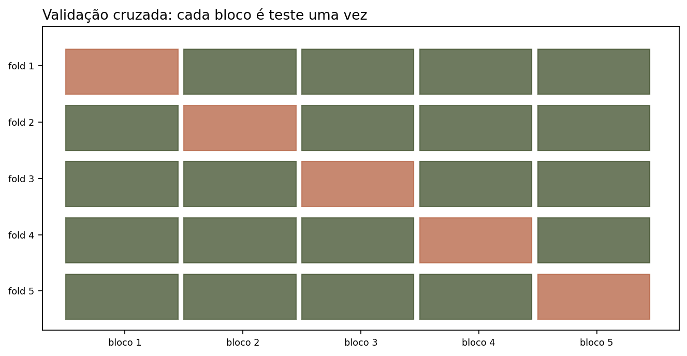

<div class="page-meta">Nível: iniciante · Tempo: 15 min · Pré-requisito: Fundamento 3</div>

<div class="objetivo">
<b>Objetivo:</b> executar a ordem correta das etapas e reconhecer onde o vazamento de dados
entra em um pipeline.
</div>

## As dez etapas

| # | Etapa | Pergunta que responde |
|---|---|---|
| 1 | Pergunta | o que eu quero prever ou descrever? |
| 2 | Dados | de onde vêm, qual cobertura, qual licença? |
| 3 | Análise exploratória | como as variáveis se distribuem e se relacionam? |
| 4 | Split | quais dados ficam para treino, validação e teste? |
| 5 | Pré-processamento | imputação, escala, codificação — **dentro** do pipeline |
| 6 | Baseline | qual é o erro de um modelo trivial? |
| 7 | Modelo | qual família faz sentido para a tarefa? |
| 8 | Calibração | quais hiperparâmetros e com qual orçamento? |
| 9 | Avaliação | qual métrica e com qual incerteza? |
| 10 | Interpretação e relato | o que o resultado significa e como reportar? |

## A regra que salva o projeto

**Separe o teste antes de qualquer decisão.** Toda transformação que aprende algo dos
dados (média para imputar, média/desvio para escalar, seleção de features, encoding)
precisa ser ajustada **apenas no treino** e aplicada ao resto.

Se você escala a base inteira antes do split, a média e o desvio do teste vazam para o
treino. O erro fica otimista e não se reproduz.

{fig-align="center" width="82%"}

## Baseline primeiro

Nunca compare um modelo sofisticado com o nada. Compare com:

- **Regressão:** média do `y` (DummyRegressor) ou persistência.
- **Classificação:** classe majoritária (DummyClassifier).
- **Clusterização:** estrutura aleatória ou um `k` trivial.

Se o modelo não bate o baseline, o problema não é o modelo: é o dado, a pergunta ou a
métrica.

## O pipeline como objeto

Em vez de repetir transformações à mão, empacote tudo. Isso garante que a mesma sequência
usada no treino seja usada na validação, no teste e em produção.

::: {.panel-tabset}
## Python

```python
import numpy as np
from sklearn.datasets import load_diabetes
from sklearn.model_selection import train_test_split, cross_val_score
from sklearn.pipeline import Pipeline
from sklearn.preprocessing import StandardScaler
from sklearn.impute import SimpleImputer
from sklearn.linear_model import LinearRegression
from sklearn.dummy import DummyRegressor

X, y = load_diabetes(return_X_y=True)
X_tr, X_te, y_tr, y_te = train_test_split(X, y, test_size=0.2, random_state=42)

pipe = Pipeline([
    ("imputar", SimpleImputer(strategy="median")),
    ("escalar", StandardScaler()),
    ("modelo", LinearRegression()),
])

scores = cross_val_score(pipe, X_tr, y_tr, cv=5, scoring="neg_root_mean_squared_error")
print("RMSE CV:", round(-scores.mean(), 2), "+/-", round(scores.std(), 2))

pipe.fit(X_tr, y_tr)
print("RMSE teste:", round(np.sqrt(((pipe.predict(X_te) - y_te) ** 2).mean()), 2))

dummy = DummyRegressor(strategy="mean").fit(X_tr, y_tr)
print("RMSE baseline:", round(np.sqrt(((dummy.predict(X_te) - y_te) ** 2).mean()), 2))
```

## R

```r
data(longley)
y <- longley$Employed
X <- longley[, setdiff(names(longley), "Employed")]

set.seed(42)
idx <- sample(nrow(longley), size = floor(0.8 * nrow(longley)))
treino <- longley[idx, ]
teste  <- longley[-idx, ]

modelo <- lm(Employed ~ ., data = treino)

rmse <- function(obs, pred) sqrt(mean((obs - pred)^2))
cat("RMSE treino:", round(rmse(treino$Employed, fitted(modelo)), 2), "\n")
cat("RMSE teste :", round(rmse(teste$Employed, predict(modelo, teste)), 2), "\n")
cat("RMSE baseline (média do treino):",
    round(rmse(teste$Employed, mean(treino$Employed)), 2), "\n")
```
:::

## Onde o vazamento entra

| Etapa | Vazamento clássico | Como evitar |
|---|---|---|
| Split | embaralhar série temporal | split temporal |
| Imputação | média calculada na base toda | imputar dentro do pipeline |
| Escala | `StandardScaler` antes do split | scaler dentro do pipeline |
| Seleção de features | escolher features olhando o teste | seleção dentro do CV |
| Target | feature derivada do alvo | revisar cada feature |
| Grupo | mesma entidade em treino e teste | `GroupKFold` |

## Checklist do pipeline

- [ ] A pergunta está escrita em uma frase.
- [ ] O teste foi separado antes de qualquer transformação.
- [ ] O baseline foi calculado.
- [ ] Pré-processamento está dentro do pipeline.
- [ ] A validação respeita tempo/grupo/espaço quando necessário.
- [ ] A métrica foi escolhida antes de ver o resultado.
- [ ] Sementes e versões estão registradas.

## Exercício

Um analista calcula a média e o desvio da variável `chuva` na base inteira, padroniza
tudo, depois divide em treino e teste. O R² de teste sai 0,93. O que pode estar errado?

::: {.callout-note collapse="true" title="Solução"}
A padronização usou estatísticas do teste (média e desvio da base inteira) antes do split.
Isso é vazamento de pré-processamento: o modelo teve acesso indireto à distribuição do
teste. O resultado fica otimista. A correção é colocar o `StandardScaler` dentro do
pipeline, ajustado só no treino.
:::

## Próximo passo

[5. Dados e armadilhas](05-dados-e-armadilhas.qmd).
