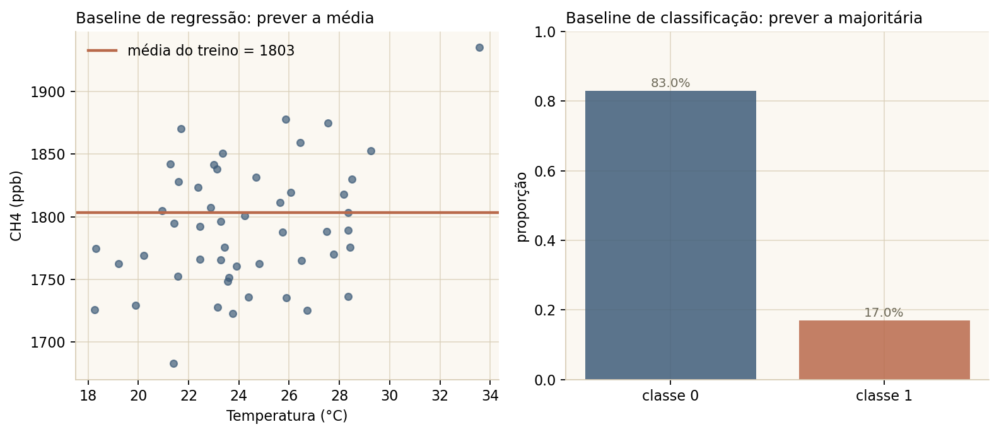

<div class="page-meta">Nível: iniciante · Tempo: 8 min · Pré-requisito: Fundamentos 2</div>

<div class="objetivo">
<b>Objetivo:</b> estabelecer a referência mínima antes de qualquer modelo e reconhecer
quando um resultado “bom” é só o baseline disfarçado.
</div>

## Em uma frase

O baseline é o modelo mais burro possível: prevê sempre a média (regressão) ou a classe
majoritária (classificação).

## Intuição

Antes de perguntar “meu modelo é bom?”, pergunte “ele é melhor que não fazer nada?”. O
baseline é o “não fazer nada” formalizado. Se o modelo não bate o baseline, o problema não é
o modelo: é o dado, a pergunta ou a métrica.

{fig-align="center" width="96%"}

## Quando usar

- **Sempre**, como primeira linha de qualquer tabela de resultados.
- Para medir o ganho real de um modelo.
- Para expor acurácia enganosa em classes desbalanceadas.
- Para checar se o pipeline está funcionando.

## Quando NÃO usar

- Como modelo final, quando há sinal nos dados.
- Para inferência ou interpretação de relações.
- Para justificar uma decisão sozinho.

## Pressupostos

Nenhum. O baseline não modela relação; ele apenas resume o treino.

## Hiperparâmetros

| Nome | O que controla | Faixa típica | Default | Borda inferior | Borda superior | Escala |
|---|---|---|---|---|---|---|
| `strategy` | regra de previsão | `mean`, `median`, `most_frequent`, `prior`, `constant` | `mean`/`prior` | — | — | categórica |
| `constant` | valor fixo | qualquer valor do alvo | `None` | — | — | — |

## Como calibrar

Não se calibra um baseline. Ele é o ponto de comparação. Use a mesma métrica, o mesmo
split e a mesma CV do modelo candidato.

## Código

::: {.panel-tabset}
## Python

```python
import pandas as pd
from sklearn.dummy import DummyClassifier, DummyRegressor
from sklearn.metrics import accuracy_score, mean_squared_error
from sklearn.model_selection import train_test_split

dados = pd.read_csv("data/exemplo_ch4.csv")
X = dados[["temperatura", "umidade", "vento", "pressao"]]
y = dados["ch4"]
X_tr, X_te, y_tr, y_te = train_test_split(X, y, test_size=0.25, random_state=42)

base = DummyRegressor(strategy="mean").fit(X_tr, y_tr)
pred = base.predict(X_te)
print("RMSE baseline:", round(mean_squared_error(y_te, pred) ** 0.5, 2))

cls = pd.read_csv("data/exemplo_classificacao.csv")
Xc = cls.drop(columns="risco")
yc = cls["risco"]
Xc_tr, Xc_te, yc_tr, yc_te = train_test_split(
    Xc, yc, test_size=0.3, stratify=yc, random_state=42
)
base_c = DummyClassifier(strategy="most_frequent").fit(Xc_tr, yc_tr)
pred_c = base_c.predict(Xc_te)
print("acurácia baseline:", round(accuracy_score(yc_te, pred_c), 3))
```

## R

```r
dados <- read.csv("data/exemplo_ch4.csv")
set.seed(42)
idx <- sample(nrow(dados), floor(0.75 * nrow(dados)))
treino <- dados[idx, ]
teste <- dados[-idx, ]

media <- mean(treino$ch4)
rmse <- sqrt(mean((teste$ch4 - media)^2))
cat("RMSE baseline:", round(rmse, 2), "\n")

cls <- read.csv("data/exemplo_classificacao.csv")
proporcao <- mean(cls$risco == 0)
cat("acurácia baseline (classe 0):", round(proporcao, 3), "\n")
```
:::

## Métricas recomendadas

| Tarefa | Métrica | Leitura |
|---|---|---|
| Regressão | RMSE/MAE | erro de prever a média |
| Classificação | acurácia | proporção da classe majoritária |
| Classificação desbalanceada | recall | baseline tem recall 0 na minoria |

## Erros comuns

1. Não incluir o baseline na tabela.
2. Comparar modelos com métricas diferentes do baseline.
3. Calcular a média no teste (deve ser no treino).
4. Celebrar acurácia alta quando o baseline já era alto.
5. Usar baseline como desculpa para não melhorar.

## Exercício

Calcule o RMSE do baseline de média e a acurácia do baseline majoritário. Quanto o seu
modelo precisa melhorar para justificar a complexidade?

::: {.callout-note collapse="true" title="Solução"}
O baseline de regressão prevê a média do treino; o de classificação prevê a classe
majoritária. O modelo precisa reduzir o erro (ou aumentar a métrica) **além da incerteza**
entre folds. Se o ganho é menor que a variabilidade, a complexidade não se paga.
:::

## Próximo passo

[Regressão linear](02-regressao-linear.qmd).
