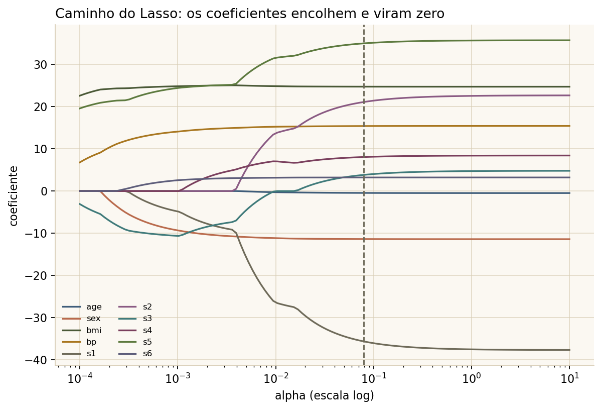

<div class="page-meta">Nível: intermediário · Tempo: 18 min · Pré-requisito: Regressão linear</div>

<div class="objetivo">
<b>Objetivo:</b> usar regularização para reduzir overfitting, estabilizar coeficientes e
selecionar features — sem transformar o coeficiente em causalidade.
</div>

## Em uma frase

Ridge e Lasso são regressões lineares com uma **penalidade** nos coeficientes: o modelo
aceita um pouco de viés para ganhar estabilidade e generalização. O Lasso também zera
coeficientes, fazendo seleção de features.

## Intuição

Com muitas features ou features correlacionadas, a regressão linear comum fica instável:
pequenas mudanças no dado mudam muito os coeficientes.

- **Ridge (L2):** encolhe todos os coeficientes para perto de zero, sem zerar.
- **Lasso (L1):** encolhe e **zera** alguns coeficientes — seleção automática.
- **Elastic Net:** mistura L1 e L2; útil quando há grupos de features correlacionadas.

O preço é viés. O ganho é variância menor e melhor erro fora da amostra.

::: {.formula-card}
#### Fórmula comentada

<p class="formula-words">A função de custo soma o erro quadrático e uma penalidade pelo
tamanho dos coeficientes.</p>

$$
\text{Ridge}: \sum_{i=1}^{n}(y_i-\hat{y}_i)^2 + \alpha \sum_{j=1}^{p}\beta_j^2
$$

$$
\text{Lasso}: \sum_{i=1}^{n}(y_i-\hat{y}_i)^2 + \alpha \sum_{j=1}^{p}|\beta_j|
$$

| Símbolo | Significado |
|---|---|
| \(\hat{y}_i\) | previsão do modelo |
| \(\alpha\) | força da penalidade |
| \(\beta_j\) | coeficiente da variável \(j\) |
| \(\sum \beta_j^2\) | penalidade L2 (Ridge) |
| \(\sum \|\beta_j\|\) | penalidade L1 (Lasso) |

**O que premia:** coeficientes pequenos e estáveis.  
**O que pune:** coeficientes grandes; no Lasso, também zera coeficientes.  
**Quando engana:** sem padronização, com alpha na borda ou lendo coeficiente regularizado
como efeito causal.
:::

## Quando usar

- Muitas features, `p` próximo de `n` ou `p > n`.
- Multicolinearidade entre preditores.
- Você quer um modelo interpretável com coeficientes estáveis.
- Precisa de seleção de features (Lasso/Elastic Net).
- Baseline regularizado antes de partir para árvores/boosting.

## Quando NÃO usar

- Relação claramente não linear (a penalidade não resolve isso).
- Inferência com coeficientes não enviesados — a regularização introduz viés.
- Features em escalas diferentes sem padronizar (a penalidade pune escalas).
- Muitas features correlacionadas e você precisa que todas fiquem no modelo (Lasso
  escolhe uma e descarta outras; use Elastic Net ou Ridge).

## Pressupostos

| Pressuposto | O que significa | Como checar |
|---|---|---|
| Linearidade nos parâmetros | `y` é combinação linear de `X` | resíduos vs ajustados |
| Independência dos erros | observações não se repetem | desenho, Durbin-Watson |
| Escala comparável | features padronizadas | `StandardScaler` no pipeline |
| Multicolinearidade controlada | features não são redundantes | correlação, VIF |

## Hiperparâmetros

| Nome | O que controla | Faixa típica | Default | Borda inferior | Borda superior | Escala |
|---|---|---|---|---|---|---|
| `alpha` | força da regularização | `1e-4`–`1e4` | `1.0` | sem regularização, overfitting | coeficientes colapsam, underfitting | **log** |
| `l1_ratio` | mistura L1/L2 (Elastic Net) | `0`–`1` | `0.5` | vira Ridge | vira Lasso | linear |
| `fit_intercept` | ajusta o intercepto | `True`/`False` | `True` | força a reta pela origem | — | categórica |
| `max_iter` | iterações do solver | `1.000`–`10.000` | `1.000` | não converge | custo sem ganho | linear |
| `solver` | algoritmo | `auto`, `saga`, `lbfgs` | `auto` | — | — | categórica |
| `positive` | coeficientes ≥ 0 | `True`/`False` | `False` | — | impede efeito negativo real | categórica |

::: {.callout-warning}
## Borda é aviso
Se o melhor `alpha` cai em `1e-4` ou `1e4`, o ótimo provavelmente está fora da faixa.
Amplie o espaço e rode de novo.
:::

## Como calibrar

### Na mão

1. Padronize `X`.
2. Teste `alpha` em potências de 10: `0.001, 0.01, 0.1, 1, 10, 100`.
3. Para cada valor, calcule o RMSE em CV.
4. Plote `alpha` (log) vs RMSE e escolha o mínimo.
5. Confirme que o mínimo não está na borda.
6. Para Lasso, olhe quantos coeficientes ficaram diferentes de zero.

### Com Optuna

```python
import optuna
from sklearn.linear_model import Ridge
from sklearn.pipeline import make_pipeline
from sklearn.preprocessing import StandardScaler
from sklearn.model_selection import cross_val_score

def objetivo(trial):
    alpha = trial.suggest_float("alpha", 1e-4, 1e4, log=True)
    modelo = make_pipeline(StandardScaler(), Ridge(alpha=alpha))
    score = cross_val_score(
        modelo, X_tr, y_tr, cv=5, scoring="neg_root_mean_squared_error"
    ).mean()
    return -score

estudo = optuna.create_study(
    direction="minimize",
    sampler=optuna.samplers.TPESampler(seed=42),
)
estudo.optimize(objetivo, n_trials=50)
print(estudo.best_params, round(estudo.best_value, 2))
```

## O caminho da regularização

{fig-align="center" width="84%"}

**Leitura:** cada linha é um coeficiente. Em `alpha` baixo, todos estão livres; em `alpha`
alto, quase todos colapsam. A linha vertical marca o `alpha` escolhido pela CV. O Lasso
zera coeficientes — isso é seleção de features, não prova de importância causal.

## Código

::: {.panel-tabset}
## Python

```python
import numpy as np
from sklearn.datasets import load_diabetes
from sklearn.linear_model import ElasticNet, Lasso, LassoCV, Ridge
from sklearn.model_selection import KFold, cross_val_score
from sklearn.pipeline import make_pipeline
from sklearn.preprocessing import StandardScaler

X, y = load_diabetes(return_X_y=True)
nomes = load_diabetes().feature_names
cv = KFold(n_splits=5, shuffle=True, random_state=42)

for nome, modelo in [
    ("Ridge", Ridge(alpha=1.0)),
    ("Lasso", Lasso(alpha=0.1)),
    ("ElasticNet", ElasticNet(alpha=0.1, l1_ratio=0.5)),
]:
    pipe = make_pipeline(StandardScaler(), modelo)
    scores = cross_val_score(
        pipe, X, y, cv=cv, scoring="neg_root_mean_squared_error"
    )
    print(f"{nome:>10}: RMSE {(-scores.mean()):.2f} +/- {scores.std():.2f}")

lasso = make_pipeline(StandardScaler(), LassoCV(cv=5, random_state=42)).fit(X, y)
print("alpha escolhido:", round(lasso[-1].alpha_, 4))
print(dict(zip(nomes, lasso[-1].coef_.round(2))))
print("coeficientes != 0:", int((lasso[-1].coef_ != 0).sum()))
```

## R

```r
# install.packages("glmnet")
library(glmnet)

dados <- longley
y <- dados$Employed
X <- as.matrix(dados[, setdiff(names(dados), "Employed")])

set.seed(42)
ridge <- cv.glmnet(X, y, alpha = 0)
lasso <- cv.glmnet(X, y, alpha = 1)

cat("Ridge lambda.min:", round(ridge$lambda.min, 4), "\n")
cat("Lasso lambda.min:", round(lasso$lambda.min, 4), "\n")
print(coef(lasso, s = "lambda.min"))
```
:::

::: {.callout-note}
## A aba R usa outro conjunto
O exemplo R usa `longley` e o pacote `glmnet`; os números não precisam coincidir com o
Python. O objetivo é mostrar o fluxo: padronizar, validar e escolher `lambda`/`alpha`.
:::

## Métricas recomendadas

| Métrica | Uso |
|---|---|
| RMSE | erro na unidade do alvo; comparação principal |
| MAE | erro absoluto médio; robusto a outliers |
| R² | variância explicada; complemento |
| nº de coeficientes ≠ 0 | grau de seleção do Lasso |

## Erros comuns

1. Não padronizar `X` antes da penalidade.
2. Interpretar coeficiente regularizado como efeito causal.
3. Aceitar `alpha` na borda da busca.
4. Usar Lasso com features correlacionadas e concluir que as descartadas "não importam".
5. Comparar Ridge e Lasso sem a mesma CV.
6. Reportar só R² e ignorar RMSE.
7. Usar `alpha` alto demais e chamar o underfitting de "modelo conservador".

## Exercício

Rode Ridge e Lasso no mesmo conjunto. Quais coeficientes o Lasso zerou? O que isso
significa — e o que **não** significa?

::: {.callout-note collapse="true" title="Solução"}
O Lasso zera coeficientes porque a penalidade L1 favorece soluções esparsas. Isso significa
que, **naquele modelo e naquela escala**, a feature não ajudou a reduzir o erro o suficiente
para pagar a penalidade. Não significa que a feature é irrelevante para o fenômeno, nem que
não há causalidade. Features correlacionadas podem ser descartadas em favor de outra.
:::

## Próximo passo

[Regressão logística](04-regressao-logistica.qmd) — a versão para classificação.
