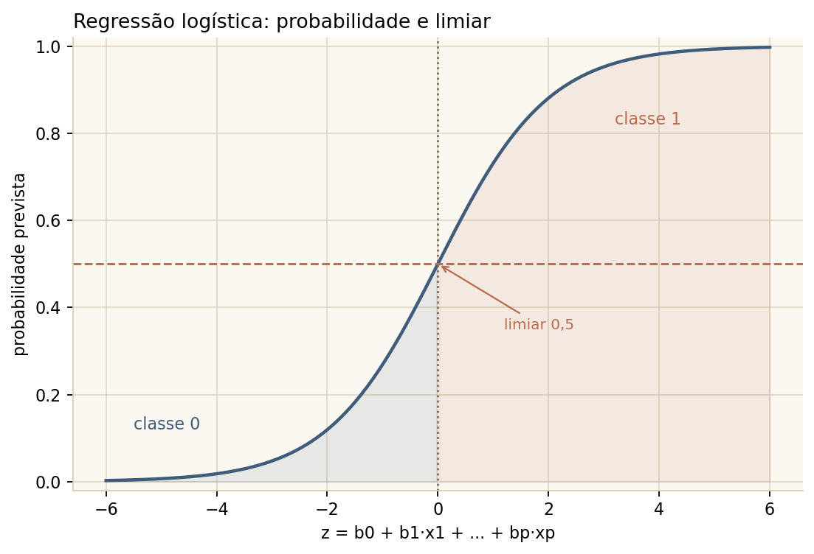

<div class="page-meta">Nível: intermediário · Tempo: 18 min · Pré-requisito: Métricas de classificação</div>

<div class="objetivo">
<b>Objetivo:</b> usar regressão logística para classificação binária, interpretar
coeficientes como log-odds, escolher o limiar pelo custo e checar a calibração.
</div>

## Em uma frase

A regressão logística modela o **logito** (log da razão de chances) como uma combinação
linear das features e transforma o resultado em probabilidade com a função sigmoide.

## Intuição

A saída linear `z = b0 + b1·x1 + ...` pode ser qualquer número. A sigmoide aperta esse
número para o intervalo `(0, 1)`:

$$
p = \frac{1}{1 + e^{-z}}
$$

Quando `z = 0`, `p = 0,5`. O limiar de decisão é uma escolha sua — 0,5 é só o padrão.

{fig-align="center" width="76%"}

::: {.formula-card}
#### Fórmula comentada

<p class="formula-words">O modelo faz uma reta no log-odds e transforma o resultado em
probabilidade com a sigmoide.</p>

$$
\log\left(\frac{p}{1-p}\right) = \beta_0 + \beta_1 x_1 + \cdots + \beta_p x_p
\qquad
p = \frac{1}{1 + e^{-z}}
$$

| Símbolo | Significado |
|---|---|
| \(p\) | probabilidade da classe 1 |
| \(\frac{p}{1-p}\) | odds (razão de chances) |
| \(\beta_0\) | intercepto no log-odds |
| \(\beta_j\) | coeficiente da variável \(j\) |
| \(x_j\) | variável \(j\) |

**O que premia:** fronteira linear no logito e coeficientes interpretáveis como odds ratios.  
**O que pune:** relações muito não lineares e separação perfeita.  
**Quando engana:** desbalanceamento severo, separação perfeita e calibração ruim.
:::

## Quando usar

- Classificação binária com relação aproximadamente linear no logito.
- Precisa de interpretabilidade (coeficientes e odds ratios).
- Baseline forte para classificação.
- Probabilidades que você pretende usar (depois de checar a calibração).
- Multicolinearidade moderada, com regularização.

## Quando NÃO usar

- Fronteira muito não linear sem feature engineering (interações, splines).
- Separação perfeita: os coeficientes explodem sem regularização.
- Desbalanceamento severo sem `class_weight` ou ajuste de limiar.
- Precisa capturar interações complexas de muitas features — árvores/boosting podem ser
  melhores.

## Pressupostos

| Pressuposto | O que significa | Como checar |
|---|---|---|
| Linearidade no logito | `log(p/(1-p))` é linear nas features | termos quadráticos/interações |
| Independência | observações não se repetem | desenho |
| Multicolinearidade controlada | features não são redundantes | correlação, VIF |
| n suficiente | eventos por preditor | regra de bolso: ≥10 eventos por feature |

## Hiperparâmetros

| Nome | O que controla | Faixa típica | Default | Borda inferior | Borda superior | Escala |
|---|---|---|---|---|---|---|
| `C` | inverso da regularização | `1e-4`–`1e4` | `1.0` | regularização forte, underfitting | sem regularização, overfitting | **log** |
| `penalty` | tipo de regularização | `l1`, `l2`, `elasticnet`, `none` | `l2` | — | — | categórica |
| `solver` | algoritmo | `lbfgs`, `liblinear`, `saga` | `lbfgs` | — | — | categórica |
| `class_weight` | peso das classes | `None`, `balanced` | `None` | ignora desbalanceamento | pode distorcer probabilidades | categórica |
| `max_iter` | iterações | `100`–`5.000` | `100` | não converge | custo sem ganho | linear |
| `fit_intercept` | ajusta o intercepto | `True`/`False` | `True` | força `p=0,5` em `x=0` | — | categórica |

::: {.callout-warning}
## `C` é o inverso de `alpha`
Em regressão logística, `C` pequeno = regularização forte. Em Ridge/Lasso, `alpha` grande
= regularização forte. Não confunda os sinais.
:::

## Como calibrar

1. Padronize as features (especialmente com `l1`/`elasticnet`).
2. Varie `C` em potências de 10 e calcule a métrica em CV.
3. Escolha pelo mínimo/máximo da métrica, não pelo treino.
4. Ajuste o **limiar** separadamente, pelo custo do erro.
5. Se a probabilidade for usada na decisão, verifique a curva de calibração.

```python
import optuna
from sklearn.linear_model import LogisticRegression
from sklearn.pipeline import make_pipeline
from sklearn.preprocessing import StandardScaler
from sklearn.model_selection import cross_val_score

def objetivo(trial):
    C = trial.suggest_float("C", 1e-4, 1e4, log=True)
    modelo = make_pipeline(StandardScaler(), LogisticRegression(C=C, max_iter=5000))
    score = cross_val_score(
        modelo, X_tr, y_tr, cv=5, scoring="neg_log_loss"
    ).mean()
    return -score

estudo = optuna.create_study(
    direction="minimize",
    sampler=optuna.samplers.TPESampler(seed=42),
)
estudo.optimize(objetivo, n_trials=40)
print(estudo.best_params, round(estudo.best_value, 3))
```

## Código

::: {.panel-tabset}
## Python

```python
import numpy as np
from sklearn.datasets import make_classification
from sklearn.linear_model import LogisticRegression
from sklearn.metrics import (
    brier_score_loss, classification_report, log_loss, roc_auc_score,
)
from sklearn.model_selection import train_test_split
from sklearn.pipeline import make_pipeline
from sklearn.preprocessing import StandardScaler

X, y = make_classification(
    n_samples=1200, n_features=12, n_informative=6, n_redundant=3,
    class_sep=1.3, flip_y=0.05, weights=[0.75, 0.25], random_state=42,
)
X_tr, X_te, y_tr, y_te = train_test_split(
    X, y, test_size=0.3, stratify=y, random_state=42
)

modelo = make_pipeline(
    StandardScaler(),
    LogisticRegression(C=1.0, max_iter=5000, random_state=42),
).fit(X_tr, y_tr)

prob = modelo.predict_proba(X_te)[:, 1]
pred = (prob >= 0.5).astype(int)

print("ROC-AUC:", round(roc_auc_score(y_te, prob), 3))
print("Log loss:", round(log_loss(y_te, prob), 3))
print("Brier   :", round(brier_score_loss(y_te, prob), 3))
print(classification_report(y_te, pred, target_names=["negativo", "positivo"]))

coefs = modelo[-1].coef_[0]
odds = np.exp(coefs)
for i, (c, o) in enumerate(zip(coefs, odds)):
    print(f"x{i}: log-odds {c:+.3f} | odds ratio {o:.3f}")
```

## R

```r
dados <- read.csv("data/exemplo_classificacao.csv")

modelo <- glm(risco ~ ., data = dados, family = binomial)
summary(modelo)

# odds ratios
print(round(exp(coef(modelo)), 3))

# probabilidades e classe no limiar 0,5
prob <- predict(modelo, type = "response")
pred <- ifelse(prob >= 0.5, 1, 0)
table(real = dados$risco, previsto = pred)
```
:::

::: {.callout-note}
## A aba R usa o conjunto inteiro
O exemplo R ajusta no conjunto inteiro para mostrar a interpretação dos coeficientes.
Para avaliar, separe treino e teste antes, como nas páginas de classificação.
:::

## Como interpretar os coeficientes

- Coeficiente `b`: variação no **log-odds** para +1 unidade em `x`, mantendo o resto.
- **Odds ratio** `exp(b)`: multiplica as chances por esse fator.
  - `exp(b) = 1`: sem efeito nas chances.
  - `exp(b) > 1`: aumenta as chances.
  - `exp(b) < 1`: reduz as chances.
- Não é "a probabilidade aumenta em X pontos percentuais". O efeito na probabilidade
  depende do ponto de partida.

## Métricas recomendadas

| Métrica | Uso |
|---|---|
| ROC-AUC | separação global |
| PR-AUC / AP | classe positiva rara |
| Log loss / Brier | qualidade da probabilidade |
| Precisão, recall, F1 | decisão no limiar escolhido |
| Curva de calibração | probabilidade = frequência? |

## Erros comuns

1. Reportar acurácia em classe desbalanceada.
2. Usar 0,5 por hábito, sem olhar o custo.
3. Interpretar odds ratio como probabilidade.
4. Não padronizar features com penalidade `l1`/`elasticnet`.
5. Ignorar separação perfeita (coeficientes instáveis).
6. Usar `class_weight="balanced"` e continuar tratando as probabilidades como calibradas.
7. Comparar modelos com limiares diferentes.

## Exercício

Um coeficiente é `0,7`. Qual é o odds ratio? Se a probabilidade inicial é 0,30, qual é a
probabilidade depois de +1 unidade em `x`, mantendo o resto constante?

::: {.callout-note collapse="true" title="Solução"}
Odds ratio = `exp(0,7) ≈ 2,01` (as chances dobram). Probabilidade inicial 0,30 → odds
`0,30/0,70 ≈ 0,429`; novas odds `0,429 × 2,01 ≈ 0,861`; nova probabilidade
`0,861/(1+0,861) ≈ 0,463`. O efeito em pontos percentuais depende do ponto de partida.
:::

## Próximo passo

[Árvore de decisão](05-arvore-decisao.qmd) — quando a fronteira não é linear.
