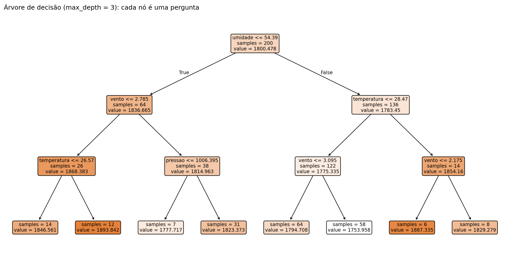

<div class="page-meta">Nível: intermediário · Tempo: 16 min · Pré-requisito: Fundamentos 2</div>

<div class="objetivo">
<b>Objetivo:</b> entender como uma árvore divide o espaço, calibrar profundidade e poda, e
reconhecer quando uma única árvore não é a melhor escolha.
</div>

## Em uma frase

A árvore faz perguntas binárias sobre as features e divide o espaço em regiões; a previsão é
a média (regressão) ou a classe majoritária (classificação) da região.

## Intuição

É o jogo das 20 perguntas. A cada nó, a árvore escolhe a pergunta que mais separa os valores
do alvo. O caminho da raiz até a folha é a regra de decisão.

{fig-align="center" width="96%"}

**Leitura:** a primeira pergunta é `umidade <= 54,39`. À esquerda, o modelo separa por vento
e temperatura; à direita, por temperatura e vento de novo. As folhas mostram a previsão
média de CH4 naquele grupo.

## Quando usar

- Precisa de regras interpretáveis e apresentáveis.
- Relação não linear e interações entre features.
- Dados mistos (numéricos e categóricos).
- Não quer se preocupar com escala.
- Baseline não linear para comparar com ensembles.

## Quando NÃO usar

- Precisa de extrapolação suave (a árvore não extrapola: prevê a média da folha).
- Precisa da maior acurácia possível (Random Forest/boosting costumam ganhar).
- `n` pequeno com muito ruído (a árvore decora fácil).
- Precisa de estabilidade: pequenas mudanças no dado podem mudar a árvore.
- A relação é aproximadamente linear e a interpretação por coeficientes basta.

## Pressupostos

A árvore tem poucos pressupostos fortes, mas tem limitações:

| Limitação | Consequência |
|---|---|
| Cortes alinhados aos eixos | fronteiras oblíquas exigem muitos cortes |
| Ganância | cada split é ótimo local, não global |
| Instabilidade | pequenas mudanças podem mudar a estrutura |
| Sem extrapolação | fora da faixa observada, prevê a folha mais próxima |

## Hiperparâmetros

| Nome | O que controla | Faixa típica | Default | Borda inferior | Borda superior | Escala |
|---|---|---|---|---|---|---|
| `max_depth` | profundidade máxima | `1`–`30` ou `None` | `None` | underfitting | overfitting | linear |
| `min_samples_split` | mínimo para dividir | `2`–`50` | `2` | overfitting | underfitting | log |
| `min_samples_leaf` | mínimo por folha | `1`–`50` | `1` | overfitting | underfitting | log |
| `max_leaf_nodes` | máximo de folhas | `None` ou `10`–`100` | `None` | underfitting | overfitting | linear |
| `ccp_alpha` | poda por complexidade | `0`–`0.1` | `0.0` | sem poda, overfitting | poda demais | log |
| `criterion` | impureza | `gini`, `entropy`, `squared_error` | depende da tarefa | — | — | categórica |
| `max_features` | features por split | `None`, `sqrt`, `log2` | `None` | mais viés | mais variância | categórica |

## Como calibrar

### Na mão

1. Varie `max_depth` de 1 a 20 e calcule o RMSE/AUC em CV.
2. Plote treino e validação.
3. Escolha o mínimo da validação, não do treino.
4. Se o mínimo está na borda, amplie a faixa.
5. Para podar, use `ccp_alpha` ou `min_samples_leaf`.

### Com Optuna

```python
import optuna
from sklearn.tree import DecisionTreeRegressor
from sklearn.model_selection import cross_val_score

def objetivo(trial):
    modelo = DecisionTreeRegressor(
        max_depth=trial.suggest_int("max_depth", 2, 30),
        min_samples_leaf=trial.suggest_int("min_samples_leaf", 1, 50, log=True),
        ccp_alpha=trial.suggest_float("ccp_alpha", 1e-6, 1e-1, log=True),
        random_state=42,
    )
    score = cross_val_score(
        modelo, X_tr, y_tr, cv=5, scoring="neg_root_mean_squared_error"
    ).mean()
    return -score

estudo = optuna.create_study(
    direction="minimize",
    sampler=optuna.samplers.TPESampler(seed=42),
)
estudo.optimize(objetivo, n_trials=50)
print(estudo.best_params, round(estudo.best_value, 2))
```

## Código

::: {.panel-tabset}
## Python

```python
import pandas as pd
from sklearn.model_selection import KFold, cross_val_score
from sklearn.tree import DecisionTreeRegressor, plot_tree
import matplotlib.pyplot as plt

dados = pd.read_csv("data/exemplo_ch4.csv")
X = dados[["temperatura", "umidade", "vento", "pressao"]]
y = dados["ch4"]
cv = KFold(n_splits=5, shuffle=True, random_state=42)

for d in [1, 2, 3, 5, 10, 20, None]:
    modelo = DecisionTreeRegressor(max_depth=d, random_state=42)
    scores = cross_val_score(
        modelo, X, y, cv=cv, scoring="neg_root_mean_squared_error"
    )
    print(f"max_depth={str(d):>4}: RMSE {(-scores.mean()):6.2f} +/- {scores.std():.2f}")

arvore = DecisionTreeRegressor(max_depth=3, random_state=42).fit(X, y)
plt.figure(figsize=(13, 7))
plot_tree(arvore, feature_names=list(X.columns), filled=True, rounded=True, fontsize=9)
plt.show()
```

## R

```r
library(rpart)

dados <- read.csv("data/exemplo_ch4.csv")

arvore <- rpart(
  ch4 ~ ., data = dados, method = "anova",
  control = rpart.control(maxdepth = 3, cp = 0, minsplit = 2)
)

print(arvore)
printcp(arvore)

plot(arvore, uniform = TRUE, margin = 0.1)
text(arvore, use.n = TRUE, cex = 0.8)
```
:::

## Métricas recomendadas

| Tarefa | Métrica | Complemento |
|---|---|---|
| Regressão | RMSE/MAE | R² |
| Classificação | F1/recall | ROC-AUC, matriz |
| Interpretação | número de folhas | estabilidade entre sementes |

## Erros comuns

1. Deixar a árvore crescer sem poda e chamar o overfitting de "modelo flexível".
2. Interpretar a árvore como relação causal.
3. Ignorar a instabilidade: rodar com outra semente e obter outra árvore.
4. Usar uma única árvore quando Random Forest/boosting é claramente melhor.
5. Extrapolar para fora da faixa observada.
6. Comparar árvores com profundidades diferentes no treino.
7. Não olhar o número de folhas e a quantidade de dados por folha.

## Exercício

Leia a primeira pergunta da árvore da figura (`umidade <= 54,39`). O que acontece com a
previsão à esquerda e à direita? Depois, rode com `max_depth = 2` e `max_depth = 10` e
compare o RMSE de validação.

::: {.callout-note collapse="true" title="Solução"}
À esquerda (umidade baixa), a árvore separa por vento e temperatura; à direita (umidade
alta), separa por temperatura e vento. Com `max_depth=2`, o modelo underfitta; com 10,
overfitta. O melhor é o mínimo da validação, não o menor erro de treino.
:::

## Próximo passo

[Random Forest](06-random-forest.qmd) — muitas árvores, menos variância.
