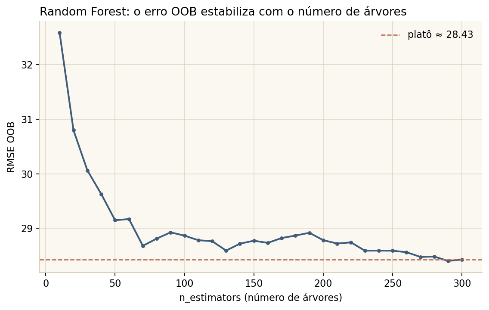

<div class="page-meta">Nível: intermediário · Tempo: 20 min · Pré-requisito: Árvore de decisão</div>

<div class="objetivo">
<b>Objetivo:</b> usar Random Forest para dados tabulares, calibrar o número de árvores e a
profundidade, e interpretar importância sem cair em armadilhas.
</div>

## Em uma frase

Random Forest treina muitas árvores em amostras bootstrap e subconjuntos aleatórios de
features, e combina as previsões por média (regressão) ou voto/probabilidade
(classificação).

## Intuição

Uma árvore é instável. Muitas árvores, cada uma vendo um pedaço diferente do dado, erram em
lugares diferentes. A média dos erros cancela parte da variância. O sorteio de features a
cada split **descorrelaciona** as árvores — é isso que faz o ensemble funcionar melhor que
só repetir a mesma árvore.

::: {.formula-card}
#### Fórmula comentada

<p class="formula-words">A previsão é a média das árvores (regressão) ou o voto/probabilidade
média (classificação).</p>

$$
\hat{y}(x) = \frac{1}{B}\sum_{b=1}^{B} T_b(x)
$$

| Símbolo | Significado |
|---|---|
| \(B\) | número de árvores |
| \(T_b(x)\) | previsão da árvore \(b\) para a observação \(x\) |
| \(\hat{y}(x)\) | previsão final do ensemble |

**O que premia:** diversidade entre árvores e média de previsões.  
**O que pune:** árvores muito correlacionadas e poucas árvores.  
**Quando engana:** extrapolação, importância com features correlacionadas e uso do OOB como
teste final.
:::

## Quando usar

- Dados tabulares com relações não lineares e interações.
- `n` médio, muitas features, missing e outliers moderados.
- Precisa de um modelo robusto com pouco tuning.
- Quer importância de features (com cautela).
- Baseline forte antes de gradient boosting.

## Quando NÃO usar

- Precisa extrapolar para fora da faixa observada (árvores não extrapolam).
- Dados esparsos de alta dimensão (texto): linear/SVM podem ser melhores.
- Precisa de uma única regra interpretável (use uma árvore).
- Restrição de tempo/memória para muitas árvores.
- precisa de probabilidades finamente calibradas sem pós-processamento.

## Pressupostos

| Pressuposto | O que significa | Como checar |
|---|---|---|
| Amostras independentes | OOB faz sentido | desenho |
| Features minimamente informativas | árvores diversas | importância/EDA |
| Sem vazamento | nenhuma feature do futuro | pipeline/checklist |
| Escala | não é obrigatória | — |

## Hiperparâmetros

| Nome | O que controla | Faixa típica | Default | Borda inferior | Borda superior | Escala |
|---|---|---|---|---|---|---|
| `n_estimators` | número de árvores | `100`–`1.000` | `100` | instável | custo sem ganho | linear |
| `max_depth` | profundidade máxima | `3`–`30` ou `None` | `None` | underfitting | overfitting | linear |
| `min_samples_leaf` | mínimo por folha | `1`–`50` | `1` | overfitting | underfitting | log |
| `min_samples_split` | mínimo para dividir | `2`–`50` | `2` | overfitting | underfitting | log |
| `max_features` | features por split | `sqrt`, `log2`, `0.1`–`1.0` | `1.0` (regressão) | mais viés | mais variância | categórica/linear |
| `max_samples` | fração no bootstrap | `0.5`–`1.0` | `1.0` | mais viés | sem ganho | linear |
| `bootstrap` | amostragem com reposição | `True`/`False` | `True` | — | — | categórica |
| `oob_score` | calcula OOB | `True`/`False` | `False` | — | — | categórica |
| `class_weight` | peso das classes | `None`/`balanced` | `None` | ignora desbalanceamento | distorce probabilidades | categórica |

::: {.callout-warning}
## Borda é aviso
Se o melhor `n_estimators` cai no limite superior, amplie a faixa. Se o melhor
`max_depth` cai no limite, o ótimo pode estar fora do espaço.
:::

## Como calibrar

1. Comece com `n_estimators=300` e `max_depth=None`.
2. Use a curva OOB para ver se mais árvores ajudam.
3. Calibre `max_depth` e `min_samples_leaf` por CV.
4. Só depois mexa em `max_features` e `max_samples`.
5. Se o melhor valor cair na borda, amplie.

```python
import optuna
from sklearn.ensemble import RandomForestRegressor
from sklearn.model_selection import cross_val_score

def objetivo(trial):
    modelo = RandomForestRegressor(
        n_estimators=trial.suggest_int("n_estimators", 100, 600, step=100),
        max_depth=trial.suggest_int("max_depth", 3, 30),
        min_samples_leaf=trial.suggest_int("min_samples_leaf", 1, 30, log=True),
        max_features=trial.suggest_categorical("max_features", ["sqrt", "log2", 0.5, 1.0]),
        random_state=42,
        n_jobs=-1,
    )
    score = cross_val_score(
        modelo, X_tr, y_tr, cv=5, scoring="neg_root_mean_squared_error"
    ).mean()
    return -score

estudo = optuna.create_study(
    direction="minimize",
    sampler=optuna.samplers.TPESampler(seed=42),
)
estudo.optimize(objetivo, n_trials=40)
print(estudo.best_params, round(estudo.best_value, 2))
```

## Quantas árvores?

{fig-align="center" width="80%"}

**Leitura:** o OOB é uma estimativa "de graça" usando as amostras que ficaram fora de cada
bootstrap. Ele não substitui o teste, mas ajuda a escolher `n_estimators`. Depois do platô,
adicionar árvores só aumenta o custo.

## Código

::: {.panel-tabset}
## Python

```python
import pandas as pd
from sklearn.ensemble import RandomForestRegressor
from sklearn.inspection import permutation_importance
from sklearn.model_selection import KFold, cross_val_score, train_test_split

dados = pd.read_csv("data/exemplo_ch4.csv")
X = dados[["temperatura", "umidade", "vento", "pressao"]]
y = dados["ch4"]

X_tr, X_te, y_tr, y_te = train_test_split(X, y, test_size=0.25, random_state=42)

rf = RandomForestRegressor(
    n_estimators=300, max_depth=None, min_samples_leaf=1,
    oob_score=True, random_state=42, n_jobs=-1,
).fit(X_tr, y_tr)

print("OOB R²:", round(rf.oob_score_, 3))
print("RMSE teste:", round(((y_te - rf.predict(X_te)) ** 2).mean() ** 0.5, 2))

cv = KFold(n_splits=5, shuffle=True, random_state=42)
scores = cross_val_score(
    rf, X, y, cv=cv, scoring="neg_root_mean_squared_error"
)
print("RMSE CV:", round(-scores.mean(), 2), "+/-", round(scores.std(), 2))

imp = permutation_importance(rf, X_te, y_te, n_repeats=20, random_state=42)
for nome, media in sorted(zip(X.columns, imp.importances_mean), key=lambda t: -t[1]):
    print(f"{nome:>12}: {media:.2f}")
```

## R

```r
# install.packages("randomForest")
library(randomForest)

dados <- read.csv("data/exemplo_ch4.csv")

set.seed(42)
rf <- randomForest(
  ch4 ~ ., data = dados,
  ntree = 300, importance = TRUE
)

print(rf)
importance(rf)
varImpPlot(rf)
```
:::

::: {.callout-note}
## A aba R usa outro conjunto
O exemplo R usa o CSV e o pacote `randomForest`; os números não precisam coincidir com o
Python. O fluxo é o mesmo: treinar, olhar OOB/erro e importância.
:::

## Como interpretar a importância

- **Impureza (padrão do sklearn):** rápida, mas favorece features contínuas e de alta
  cardinalidade, e se distorce com features correlacionadas.
- **Permutação:** mede a queda no erro ao embaralhar uma feature no teste; mais confiável,
  mas mais cara.
- **Correlação entre features:** duas features redundantes dividem a importância; nenhuma
  parece importante sozinha.

Importância não é causalidade. Uma feature importante pode ser um proxy de outra.

## Métricas recomendadas

| Tarefa | Métrica | Complemento |
|---|---|---|
| Regressão | RMSE/MAE | R², OOB |
| Classificação | F1/recall | ROC-AUC, PR-AUC |
| Importância | permutação | impureza (com cautela) |

## Erros comuns

1. Usar só a importância de impureza com features correlacionadas.
2. Rodar com 10 árvores e concluir que o modelo é fraco.
3. Usar OOB como se fosse teste final.
4. Extrapolar para fora da faixa.
5. Comparar Random Forest com boosting sem tunar nenhum dos dois.
6. Ignorar o custo de memória/tempo de muitas árvores.
7. Interpretar importância como causalidade.

## Exercício

Rode o modelo com `n_estimators=50`, `300` e `800`. O OOB melhora depois de 300? O custo
compensa? Depois, compare a importância por impureza com a importância por permutação.

::: {.callout-note collapse="true" title="Solução"}
O OOB deve estabilizar; depois do platô, mais árvores não melhoram o erro de forma
relevante. As importâncias podem discordar, especialmente com features correlacionadas. A
permutação é mais próxima do que importa para a previsão; a impureza é mais rápida e
enviesada.
:::

## Próximo passo

[Gradient boosting](07-gradient-boosting.qmd) — corrigir erros em sequência.
