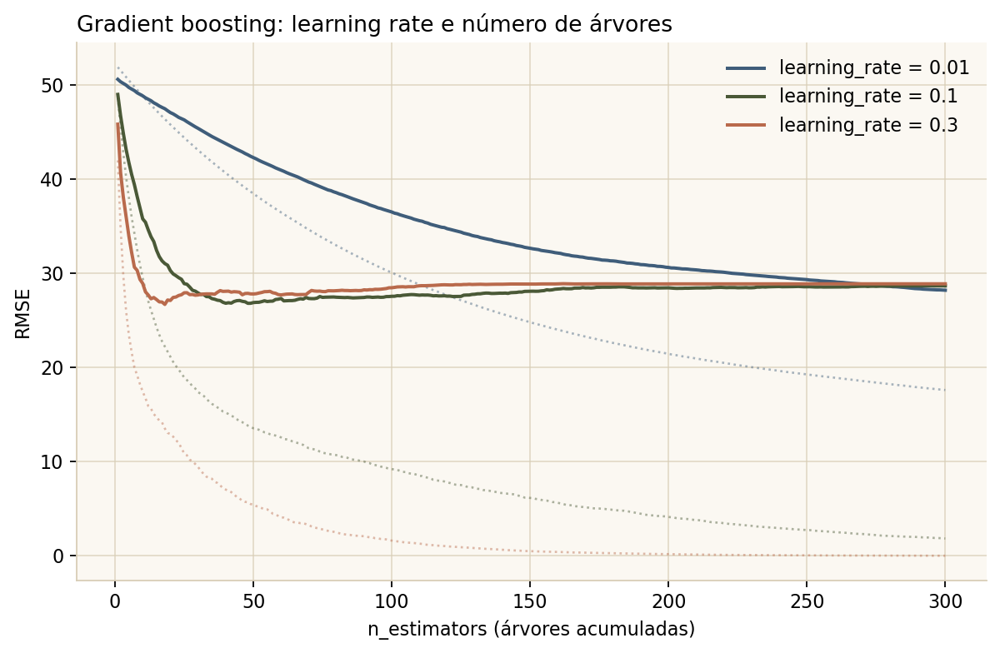

<div class="page-meta">Nível: avançado · Tempo: 22 min · Pré-requisito: Random Forest + Calibração</div>

<div class="objetivo">
<b>Objetivo:</b> entender boosting, calibrar learning rate e número de árvores juntos, usar
early stopping e reconhecer quando o custo de tuning não compensa.
</div>

## Em uma frase

Gradient boosting treina árvores **em sequência**: cada árvore nova tenta corrigir o erro
(resíduo/gradiente) da soma das árvores anteriores. O resultado é um modelo forte, mas
sensível ao tuning.

## Intuição

Random Forest é uma votação de especialistas independentes. Boosting é um aluno que revisa
a prova: a cada rodada, ele olha onde errou e foca nisso. O **learning rate** controla
quanto de cada correção entra; o **n_estimators** controla quantas correções são feitas.

- Learning rate pequeno + muitas árvores: aprendizado lento e suave.
- Learning rate grande + poucas árvores: converge rápido, mas pode passar do ponto.
- Profundidade maior: captura interações, mas decora.

::: {.formula-card}
#### Fórmula comentada

<p class="formula-words">Cada árvore nova entra com um peso pequeno e corrige o erro da soma
anterior.</p>

$$
F_m(x) = F_{m-1}(x) + \nu\, h_m(x)
$$

| Símbolo | Significado |
|---|---|
| \(F_m\) | modelo após \(m\) árvores |
| \(h_m\) | árvore nova, ajustada ao resíduo/gradiente |
| \(\nu\) | learning rate (quanto da correção entra) |
| \(m\) | número de árvores já acumuladas |

**O que premia:** correções sequenciais que reduzem o erro.  
**O que pune:** árvores profundas demais e learning rate alto.  
**Quando engana:** sem early stopping, com `n_estimators` alto, ou lendo importância como
causalidade.
:::

## Quando usar

- Dados tabulares, busca de maior acurácia.
- `n` médio/grande, features com interações.
- Você tem orçamento para calibrar.
- Precisa de importância/SHAP para interpretar depois.

## Quando NÃO usar

- `n` muito pequeno e ruidoso (overfitting fácil).
- Sem tempo/orçamento para tuning.
- Precisa de uma regra simples e interpretável.
- Precisa extrapolar para fora da faixa.
- Dados esparsos de altíssima dimensão (linear/SVM podem ser melhores).

## Pressupostos

| Pressuposto | O que significa | Como checar |
|---|---|---|
| Amostras independentes | validação faz sentido | desenho |
| Sem vazamento | nenhuma feature do futuro | pipeline/checklist |
| Escala | não é obrigatória | — |
| Tuning | learning rate e n_estimators juntos | curvas/early stopping |

## Hiperparâmetros

| Nome | O que controla | Faixa típica | Default | Borda inferior | Borda superior | Escala |
|---|---|---|---|---|---|---|
| `n_estimators` | número de árvores | `50`–`1.000` | `100` | underfitting | overfitting | linear |
| `learning_rate` | quanto cada árvore corrige | `0.001`–`0.3` | `0.1` | precisa de muitas árvores | overfitting | **log/linear** |
| `max_depth` | profundidade de cada árvore | `1`–`10` | `3` | underfitting | overfitting | linear |
| `min_samples_leaf` | mínimo por folha | `1`–`50` | `1` | overfitting | underfitting | log |
| `subsample` | fração por árvore | `0.5`–`1.0` | `1.0` | mais regularização | sem ganho | linear |
| `max_features` | features por split | `None`, `sqrt`, `log2`, `0.1`–`1` | `None` | mais viés | mais variância | categórica |
| `l2_regularization` | penalidade L2 | `0`–`10` | `0.0` | sem regularização | underfitting | log |
| `early_stopping` | para cedo | `True`/`False` | `False` | — | — | categórica |

::: {.callout-warning}
## learning_rate e n_estimators são um par
Não calibre `n_estimators` sozinho. Diminuir `learning_rate` exige mais árvores; aumentar
`learning_rate` exige menos. Calibre os dois juntos ou use early stopping.
:::

## Como calibrar

1. Fixe `max_depth=3` e `learning_rate=0.05`.
2. Use early stopping em uma fração de validação.
3. Varie `learning_rate` em `0.01, 0.03, 0.05, 0.1, 0.3`.
4. Para cada um, deixe o early stopping escolher `n_estimators`.
5. Calibre `max_depth` e `min_samples_leaf` por CV.
6. Confira se o melhor valor não está na borda.

```python
import optuna
from sklearn.ensemble import GradientBoostingRegressor
from sklearn.model_selection import cross_val_score

def objetivo(trial):
    modelo = GradientBoostingRegressor(
        n_estimators=1000,
        learning_rate=trial.suggest_float("learning_rate", 1e-3, 0.3, log=True),
        max_depth=trial.suggest_int("max_depth", 1, 6),
        min_samples_leaf=trial.suggest_int("min_samples_leaf", 1, 30, log=True),
        subsample=trial.suggest_float("subsample", 0.5, 1.0),
        validation_fraction=0.15,
        n_iter_no_change=20,
        tol=1e-4,
        random_state=42,
    )
    score = cross_val_score(
        modelo, X_tr, y_tr, cv=5, scoring="neg_root_mean_squared_error"
    ).mean()
    return -score

estudo = optuna.create_study(
    direction="minimize",
    sampler=optuna.samplers.TPESampler(seed=42),
)
estudo.optimize(objetivo, n_trials=40)
print(estudo.best_params, round(estudo.best_value, 2))
```

## O trade-off central

{fig-align="center" width="84%"}

**Leitura:**

- `learning_rate=0.01` aprende devagar; em 300 árvores ainda está melhorando.
- `learning_rate=0.3` converge rápido, mas a validação para de melhorar cedo e pode subir.
- O treino (pontilhado) vai a zero em todos; o que importa é a validação (cheio).
- O ponto de parada é o mínimo da validação, não o fim do gráfico.

## Código

::: {.panel-tabset}
## Python

```python
import pandas as pd
from sklearn.ensemble import GradientBoostingRegressor
from sklearn.metrics import mean_squared_error
from sklearn.model_selection import train_test_split

dados = pd.read_csv("data/exemplo_ch4.csv")
X = dados[["temperatura", "umidade", "vento", "pressao"]]
y = dados["ch4"]

X_tr, X_te, y_tr, y_te = train_test_split(X, y, test_size=0.25, random_state=42)

gb = GradientBoostingRegressor(
    n_estimators=1000,
    learning_rate=0.05,
    max_depth=3,
    subsample=0.8,
    validation_fraction=0.15,
    n_iter_no_change=20,
    tol=1e-4,
    random_state=42,
).fit(X_tr, y_tr)

print("árvores usadas:", gb.n_estimators_)
print("RMSE teste:", round(mean_squared_error(y_te, gb.predict(X_te)) ** 0.5, 2))

# curva de validação por número de árvores
rmse_tr = [mean_squared_error(y_tr, p) ** 0.5 for p in gb.staged_predict(X_tr)]
rmse_te = [mean_squared_error(y_te, p) ** 0.5 for p in gb.staged_predict(X_te)]
print("melhor RMSE teste:", round(min(rmse_te), 2),
      "na árvore", rmse_te.index(min(rmse_te)) + 1)
```

## R

```r
# install.packages("gbm")
library(gbm)

dados <- read.csv("data/exemplo_ch4.csv")

set.seed(42)
gb <- gbm(
  ch4 ~ ., data = dados,
  distribution = "gaussian",
  n.trees = 1000,
  interaction.depth = 3,
  shrinkage = 0.05,
  bag.fraction = 0.8,
  cv.folds = 5,
  n.cores = 1
)

melhor <- gbm.perf(gb, method = "cv")
cat("melhor número de árvores:", melhor, "\n")
summary(gb, n.trees = melhor)
```
:::

::: {.callout-note}
## A aba R usa outro conjunto
O exemplo R usa `gbm` e o CSV; os números não precisam coincidir com o Python. O ponto
central é o mesmo: early stopping/cv para escolher o número de árvores.
:::

## Métricas recomendadas

| Tarefa | Métrica | Complemento |
|---|---|---|
| Regressão | RMSE/MAE | R², curva de validação |
| Classificação | F1/recall | ROC-AUC, PR-AUC, log loss |
| Interpretação | SHAP/importância | dependência parcial |

## Erros comuns

1. Calibrar `n_estimators` sem `learning_rate` (ou vice-versa).
2. Não usar early stopping e escolher o número de árvores no teste.
3. Árvores profundas demais (`max_depth` alto) em dados ruidosos.
4. Comparar com Random Forest sem tunar nenhum dos dois.
5. Ignorar o custo de tuning e o tempo de treino.
6. Interpretar importância/SHAP como causalidade.
7. Usar boosting para extrapolar.

## Exercício

Compare `learning_rate` 0,01, 0,1 e 0,3 com early stopping. Qual precisa de mais árvores?
Qual overfitta primeiro? O que você reportaria como modelo final?

::: {.callout-note collapse="true" title="Solução"}
`learning_rate=0.01` precisa de mais árvores para chegar ao mesmo erro; `0.3` converge
rápido e tende a overfittar/parar cedo. O modelo final é o que tem melhor RMSE de
validação com o menor custo aceitável, não o que tem menor erro de treino.
:::

## Próximo passo

A Parte III aprofunda a [calibração](../03-calibracao/01-parametros-vs-hiperparametros.qmd).
A Parte IV mostra as [métricas de regressão](../04-avaliacao/01-regressao.qmd) e de
[classificação](../04-avaliacao/02-classificacao.qmd).
