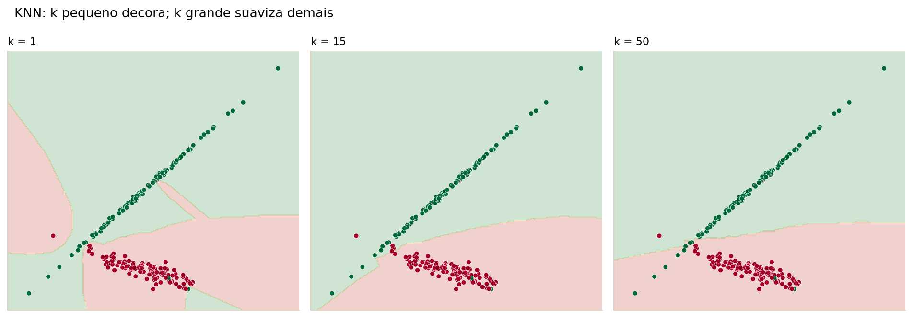

<div class="page-meta">Nível: intermediário · Tempo: 15 min · Pré-requisito: Relação</div>

<div class="objetivo">
<b>Objetivo:</b> usar KNN com distância e escala conscientes, calibrar `k` e reconhecer a
maldição da dimensionalidade.
</div>

## Em uma frase

KNN prevê o valor de uma observação olhando para os `k` vizinhos mais próximos no espaço
das features.

## Intuição

“Diga-me com quem andas e eu digo quem tu és.” O modelo não aprende uma equação: guarda os
dados e decide por vizinhança. Com `k=1`, copia o vizinho mais próximo; com `k` grande,
suaviza a fronteira.

{fig-align="center" width="96%"}

## Quando usar

- `n` pequeno/médio e poucas features.
- Fronteiras não lineares e locais.
- Dados já em escala comparável.
- Baseline simples para classificação/regressão.

## Quando NÃO usar

- Alta dimensão: a distância perde sentido (maldição da dimensionalidade).
- Muitos dados: a previsão é cara (compara com todos).
- Missing ou variáveis categóricas sem tratamento.
- Features em escalas muito diferentes sem padronização.

## Pressupostos

| Pressuposto | O que significa | Como checar |
|---|---|---|
| Distância faz sentido | features comparáveis | padronizar |
| Espaço denso | `n` suficiente para a dimensão | curva de aprendizado |
| Sem missing | distância precisa de valores | imputar dentro do pipeline |
| Escala | nenhuma feature domina | `StandardScaler` |

## Hiperparâmetros

| Nome | O que controla | Faixa típica | Default | Borda inferior | Borda superior | Escala |
|---|---|---|---|---|---|---|
| `n_neighbors` | número de vizinhos | `1`–`50` | `5` | overfitting | underfitting | linear |
| `weights` | peso dos vizinhos | `uniform`, `distance` | `uniform` | — | — | categórica |
| `metric` | distância | `euclidean`, `manhattan` | `minkowski` | — | — | categórica |
| `p` | potência da Minkowski | `1`–`2` | `2` | Manhattan | Euclidiana | linear |
| `algorithm` | busca | `auto`, `kd_tree`, `ball_tree`, `brute` | `auto` | — | — | categórica |

::: {.callout-warning}
## Borda é aviso
Se o melhor `k` cai em 1 ou no limite superior, amplie a faixa. `k=1` quase sempre é
overfitting; `k` muito grande borra a fronteira.
:::

## Como calibrar

1. Padronize as features.
2. Varie `k` em valores ímpares (para classificação binária).
3. Calcule a métrica em CV.
4. Escolha o mínimo da validação, não do treino.
5. Teste `weights="distance"` se os vizinhos próximos importam mais.

```python
import optuna
from sklearn.neighbors import KNeighborsClassifier
from sklearn.pipeline import make_pipeline
from sklearn.preprocessing import StandardScaler
from sklearn.model_selection import cross_val_score

def objetivo(trial):
    k = trial.suggest_int("n_neighbors", 1, 50)
    modelo = make_pipeline(
        StandardScaler(),
        KNeighborsClassifier(n_neighbors=k, weights="distance"),
    )
    score = cross_val_score(modelo, X_tr, y_tr, cv=5, scoring="f1").mean()
    return score

estudo = optuna.create_study(direction="maximize")
estudo.optimize(objetivo, n_trials=30)
print(estudo.best_params, round(estudo.best_value, 3))
```

## Código

::: {.panel-tabset}
## Python

```python
from sklearn.datasets import make_classification
from sklearn.model_selection import train_test_split, cross_val_score
from sklearn.neighbors import KNeighborsClassifier
from sklearn.pipeline import make_pipeline
from sklearn.preprocessing import StandardScaler

X, y = make_classification(
    n_samples=400, n_features=8, n_informative=5, n_redundant=2,
    class_sep=0.9, flip_y=0.05, random_state=42,
)
X_tr, X_te, y_tr, y_te = train_test_split(
    X, y, test_size=0.3, stratify=y, random_state=42
)

for k in [1, 5, 15, 50]:
    modelo = make_pipeline(StandardScaler(), KNeighborsClassifier(n_neighbors=k))
    scores = cross_val_score(modelo, X_tr, y_tr, cv=5, scoring="f1")
    print(f"k={k:>2}: F1 {scores.mean():.3f} +/- {scores.std():.3f}")

modelo = make_pipeline(StandardScaler(), KNeighborsClassifier(n_neighbors=15)).fit(X_tr, y_tr)
print("F1 teste:", round(modelo.score(X_te, y_te), 3))
```

## R

```r
library(class)

dados <- read.csv("data/exemplo_classificacao.csv")
set.seed(42)
idx <- sample(nrow(dados), floor(0.7 * nrow(dados)))
tr <- dados[idx, ]
te <- dados[-idx, ]

features <- setdiff(names(dados), "risco")
X_tr <- scale(tr[, features])
centro <- attr(X_tr, "scaled:center")
escala <- attr(X_tr, "scaled:scale")
X_te <- scale(te[, features], center = centro, scale = escala)

pred <- knn(train = X_tr, test = X_te, cl = tr$risco, k = 15)
table(real = te$risco, previsto = pred)
```
:::

::: {.callout-note}
## A aba R usa outro conjunto
O exemplo R usa o CSV de classificação e o pacote `class`; os números não precisam
coincidir com o Python.
:::

## Métricas recomendadas

| Tarefa | Métrica | Complemento |
|---|---|---|
| Classificação | F1/recall | ROC-AUC, matriz |
| Regressão | RMSE/MAE | R² |
| Escolha de `k` | F1/RMSE em CV | curva de validação |

## Erros comuns

1. Não padronizar as features.
2. Usar `k` par em classificação binária (empate).
3. Escolher `k` no treino.
4. Ignorar a maldição da dimensionalidade.
5. Imputar missing antes do split.
6. Deixar vizinhos do mesmo grupo nos dois lados da validação.
7. Comparar KNN com modelos lineares sem padronizar.

## Exercício

Compare `k=1`, `k=15` e `k=50`. Qual tem o melhor F1 em CV? O que muda na fronteira?

::: {.callout-note collapse="true" title="Solução"}
`k=1` tende a overfittar; `k=50` tende a suavizar demais. O melhor fica no meio, e a
fronteira fica mais regular. A escolha é pela validação, não pelo treino.
:::

## Próximo passo

[SVM](09-svm.qmd).
