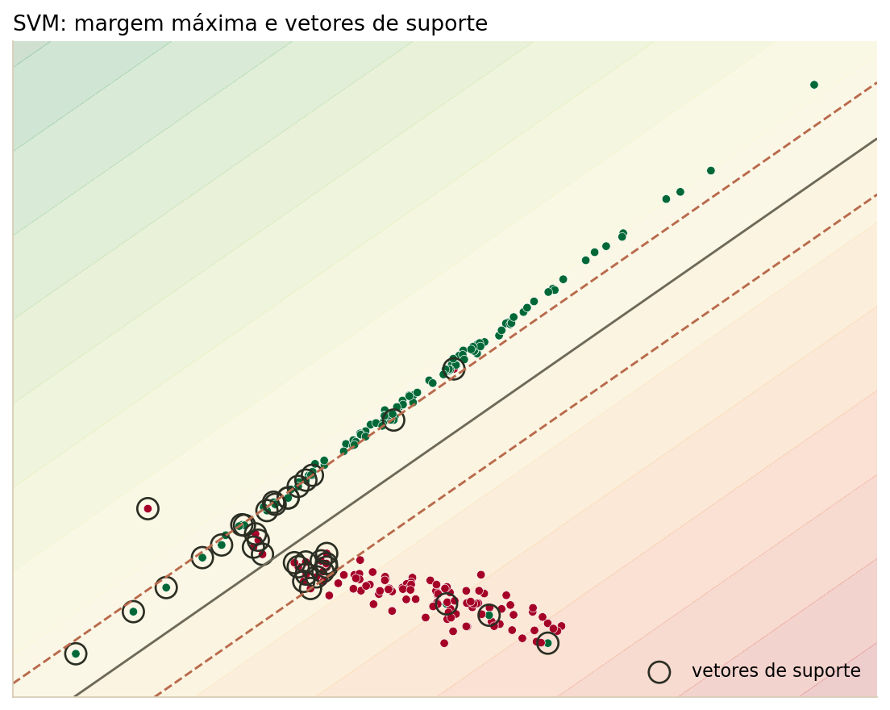

<div class="page-meta">Nível: avançado · Tempo: 18 min · Pré-requisito: Relação</div>

<div class="objetivo">
<b>Objetivo:</b> entender margem, vetores de suporte e kernel, calibrar `C` e `gamma` e
reconhecer quando o SVM não é a melhor escolha.
</div>

## Em uma frase

A máquina de vetores de suporte encontra a fronteira que separa as classes com a **maior
margem**; com kernels, ela também separa fronteiras não lineares.

## Intuição

Imagine uma rua entre duas classes. O SVM escolhe a rua mais larga possível; os pontos que
encostam na calçada são os **vetores de suporte**. Se a rua não puder ser reta, o kernel
“dobra” o espaço para permitir uma separação linear.

{fig-align="center" width="80%"}

::: {.formula-card}
#### Fórmula comentada

<p class="formula-words">O SVM maximiza a margem e paga um custo por cada ponto que invade
ou cruza a margem.</p>

$$
\min_{w,b}\ \frac{1}{2}\|w\|^2 + C\sum_{i=1}^{n}\xi_i
\quad\text{sujeito a}\quad
y_i(w^T x_i + b) \ge 1 - \xi_i,\ \xi_i \ge 0
$$

| Símbolo | Significado |
|---|---|
| \(w\) | vetor normal da fronteira |
| \(b\) | viés (intercepto) |
| \(C\) | custo de violar a margem |
| \(\xi_i\) | violação da margem para a observação \(i\) |
| \(y_i\) | rótulo (-1 ou +1) |

**O que premia:** margem larga e poucas violações.  
**O que pune:** margem estreita e pontos mal classificados.  
**Quando engana:** sem padronização, `C`/`gamma` na borda ou probabilidade não calibrada.
:::

## Quando usar

- `n` médio, muitas features, margem razoavelmente clara.
- Fronteiras não lineares com kernel RBF.
- Dados de alta dimensão (texto, imagens pequenas).
- Baseline forte antes de boosting.

## Quando NÃO usar

- `n` muito grande (custo de treino).
- Classes muito sobrepostas e ruidosas.
- Precisa de probabilidades calibradas sem pós-processamento.
- Features em escalas diferentes sem padronização.

## Pressupostos

| Pressuposto | O que significa | Como checar |
|---|---|---|
| Escala | kernel é sensível à distância | padronizar |
| Kernel adequado | linear vs RBF vs polinomial | CV |
| `C` calibrado | trade-off margem × erro | curva de validação |
| `gamma` calibrado | alcance da influência | curva de validação |

## Hiperparâmetros

| Nome | O que controla | Faixa típica | Default | Borda inferior | Borda superior | Escala |
|---|---|---|---|---|---|---|
| `C` | custo de violar a margem | `1e-3`–`1e3` | `1.0` | margem larga, underfitting | margem estreita, overfitting | **log** |
| `kernel` | tipo de fronteira | `linear`, `rbf`, `poly` | `rbf` | — | — | categórica |
| `gamma` | alcance do kernel RBF | `1e-4`–`1e1` | `scale` | underfitting | overfitting | **log** |
| `degree` | grau do polinomial | `2`–`5` | `3` | underfitting | overfitting | linear |
| `class_weight` | peso das classes | `None`, `balanced` | `None` | ignora imbalance | distorce probabilidades | categórica |

::: {.callout-warning}
## Borda é aviso
`C` ou `gamma` no limite da busca indicam que o ótimo pode estar fora. Amplie a faixa e
rode de novo.
:::

## Como calibrar

1. Padronize as features.
2. Comece com `kernel="rbf"` e `C=1`, `gamma="scale"`.
3. Varie `C` e `gamma` em escala log com CV.
4. Se a fronteira for aproximadamente linear, teste `kernel="linear"`.
5. Se precisar de probabilidade, ative `probability=True` e verifique a calibração.

```python
import optuna
from sklearn.svm import SVC
from sklearn.pipeline import make_pipeline
from sklearn.preprocessing import StandardScaler
from sklearn.model_selection import cross_val_score

def objetivo(trial):
    C = trial.suggest_float("C", 1e-3, 1e3, log=True)
    gamma = trial.suggest_float("gamma", 1e-4, 1e1, log=True)
    modelo = make_pipeline(StandardScaler(), SVC(C=C, gamma=gamma, kernel="rbf"))
    return cross_val_score(modelo, X_tr, y_tr, cv=5, scoring="f1").mean()

estudo = optuna.create_study(direction="maximize")
estudo.optimize(objetivo, n_trials=40)
print(estudo.best_params, round(estudo.best_value, 3))
```

## Código

::: {.panel-tabset}
## Python

```python
from sklearn.datasets import make_classification
from sklearn.model_selection import train_test_split, cross_val_score
from sklearn.pipeline import make_pipeline
from sklearn.preprocessing import StandardScaler
from sklearn.svm import SVC

X, y = make_classification(
    n_samples=500, n_features=10, n_informative=6, n_redundant=2,
    class_sep=0.9, flip_y=0.05, random_state=42,
)
X_tr, X_te, y_tr, y_te = train_test_split(
    X, y, test_size=0.3, stratify=y, random_state=42
)

for kernel in ["linear", "rbf"]:
    modelo = make_pipeline(StandardScaler(), SVC(kernel=kernel, C=1.0))
    scores = cross_val_score(modelo, X_tr, y_tr, cv=5, scoring="f1")
    print(f"{kernel:>6}: F1 {scores.mean():.3f} +/- {scores.std():.3f}")

modelo = make_pipeline(StandardScaler(), SVC(kernel="rbf", C=1.0)).fit(X_tr, y_tr)
print("F1 teste:", round(modelo.score(X_te, y_te), 3))
```

## R

```r
# install.packages("e1071")
library(e1071)

dados <- read.csv("data/exemplo_classificacao.csv")
dados$risco <- factor(dados$risco)

set.seed(42)
idx <- sample(nrow(dados), floor(0.7 * nrow(dados)))
tr <- dados[idx, ]
te <- dados[-idx, ]

modelo <- svm(risco ~ ., data = tr, kernel = "radial",
              cost = 1, gamma = 1 / ncol(tr))
pred <- predict(modelo, te)
table(real = te$risco, previsto = pred)
```
:::

::: {.callout-note}
## A aba R usa outro conjunto
O exemplo R usa `e1071` e o CSV; os números não precisam coincidir com o Python.
:::

## Métricas recomendadas

| Tarefa | Métrica | Complemento |
|---|---|---|
| Classificação | F1/recall | ROC-AUC, matriz |
| Probabilidade | log loss, Brier | calibração |
| Regressão | RMSE/MAE | R² |

## Erros comuns

1. Não padronizar as features.
2. Deixar `gamma` no default sem testar.
3. Usar `probability=True` e tratar a saída como calibrada.
4. `C` ou `gamma` na borda.
5. `n` muito grande e kernel RBF sem necessidade.
6. Comparar SVM com modelos lineares sem a mesma CV.
7. Interpretar margem como probabilidade.

## Exercício

Compare `kernel="linear"` e `kernel="rbf"` com a mesma CV. Qual ganha? O ganho passa da
incerteza? Depois, varie `C` em `0.01, 0.1, 1, 10, 100`.

::: {.callout-note collapse="true" title="Solução"}
Se a fronteira for aproximadamente linear, o kernel linear pode empatar ou ganhar com menos
custo. O RBF ganha quando há curvatura. O `C` alto reduz a margem e pode overfittar; o `C`
baixo underfitta. A escolha é pela CV, com incerteza.
:::

## Próximo passo

[Naive Bayes](10-naive-bayes.qmd).
