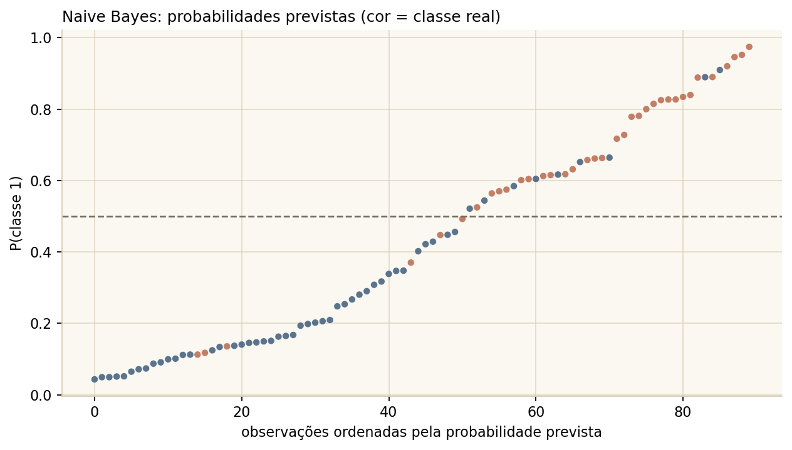

<div class="page-meta">Nível: intermediário · Tempo: 14 min · Pré-requisito: Probabilidade</div>

<div class="objetivo">
<b>Objetivo:</b> usar Naive Bayes como baseline rápido, entender a suposição de
independência e reconhecer quando as probabilidades são apenas um ranking.
</div>

## Em uma frase

Naive Bayes aplica o teorema de Bayes assumindo que as features são condicionalmente
independentes dada a classe.

## Intuição

O modelo combina a **prior** da classe com a **verossimilhança** de cada feature. A
suposição “naive” é que cada feature contribui de forma independente; na prática, isso
raramente é verdade, mas o modelo ainda costuma funcionar bem para triagem.

{fig-align="center" width="82%"}

## Quando usar

- Texto e alta dimensão (multinomial/Bernoulli).
- `n` pequeno e treino rápido.
- Baseline de classificação.
- Features categóricas ou contagens.
- Quando a ordem das probabilidades importa mais que a calibração.

## Quando NÃO usar

- Features fortemente correlacionadas.
- Necessidade de probabilidades calibradas.
- Relações complexas entre features.
- Features contínuas com distribuições muito distantes da normal (GaussianNB).
- Quando um modelo discriminativo simples já resolve melhor.

## Pressupostos

| Pressuposto | O que significa | Como checar |
|---|---|---|
| Independência condicional | features não se explicam dada a classe | conhecimento do domínio |
| Distribuição | Gaussian, multinomial ou Bernoulli | tipo de feature |
| Prior | proporção das classes | `class_prior`/dados |
| Escala | GaussianNB assume normalidade | histogramas por classe |

## Hiperparâmetros

| Nome | O que controla | Faixa típica | Default | Borda inferior | Borda superior | Escala |
|---|---|---|---|---|---|---|
| `var_smoothing` | estabilidade da variância (GaussianNB) | `1e-12`–`1e-6` | `1e-9` | underfitting numérico | suaviza demais | **log** |
| `alpha` | suavização de Laplace (Multinomial/Bernoulli) | `1e-3`–`10` | `1.0` | overfitting | suaviza demais | **log** |
| `fit_prior` | aprende a prior | `True`/`False` | `True` | prior fixa | — | categórica |
| `class_prior` | prior manual | vetor de probabilidades | `None` | — | — | — |
| `binarize` | limiar (BernoulliNB) | `0`–`1` | `0.0` | — | — | linear |

## Como calibrar

1. Escolha a variante pelo tipo de feature: `GaussianNB`, `MultinomialNB`, `BernoulliNB`.
2. Varie `var_smoothing` ou `alpha` em CV.
3. Olhe log loss e a curva de calibração, não só a acurácia.
4. Se as probabilidades forem extremas, calibre (Platt/isotônica) ou use outro modelo.

```python
import optuna
from sklearn.naive_bayes import GaussianNB
from sklearn.model_selection import cross_val_score

def objetivo(trial):
    vs = trial.suggest_float("var_smoothing", 1e-12, 1e-6, log=True)
    modelo = GaussianNB(var_smoothing=vs)
    return cross_val_score(modelo, X_tr, y_tr, cv=5, scoring="neg_log_loss").mean()

estudo = optuna.create_study(direction="maximize")
estudo.optimize(objetivo, n_trials=30)
print(estudo.best_params, round(estudo.best_value, 3))
```

## Código

::: {.panel-tabset}
## Python

```python
from sklearn.datasets import make_classification
from sklearn.metrics import classification_report
from sklearn.model_selection import train_test_split
from sklearn.naive_bayes import GaussianNB

X, y = make_classification(
    n_samples=600, n_features=8, n_informative=4, n_redundant=2,
    class_sep=0.7, flip_y=0.15, weights=[0.6, 0.4], random_state=42,
)
X_tr, X_te, y_tr, y_te = train_test_split(
    X, y, test_size=0.3, stratify=y, random_state=42
)

modelo = GaussianNB().fit(X_tr, y_tr)
pred = modelo.predict(X_te)
print(classification_report(y_te, pred, target_names=["0", "1"]))
```

## R

```r
# install.packages("e1071")
library(e1071)

dados <- read.csv("data/exemplo_classificacao.csv")
dados$risco <- factor(dados$risco)

set.seed(42)
idx <- sample(nrow(dados), floor(0.7 * nrow(dados)))
tr <- dados[idx, ]
te <- dados[-idx, ]

modelo <- naiveBayes(risco ~ ., data = tr)
pred <- predict(modelo, te)
table(real = te$risco, previsto = pred)
```
:::

::: {.callout-note}
## A aba R usa outro conjunto
O exemplo R usa `e1071` e o CSV; os números não precisam coincidir com o Python.
:::

## Métricas recomendadas

| Tarefa | Métrica | Complemento |
|---|---|---|
| Classificação | F1/recall | ROC-AUC, matriz |
| Probabilidade | log loss, Brier | curva de calibração |
| Ranking | PR-AUC | lift |

## Erros comuns

1. Assumir que a independência é verdadeira.
2. Usar GaussianNB em contagens.
3. Tratar probabilidades extremas como calibradas.
4. Ignorar features correlacionadas.
5. Escolher `alpha`/`var_smoothing` no teste.
6. Comparar Naive Bayes com modelos calibrados sem olhar log loss.
7. Usar acurácia em classe desbalanceada.

## Exercício

Compare GaussianNB e regressão logística no mesmo conjunto. Qual tem melhor F1? Qual tem
melhor log loss? O que isso diz sobre discriminação vs calibração?

::: {.callout-note collapse="true" title="Solução"}
Naive Bayes pode ter F1 competitivo e log loss pior (probabilidades extremas). Isso mostra
que discriminação e calibração são coisas diferentes. Se a decisão usa probabilidade,
calibre ou escolha um modelo calibrado.
:::

## Próximo passo

[K-means](11-kmeans.qmd).
