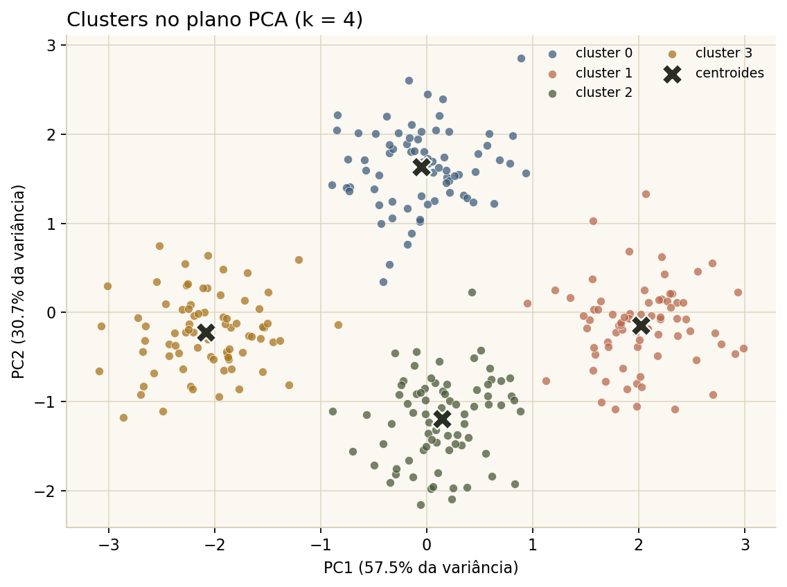
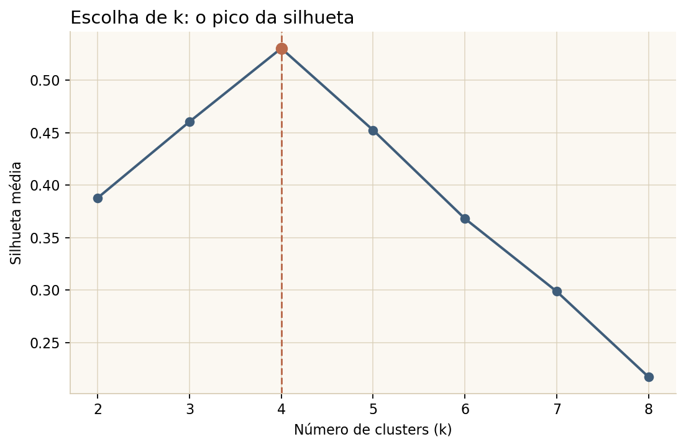

<div class="page-meta">Nível: intermediário · Tempo: 15 min · Pré-requisito: Distância e escala</div>

<div class="objetivo">
<b>Objetivo:</b> escolher `k` com silhueta e cotovelo, padronizar as features e interpretar
clusters sem tratá-los como classes naturais.
</div>

## Em uma frase

K-means divide as observações em `k` grupos minimizando a distância de cada ponto ao centro
do seu cluster.

## Intuição

O algoritmo alterna dois passos: atribui cada ponto ao centro mais próximo e recalcula os
centros. É como organizar pessoas em `k` rodas, movendo cada roda para o centro do seu grupo
até ninguém querer mudar.

{fig-align="center" width="80%"}

{fig-align="center" width="76%"}

## Quando usar

- Clusters aproximadamente esféricos e de variância parecida.
- `k` plausível ou testável.
- Features numéricas padronizadas.
- `n` médio/grande e necessidade de segmentação rápida.

## Quando NÃO usar

- Formas arbitrárias (use DBSCAN/hierárquico).
- Densidades muito diferentes.
- Muitos outliers (K-means é sensível).
- Features categóricas sem transformação.
- Quando você precisa de uma hierarquia.

## Pressupostos

| Pressuposto | O que significa | Como checar |
|---|---|---|
| Escala | distância é dominada por escala | padronizar |
| Esfericidade | clusters compactos e redondos | visualizar/PCA |
| `k` | número de grupos | silhueta/cotovelo |
| Outliers | não distorcem centros | investigar |

## Hiperparâmetros

| Nome | O que controla | Faixa típica | Default | Borda inferior | Borda superior | Escala |
|---|---|---|---|---|---|---|
| `n_clusters` | número de grupos | `2`–`10` | `8` | funde grupos | divide demais | linear |
| `init` | inicialização | `k-means++`, `random` | `k-means++` | — | — | categórica |
| `n_init` | reinícios | `10`–`50` | `10` | instável | custo sem ganho | linear |
| `max_iter` | iterações | `100`–`500` | `300` | não converge | custo | linear |
| `tol` | tolerância | `1e-4`–`1e-2` | `1e-4` | custo | para cedo | log |

## Como calibrar

1. Padronize as features.
2. Rode para `k=2..10`.
3. Calcule silhueta (quanto maior, melhor) e inércia (cotovelo).
4. Confira se os grupos fazem sentido no domínio.
5. Teste estabilidade com sementes diferentes.

```python
import optuna
from sklearn.cluster import KMeans
from sklearn.metrics import silhouette_score
from sklearn.preprocessing import StandardScaler

Xs = StandardScaler().fit_transform(X)
def objetivo(trial):
    k = trial.suggest_int("n_clusters", 2, 10)
    labels = KMeans(n_clusters=k, n_init=25, random_state=42).fit_predict(Xs)
    return silhouette_score(Xs, labels)

estudo = optuna.create_study(direction="maximize")
estudo.optimize(objetivo, n_trials=9)
print(estudo.best_params, round(estudo.best_value, 3))
```

## Código

::: {.panel-tabset}
## Python

```python
import pandas as pd
from sklearn.cluster import KMeans
from sklearn.decomposition import PCA
from sklearn.metrics import silhouette_score
from sklearn.preprocessing import StandardScaler

dados = pd.read_csv("data/exemplo_cluster.csv")
Xs = StandardScaler().fit_transform(dados)

for k in range(2, 8):
    labels = KMeans(n_clusters=k, n_init=25, random_state=42).fit_predict(Xs)
    print(f"k={k}: silhueta {silhouette_score(Xs, labels):.3f}")

km = KMeans(n_clusters=4, n_init=25, random_state=42).fit(Xs)
dados["cluster"] = km.labels_
print(dados.groupby("cluster").mean().round(2))

pca = PCA(n_components=2).fit(Xs)
print("variância explicada:", pca.explained_variance_ratio_.round(3))
```

## R

```r
library(cluster)

dados <- read.csv("data/exemplo_cluster.csv")
Xs <- scale(dados)

for (k in 2:8) {
  km <- kmeans(Xs, centers = k, nstart = 25)
  sil <- silhouette(km$cluster, dist(Xs))
  cat("k =", k, "| silhueta =", round(mean(sil[, 3]), 3), "\n")
}

set.seed(42)
km <- kmeans(Xs, centers = 4, nstart = 25)
dados$cluster <- km$cluster
print(round(aggregate(dados[, -5], by = list(cluster = dados$cluster), mean), 2))
```
:::

## Métricas recomendadas

| Métrica | Uso |
|---|---|
| Silhueta | coesão e separação |
| Inércia | cotovelo |
| Calinski-Harabasz | razão entre variâncias |
| Davies-Bouldin | similaridade entre clusters |
| Estabilidade | ARI entre sementes |

## Erros comuns

1. Não padronizar.
2. Escolher `k` só pela inércia.
3. Interpretar cluster como classe natural.
4. Ignorar outliers.
5. Usar K-means em formas não esféricas.
6. Não testar estabilidade.
7. Usar PCA para ajustar o K-means (o PCA é só visualização).

## Exercício

Compare `k=3`, `k=4` e `k=5`. Qual tem a melhor silhueta? Os perfis fazem sentido para o
problema? O que você reportaria?

::: {.callout-note collapse="true" title="Solução"}
O `k` com maior silhueta é o candidato, mas a decisão também considera interpretabilidade e
estabilidade. Reporte `k`, silhueta, perfis médios e a limitação de que cluster não é classe.
:::

## Próximo passo

[PCA](12-pca.qmd).
