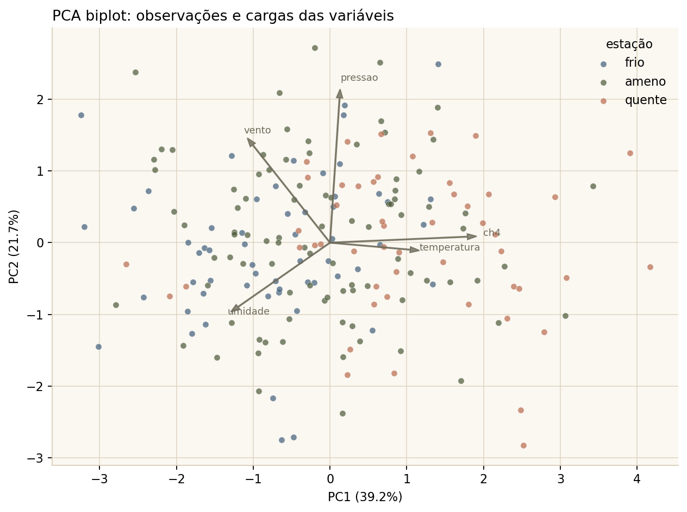

<div class="page-meta">Nível: intermediário · Tempo: 14 min · Pré-requisito: Multivariado</div>

<div class="objetivo">
<b>Objetivo:</b> usar PCA para compressão e visualização, escolher o número de componentes
e reconhecer quando a estrutura não é linear.
</div>

## Em uma frase

PCA encontra direções ortogonais que maximizam a variância e projeta os dados nelas.

## Intuição

É como girar os eixos de uma nuvem de pontos até que o primeiro eixo aponte para a maior
dispersão. O segundo eixo é perpendicular ao primeiro, e assim por diante. Cada componente é
uma combinação linear das variáveis originais.

{fig-align="center" width="86%"}

::: {.formula-card}
#### Fórmula comentada

<p class="formula-words">O PCA procura a direção \(w\) que maximiza a variância da projeção
\(Xw\), com \(w\) de norma 1.</p>

$$
\max_{w:\ \|w\|=1}\ \text{Var}(Xw)
\qquad
Z = XW
$$

| Símbolo | Significado |
|---|---|
| \(X\) | matriz de dados padronizados |
| \(w\) | direção (componente) |
| \(Z\) | dados projetados |
| \(\text{Var}(Xw)\) | variância explicada pela direção |

**O que premia:** direções de maior variância.  
**O que pune:** direções de baixa variância (descartadas).  
**Quando engana:** sem padronização, estruturas não lineares e leitura causal das cargas.
:::

## Quando usar

- Comprimir muitas variáveis correlacionadas.
- Visualizar estrutura em 2D.
- Reduzir ruído e multicolinearidade.
- Pré-processar para modelos lineares.

## Quando NÃO usar

- Estrutura claramente não linear (t-SNE/UMAP para visualização; autoencoders para outros).
- Quando a interpretação das variáveis originais é essencial.
- Variáveis categóricas sem transformação.
- Sem padronizar quando as escalas diferem.

## Pressupostos

| Pressuposto | O que significa | Como checar |
|---|---|---|
| Linearidade | combinações lineares capturam a estrutura | PCA vs UMAP |
| Escala | variáveis comparáveis | padronizar |
| Variância | direções de maior variância são informativas | scree plot |
| Sem outliers extremos | outliers dominam componentes | investigar |

## Hiperparâmetros

| Nome | O que controla | Faixa típica | Default | Borda inferior | Borda superior | Escala |
|---|---|---|---|---|---|---|
| `n_components` | número de componentes | `1`–`p` | `min(n,p)` | perde informação | ruído | linear |
| `whiten` | normaliza a variância | `True`/`False` | `False` | — | — | categórica |
| `svd_solver` | algoritmo | `auto`, `full`, `randomized` | `auto` | — | — | categórica |

## Como calibrar

1. Padronize as variáveis.
2. Ajuste o PCA e olhe a variância explicada acumulada.
3. Escolha o menor número de componentes que explica uma fração aceitável (ex.: 90%).
4. Se o PCA for usado antes de um modelo, faça o ajuste **dentro** do pipeline/CV.
5. Para visualização, use 2 componentes e não conclua causalidade.

```python
from sklearn.decomposition import PCA
from sklearn.preprocessing import StandardScaler

Xs = StandardScaler().fit_transform(X)
pca = PCA().fit(Xs)
acumulada = pca.explained_variance_ratio_.cumsum()
for i, v in enumerate(acumulada, start=1):
    print(f"{i} componentes: {v:.3f}")
```

## Código

::: {.panel-tabset}
## Python

```python
import pandas as pd
import matplotlib.pyplot as plt
from sklearn.decomposition import PCA
from sklearn.preprocessing import StandardScaler

dados = pd.read_csv("data/exemplo_ch4.csv")
features = ["temperatura", "umidade", "vento", "pressao", "ch4"]
X = StandardScaler().fit_transform(dados[features])

pca = PCA(n_components=2).fit(X)
Z = pca.transform(X)
print("variância explicada:", pca.explained_variance_ratio_.round(3))

fig, ax = plt.subplots(figsize=(8, 6))
ax.scatter(Z[:, 0], Z[:, 1], s=24, alpha=0.7)
for i, nome in enumerate(features):
    ax.arrow(0, 0, pca.components_[0, i] * 2.6, pca.components_[1, i] * 2.6,
             color="#6e6a59", width=0.01, head_width=0.08)
    ax.text(pca.components_[0, i] * 2.9, pca.components_[1, i] * 2.9, nome, fontsize=8)
plt.show()
```

## R

```r
dados <- read.csv("data/exemplo_ch4.csv")
features <- c("temperatura", "umidade", "vento", "pressao", "ch4")

pca <- prcomp(dados[, features], scale. = TRUE)
summary(pca)
biplot(pca)
```
:::

## Métricas recomendadas

| Métrica | Uso |
|---|---|
| Variância explicada | quanta informação foi mantida |
| Variância acumulada | escolha do número de componentes |
| Erro de reconstrução | perda ao comprimir |
| Desempenho do modelo | o PCA ajudou a prever? |

## Erros comuns

1. Não padronizar.
2. Interpretar componentes como variáveis originais.
3. Ajustar o PCA na base inteira antes do split (vazamento).
4. Usar PCA para relações não lineares.
5. Escolher componentes pelo gráfico sem critério.
6. Concluir causalidade a partir das cargas.

## Exercício

Quantos componentes explicam pelo menos 90% da variância? O que cada uma das duas primeiras
parece representar? O que você **não** pode concluir?

::: {.callout-note collapse="true" title="Solução"}
Use a variância acumulada para escolher o menor número que passa de 90%. As cargas indicam
quais variáveis puxam cada componente, mas não provam causalidade nem substituem a
interpretação do domínio. PCA é uma combinação linear, não uma descoberta de mecanismo.
:::

## Próximo passo

Volte ao [mapa de decisão](mapa-de-decisao.qmd) ou veja o
[catálogo de modelos](index.qmd).
