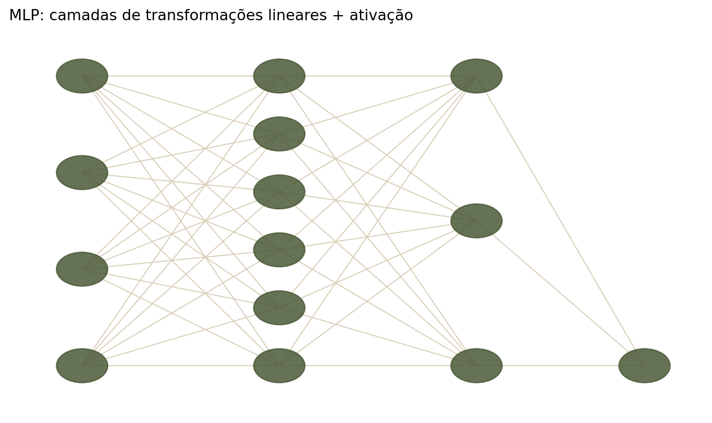
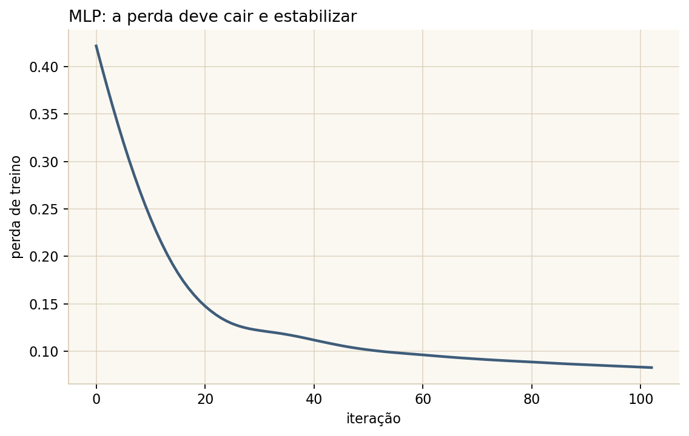

<div class="page-meta">Nível: avançado · Tempo: 20 min · Pré-requisito: Random Forest + Calibração</div>

<div class="objetivo">
<b>Objetivo:</b> entender o MLP como camadas de transformações, calibrar arquitetura e
learning rate, usar early stopping e reconhecer quando ele não compensa.
</div>

## Em uma frase

O MLP empilha camadas de combinações lineares seguidas de funções de ativação não lineares;
a saída é uma transformação aprendida das entradas.

## Intuição

Cada neurônio faz uma soma ponderada e aplica uma não linearidade. Empilhando camadas, a rede
aprende representações intermediárias: primeiro padrões simples, depois combinações. É
poderoso, mas exige escala, tuning e dados suficientes.

{fig-align="center" width="82%"}

{fig-align="center" width="78%"}

## Quando usar

- `n` grande e padrões complexos.
- Dados tabulares com interações que árvores não capturam bem.
- Sinais, imagens pequenas, séries curtas.
- Quando você tem orçamento para tuning e validação.

## Quando NÃO usar

- `n` pequeno (overfitting fácil).
- Precisa de interpretabilidade direta.
- Dados tabulares simples: RF/boosting costumam empatar com menos custo.
- Sem tempo para calibrar arquitetura e learning rate.
- Sem padronização das features.

## Pressupostos

| Pressuposto | O que significa | Como checar |
|---|---|---|
| Escala | ativações e gradientes estáveis | padronizar |
| Dados suficientes | aprender representações | curva de aprendizado |
| Arquitetura | capacidade compatível com o problema | CV |
| Early stopping | parar antes de overfittar | validação interna |

## Hiperparâmetros

| Nome | O que controla | Faixa típica | Default | Borda inferior | Borda superior | Escala |
|---|---|---|---|---|---|---|
| `hidden_layer_sizes` | neurônios por camada | `(32,)`–`(256,128)` | `(100,)` | underfitting | overfitting/custo | categórica |
| `activation` | não linearidade | `relu`, `tanh` | `relu` | — | — | categórica |
| `alpha` | regularização L2 | `1e-6`–`1e-2` | `1e-4` | overfitting | underfitting | **log** |
| `learning_rate_init` | tamanho do passo | `1e-4`–`1e-2` | `1e-3` | lento | diverge | **log** |
| `batch_size` | amostras por passo | `16`–`256` | `auto` | ruidoso | lento | linear |
| `max_iter` | épocas | `200`–`2.000` | `200` | não converge | custo | linear |
| `early_stopping` | para cedo | `True`/`False` | `False` | — | — | categórica |

## Como calibrar

1. Padronize `X` (e, se necessário, `y`).
2. Comece com uma camada oculta pequena e `early_stopping=True`.
3. Varie `hidden_layer_sizes`, `alpha` e `learning_rate_init` em CV.
4. Olhe a curva de perda: se não cai, o learning rate ou a arquitetura estão errados.
5. Compare com RF/boosting; se não ganhar, fique com o modelo mais simples.

```python
import optuna
from sklearn.neural_network import MLPRegressor
from sklearn.pipeline import make_pipeline
from sklearn.preprocessing import StandardScaler
from sklearn.model_selection import cross_val_score

def objetivo(trial):
    camadas = trial.suggest_categorical("camadas", [(32,), (64,), (64, 32), (128, 64)])
    alpha = trial.suggest_float("alpha", 1e-6, 1e-2, log=True)
    lr = trial.suggest_float("learning_rate_init", 1e-4, 1e-2, log=True)
    modelo = make_pipeline(
        StandardScaler(),
        MLPRegressor(hidden_layer_sizes=camadas, alpha=alpha,
                     learning_rate_init=lr, early_stopping=True,
                     max_iter=1000, random_state=42),
    )
    return -cross_val_score(modelo, X_tr, y_tr, cv=3,
                            scoring="neg_root_mean_squared_error").mean()

estudo = optuna.create_study(direction="minimize")
estudo.optimize(objetivo, n_trials=20)
print(estudo.best_params, round(estudo.best_value, 2))
```

## Código

::: {.panel-tabset}
## Python

```python
import pandas as pd
from sklearn.metrics import mean_squared_error
from sklearn.model_selection import train_test_split
from sklearn.neural_network import MLPRegressor
from sklearn.preprocessing import StandardScaler

dados = pd.read_csv("data/exemplo_ch4.csv")
X = dados[["temperatura", "umidade", "vento", "pressao"]]
y = dados["ch4"]

X_tr, X_te, y_tr, y_te = train_test_split(X, y, test_size=0.25, random_state=42)
scaler_x = StandardScaler().fit(X_tr)
scaler_y = StandardScaler().fit(y_tr.to_numpy().reshape(-1, 1))
X_tr_s = scaler_x.transform(X_tr)
X_te_s = scaler_x.transform(X_te)
y_tr_s = scaler_y.transform(y_tr.to_numpy().reshape(-1, 1)).ravel()

modelo = MLPRegressor(
    hidden_layer_sizes=(64, 32), activation="relu", alpha=1e-4,
    learning_rate_init=1e-3, max_iter=1000, early_stopping=True,
    n_iter_no_change=20, random_state=42,
).fit(X_tr_s, y_tr_s)

pred = scaler_y.inverse_transform(modelo.predict(X_te_s).reshape(-1, 1)).ravel()
print("RMSE teste:", round(mean_squared_error(y_te, pred) ** 0.5, 2))
```

## R

```r
library(nnet)

dados <- read.csv("data/exemplo_ch4.csv")
X <- scale(dados[, c("temperatura", "umidade", "vento", "pressao")])
y <- scale(dados$ch4)

set.seed(42)
idx <- sample(nrow(dados), floor(0.75 * nrow(dados)))

modelo <- nnet(
  x = X[idx, ], y = y[idx, ], size = 8, linout = TRUE,
  decay = 1e-4, maxit = 500, trace = FALSE
)
pred <- predict(modelo, X[-idx, ])
rmse <- sqrt(mean((y[-idx, ] - pred)^2))
cat("RMSE (y padronizado):", round(rmse, 3), "\n")
```
:::

## Métricas recomendadas

| Tarefa | Métrica | Complemento |
|---|---|---|
| Regressão | RMSE/MAE | R², curva de perda |
| Classificação | F1/recall | ROC-AUC, log loss |
| Comparação | CV + incerteza | RF/boosting como baseline |

## Erros comuns

1. Não padronizar `X` (e às vezes `y`).
2. Não usar early stopping.
3. Arquitetura grande para `n` pequeno.
4. Learning rate alto (diverge) ou baixo (não converge).
5. Ajustar a rede no teste.
6. Interpretar pesos como causalidade.
7. Comparar com RF/boosting sem a mesma CV.

## Exercício

Compare o MLP com Random Forest no mesmo conjunto. O MLP ganha além da incerteza? Qual é
mais fácil de explicar?

::: {.callout-note collapse="true" title="Solução"}
Em dados tabulares pequenos, o MLP costuma empatar ou perder para RF/boosting, com mais
custo de tuning. Se o ganho não passa da incerteza, fique com o modelo mais simples e mais
interpretável.
:::

## Próximo passo

[DBSCAN e hierárquico](14-dbscan-hierarquico.qmd).
