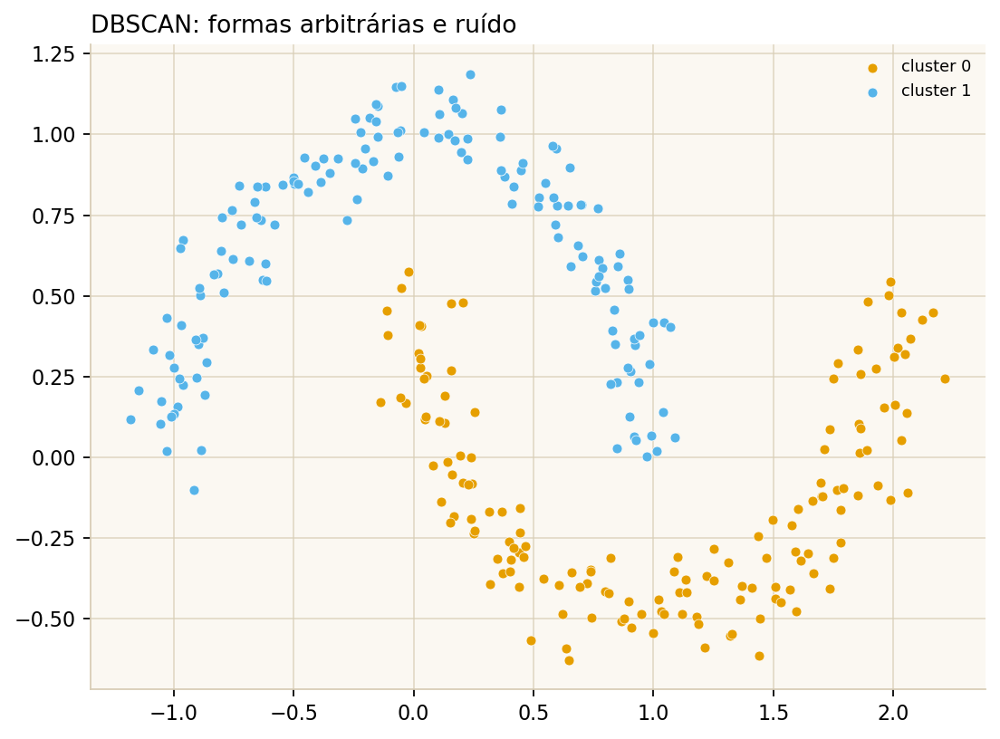
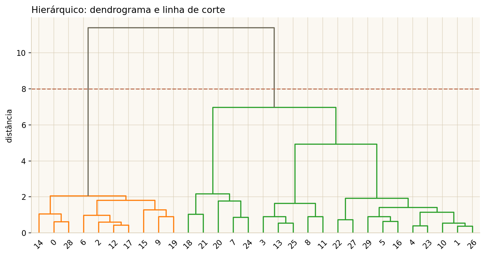

<div class="page-meta">Nível: avançado · Tempo: 18 min · Pré-requisito: K-means</div>

<div class="objetivo">
<b>Objetivo:</b> escolher entre densidade e hierarquia, calibrar `eps`/`min_samples` e o
corte do dendrograma, e interpretar ruído sem tratá-lo como classe.
</div>

## Em uma frase

DBSCAN agrupa regiões densas e marca o resto como ruído; o hierárquico constrói uma árvore
de fusões e permite cortar em diferentes níveis.

## Intuição

- **DBSCAN:** “se há gente suficiente em volta, isto é um grupo; se está isolado, é ruído.”
- **Hierárquico:** “comece com cada ponto sozinho e vá juntando os mais próximos até formar
  uma árvore.”

{fig-align="center" width="76%"}

{fig-align="center" width="86%"}

## Quando usar

**DBSCAN**
- Formas arbitrárias e clusters de densidade parecida.
- Presença de ruído/outliers.
- `k` desconhecido.

**Hierárquico**
- `n` pequeno/médio.
- Você quer ver a estrutura em vários níveis.
- Precisa de dendrograma para comunicar.

## Quando NÃO usar

**DBSCAN**
- Densidades muito diferentes.
- Alta dimensão (distância perde sentido).
- Features categóricas sem transformação.

**Hierárquico**
- `n` grande (custo quadrático).
- Clusters de formas complexas.
- Quando a ordem de fusão não é interpretável.

## Pressupostos

| Método | Pressuposto | Como checar |
|---|---|---|
| DBSCAN | densidade define cluster | k-distance plot |
| DBSCAN | escala comparável | padronizar |
| Hierárquico | distância/linkage adequados | dendrograma |
| Hierárquico | `n` viável | tamanho da matriz |

## Hiperparâmetros

| Método | Nome | O que controla | Faixa típica | Borda inferior | Borda superior |
|---|---|---|---|---|---|
| DBSCAN | `eps` | raio de vizinhança | `0.1`–`2` | tudo ruído | um cluster só |
| DBSCAN | `min_samples` | vizinhos mínimos | `3`–`20` | muitos clusters | tudo ruído |
| DBSCAN | `metric` | distância | `euclidean`, `manhattan` | — | — |
| Hierárquico | `n_clusters` | número de grupos | `2`–`10` | funde | divide demais |
| Hierárquico | `linkage` | distância entre clusters | `ward`, `complete`, `average`, `single` | — | — |
| Hierárquico | `distance_threshold` | altura do corte | `0`–`max` | muitos grupos | poucos grupos |

## Como calibrar

**DBSCAN**
1. Padronize.
2. Faça o k-distance plot (distância ao k-ésimo vizinho) e procure o “joelho”.
3. Escolha `eps` no joelho e `min_samples` ≈ dimensão + 1.
4. Meça a fração de ruído; se for enorme, `eps` está baixo.

**Hierárquico**
1. Padronize.
2. Construa o dendrograma.
3. Corte na maior distância vertical antes de uma fusão.
4. Compare com silhueta e interpretabilidade.

## Código

::: {.panel-tabset}
## Python

```python
import pandas as pd
from scipy.cluster.hierarchy import dendrogram, linkage
from sklearn.cluster import AgglomerativeClustering, DBSCAN
from sklearn.preprocessing import StandardScaler
import matplotlib.pyplot as plt

dados = pd.read_csv("data/exemplo_cluster.csv")
Xs = StandardScaler().fit_transform(dados)

db = DBSCAN(eps=0.6, min_samples=5).fit(Xs)
print("DBSCAN clusters:", sorted(set(db.labels_)))

hc = AgglomerativeClustering(n_clusters=4, linkage="ward").fit(Xs)
print("Hierárquico clusters:", sorted(set(hc.labels_)))

Z = linkage(Xs[:40], method="ward")
dendrogram(Z)
plt.axhline(8, color="#b96a4c", linestyle="--")
plt.show()
```

## R

```r
# install.packages("dbscan")
library(dbscan)
library(cluster)

dados <- read.csv("data/exemplo_cluster.csv")
Xs <- scale(dados)

db <- dbscan(Xs, eps = 0.6, minPts = 5)
print(table(db$cluster))

hc <- hclust(dist(Xs), method = "ward.D2")
plot(hc)
rect.hclust(hc, k = 4, border = "#b96a4c")
```
:::

::: {.callout-note}
## A aba R usa outro conjunto
O exemplo R usa `dbscan` e `cluster`; os números não precisam coincidir com o Python.
O pacote `dbscan` precisa ser instalado.
:::

## Métricas recomendadas

| Métrica | Uso |
|---|---|
| Silhueta | coesão/separação (ignora ruído) |
| Fração de ruído | qualidade do `eps` |
| ARI entre execuções | estabilidade |
| Altura do corte | interpretação do dendrograma |

## Erros comuns

1. Não padronizar.
2. Escolher `eps` no olho, sem k-distance.
3. Usar DBSCAN em densidades muito diferentes.
4. Tratar ruído como classe.
5. Cortar o dendrograma em altura arbitrária.
6. Comparar cluster com classe real.
7. Ignorar a instabilidade entre sementes/amostras.

## Exercício

Rode DBSCAN com `eps=0.3`, `0.6` e `1.0`. Como muda a fração de ruído e o número de
clusters? Qual valor faz sentido para o dado?

::: {.callout-note collapse="true" title="Solução"}
`eps` pequeno aumenta o ruído e fragmenta clusters; `eps` grande funde grupos. O valor
razoável fica no joelho do k-distance plot e produz uma fração de ruído interpretável. Não
existe “melhor eps” universal.
:::

## Próximo passo

Volte ao [mapa de decisão](mapa-de-decisao.qmd).
