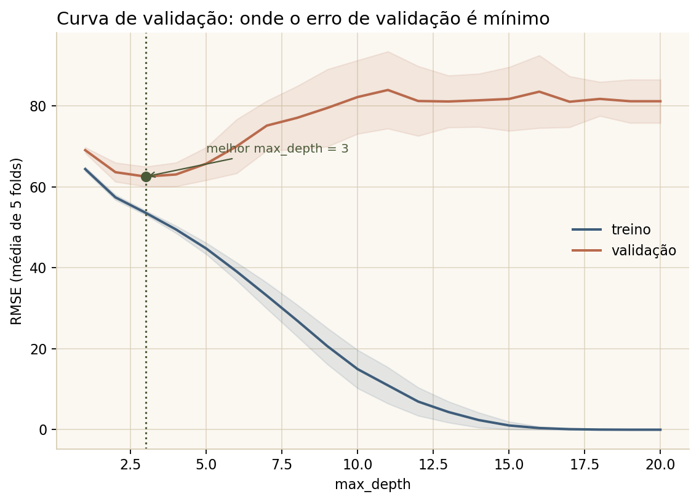
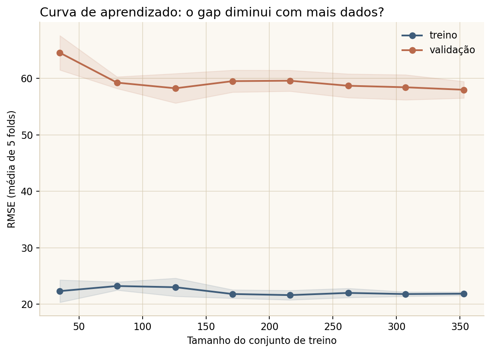

<div class="page-meta">Nível: intermediário · Tempo: 18 min · Pré-requisito: Parâmetro vs hiperparâmetro</div>

<div class="objetivo">
<b>Objetivo:</b> calibrar um hiperparâmetro na mão lendo a curva de validação e a curva de
aprendizado, e decidir quando parar.
</div>

## As duas curvas que você precisa saber ler

### Curva de validação

Um hiperparâmetro no eixo x; o erro (treino e validação) no eixo y. É a ferramenta da
calibração manual.

{fig-align="center" width="78%"}

**Como ler:**

- **Treino** cai sempre que o modelo fica mais flexível. Isso não é novidade: o modelo
  decora.
- **Validação** tem formato de U (ou de mínimo com platô). O ponto de interesse é o
  **mínimo da validação**, não o mínimo do treino.
- À esquerda do mínimo: underfitting (modelo simples demais).
- À direita: overfitting (modelo complexo demais).
- Se o mínimo está **na borda** da faixa, a faixa está errada: amplie e repita.

### Curva de aprendizado

O tamanho do conjunto de treino no eixo x; o erro no eixo y. Responde: "mais dados
resolvem?".

{fig-align="center" width="78%"}

**Como ler:**

- Se o gap treino–validação é grande e **não fecha** com mais dados, o modelo é complexo
  demais. Simplifique ou regularize antes de coletar mais dados.
- Se as duas curvas convergem para um erro alto, o modelo é simples demais ou faltam
  features.
- Se a validação ainda está caindo no fim do gráfico, vale a pena testar mais dados.

## Receita manual (um hiperparâmetro por vez)

1. Isole o hiperparâmetro. Mantenha os outros no default.
2. Escolha uma faixa com base no default e no significado do parâmetro.
3. Varie em passos que façam sentido (potências de 2 ou de 10 para escalas grandes).
4. Para cada valor, calcule a métrica em validação cruzada.
5. Plote treino e validação.
6. Escolha o mínimo da validação, **não** o mínimo do treino.
7. Confira se o mínimo não está na borda.
8. Repita para o próximo hiperparâmetro, se necessário.

::: {.callout-tip}
## Ordem importa
Calibre primeiro os hiperparâmetros que mais mudam o modelo (`max_depth`,
`n_estimators`, `C`, `alpha`). Os de ajuste fino (`min_samples_leaf`) depois. Calibrar
tudo ao mesmo tempo na mão é desperdício.
:::

## Exemplo: `max_depth` de uma árvore

A figura acima mostra o resultado em dados de diabetes (RMSE, 5 folds). O melhor valor
ficou em `max_depth = 3`, com o erro de valida��o subindo depois disso. A �rvore profunda
zera o erro de treino e piora a generaliza��o � o retrato do overfitting.

| `max_depth` | RMSE treino | RMSE valida��o | Leitura |
|---|---|---|---|
| 1 | alto | alto | underfitting |
| 3 | m�dio | **m�nimo** | ponto de equil�brio |
| 5 | baixo | alto | come�a a decorar |
| 20 | ~0 | muito alto | overfitting severo |

::: {.callout-note}
## Números exatos variam
Os valores dependem da versão, da semente e dos folds. O que importa é a **forma** da
curva e a decisão: mínimo da validação, não do treino.
:::

## Código

::: {.panel-tabset}
## Python

```python
import numpy as np
import matplotlib.pyplot as plt
from sklearn.datasets import load_diabetes
from sklearn.tree import DecisionTreeRegressor
from sklearn.model_selection import KFold, cross_val_score

X, y = load_diabetes(return_X_y=True)
cv = KFold(n_splits=5, shuffle=True, random_state=42)

resultados = []
for d in range(1, 21):
    modelo = DecisionTreeRegressor(max_depth=d, random_state=42)
    scores = cross_val_score(
        modelo, X, y, cv=cv, scoring="neg_root_mean_squared_error"
    )
    resultados.append((d, -scores.mean(), scores.std()))

for d, media, desvio in resultados:
    print(f"max_depth={d:>2} | RMSE={media:6.2f} +/- {desvio:.2f}")

melhor = min(resultados, key=lambda r: r[1])
print("melhor:", melhor)
```

## R

```r
library(rpart)

set.seed(42)
dados <- mtcars
folds <- cut(seq_len(nrow(dados)), breaks = 5, labels = FALSE)
rmse <- function(obs, pred) sqrt(mean((obs - pred)^2))

resultado <- data.frame(maxdepth = 1:8, rmse_cv = NA)
for (d in 1:8) {
  erros <- numeric(5)
  for (f in 1:5) {
    tr <- dados[folds != f, ]
    va <- dados[folds == f, ]
    m <- rpart(
      mpg ~ ., data = tr, method = "anova",
      control = rpart.control(maxdepth = d, cp = 0, minsplit = 2)
    )
    erros[f] <- rmse(va$mpg, predict(m, va))
  }
  resultado$rmse_cv[d] <- mean(erros)
}
print(resultado)
```
:::

## Quando parar

| Sinal | Decisão |
|---|---|
| Mínimo claro e estável | pare; escolha esse valor |
| Platô largo | escolha o valor mais simples do platô |
| Mínimo na borda | amplie a faixa e repita |
| Curva muito ruidosa | aumente folds ou repita a CV com sementes diferentes |
| Ganho < incerteza | fique no default ou no modelo mais simples |

::: {.callout-warning}
## Não persiga o terceiro decimal
Se a diferença entre dois valores é menor que o desvio entre folds, você não tem evidência
de que um é melhor. Escolha o mais simples e reporte a incerteza.
:::

## Exercício

Uma curva de validação para `n_estimators` (número de árvores) sobe até 100, fica plana
entre 100 e 500 e cai 0,01 depois de 500. O desvio entre folds é 1,5. Qual valor você
escolhe e por quê?

::: {.callout-note collapse="true" title="Solução"}
Fique em torno de 100–200. Depois disso o ganho é menor que a incerteza (0,01 << 1,5) e o
custo computacional cresce. O platô indica retorno decrescente; escolha o menor valor do
platô.
:::

## Próximo passo

[3. Grid e random search](03-grid-random-search.qmd) — quando automatizar a varredura.

