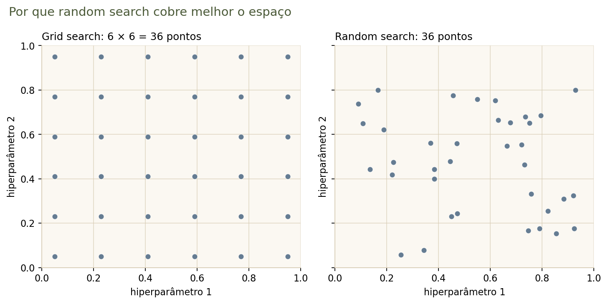

<div class="page-meta">Nível: intermediário · Tempo: 15 min · Pré-requisito: Calibração manual</div>

<div class="objetivo">
<b>Objetivo:</b> escolher entre grid e random search, desenhar o espaço de busca e evitar
a explosão combinatória.
</div>

## Grid search: varredura completa

O grid testa **todas** as combinações de uma grade. É simples, reprodutível e fácil de
explicar. O problema é o crescimento combinatorial:

| Hiperparâmetros | Valores cada | Combinações | Folds = 5 | Ajustes |
|---|---|---|---|---|
| 2 | 5 | 25 | 5 | 125 |
| 3 | 5 | 125 | 5 | 625 |
| 4 | 5 | 625 | 5 | 3.125 |
| 5 | 5 | 3.125 | 5 | 15.625 |

Com muitos hiperparâmetros, o grid gasta a maior parte do orçamento em combinações
irrelevantes. Use grid quando:

- há **poucos** hiperparâmetros (1–3);
- a faixa é curta e você quer cobertura sistemática;
- o modelo é barato.

## Random search: amostragem do espaço

O random search sorteia configurações dentro das distribuições que você define. A ideia
central (Bergstra & Bengio, 2012): se poucos hiperparâmetros realmente importam, vale mais
testar **muitos valores diferentes** nesses poucos do que uma grade fina em todos.

{fig-align="center" width="86%"}

**Leitura:** o grid repete os mesmos valores em cada linha e coluna. O random cobre mais
combinações únicas por dimensão. Com orçamento fixo, isso aumenta a chance de acertar a
região boa.

## Como desenhar o espaço

| Tipo de hiperparâmetro | Distribuição | Exemplo |
|---|---|---|
| Inteiro pequeno | uniforme discreta | `max_depth`: 2–20 |
| Inteiro positivo com escala | **log-uniforme** | `min_samples_leaf`: 1–50 |
| Float positivo | **log-uniforme** | `alpha`: 1e-4–1e4 |
| Float limitado | uniforme | `learning_rate`: 0.001–0.3 |
| Categórico | escolha discreta | `max_features`: `sqrt`, `log2`, 0.5, 1.0 |
| Proporção | uniforme [0,1] | `subsample`: 0.5–1.0 |

::: {.callout-warning}
## Log, sempre que a ordem de grandeza importa
Para `alpha`, `C`, `gamma`, `learning_rate` e `min_samples_leaf`, a diferença entre
`0.01` e `0.1` importa tanto quanto entre `10` e `100`. Sem escala log, o random search
concentra pontos na parte alta da faixa e quase não explora a parte baixa.
:::

## Código

::: {.panel-tabset}
## Python

```python
from sklearn.datasets import load_diabetes
from sklearn.ensemble import RandomForestRegressor
from sklearn.model_selection import GridSearchCV, RandomizedSearchCV, KFold

X, y = load_diabetes(return_X_y=True)
cv = KFold(n_splits=3, shuffle=True, random_state=42)

grade = {
    "max_depth": [3, 5, 8, 12, 20],
    "min_samples_leaf": [1, 3, 5, 10],
    "max_features": ["sqrt", "log2", 0.5],
}

grid = GridSearchCV(
    RandomForestRegressor(n_estimators=100, random_state=42, n_jobs=-1),
    grade,
    cv=cv,
    scoring="neg_root_mean_squared_error",
    n_jobs=1,
)
grid.fit(X, y)
print("Grid  :", grid.best_params_, round(-grid.best_score_, 2))

aleatorio = RandomizedSearchCV(
    RandomForestRegressor(n_estimators=100, random_state=42, n_jobs=-1),
    grade,
    n_iter=20,
    cv=cv,
    scoring="neg_root_mean_squared_error",
    random_state=42,
    n_jobs=1,
)
aleatorio.fit(X, y)
print("Random:", aleatorio.best_params_, round(-aleatorio.best_score_, 2))
```

## R

```r
library(rpart)

set.seed(42)
dados <- mtcars
folds <- cut(seq_len(nrow(dados)), breaks = 3, labels = FALSE)
rmse <- function(obs, pred) sqrt(mean((obs - pred)^2))

avaliar <- function(maxdepth, minsplit) {
  erros <- numeric(3)
  for (f in 1:3) {
    tr <- dados[folds != f, ]
    va <- dados[folds == f, ]
    m <- rpart(
      mpg ~ ., data = tr, method = "anova",
      control = rpart.control(maxdepth = maxdepth, minsplit = minsplit, cp = 0)
    )
    erros[f] <- rmse(va$mpg, predict(m, va))
  }
  mean(erros)
}

# Grid
grade <- expand.grid(maxdepth = c(2, 3, 5, 8), minsplit = c(2, 5, 10))
grade$rmse <- mapply(avaliar, grade$maxdepth, grade$minsplit)
print(grade[order(grade$rmse), ])

# Random
set.seed(42)
amostra <- data.frame(
  maxdepth = sample(2:8, 10, replace = TRUE),
  minsplit = sample(c(2, 5, 10, 20), 10, replace = TRUE)
)
amostra$rmse <- mapply(avaliar, amostra$maxdepth, amostra$minsplit)
print(amostra[order(amostra$rmse), ])
```
:::

## Erros comuns

1. Grid fino demais: gasta orçamento e não melhora.
2. Random sem escala log: não explora a parte baixa da faixa.
3. Espaço com borda: o melhor cai no limite e você não percebe.
4. Comparar trials com folds diferentes ou sementes diferentes.
5. Calibrar no teste.
6. Não registrar os trials: você não consegue reproduzir nem auditar.
7. Usar `n_iter` alto com modelo caro e sem paralelismo.

## Exercício

Você tem 5 hiperparâmetros, cada um com 6 valores, e um modelo que leva 2 minutos por
ajuste. Quantos ajustes um grid completo com 5 folds faria? Vale a pena? O que você faria?

::: {.callout-note collapse="true" title="Solução"}
6⁵ = 7.776 combinações × 5 folds = 38.880 ajustes. A 2 min cada, são ~1.296 horas
(~54 dias). Não vale. Use random search ou Optuna com orçamento de dezenas/centenas de
trials, ou reduza o espaço e os folds.
:::

## Próximo passo

[4. Optuna](04-optuna.qmd) — busca bayesiana com poda.
