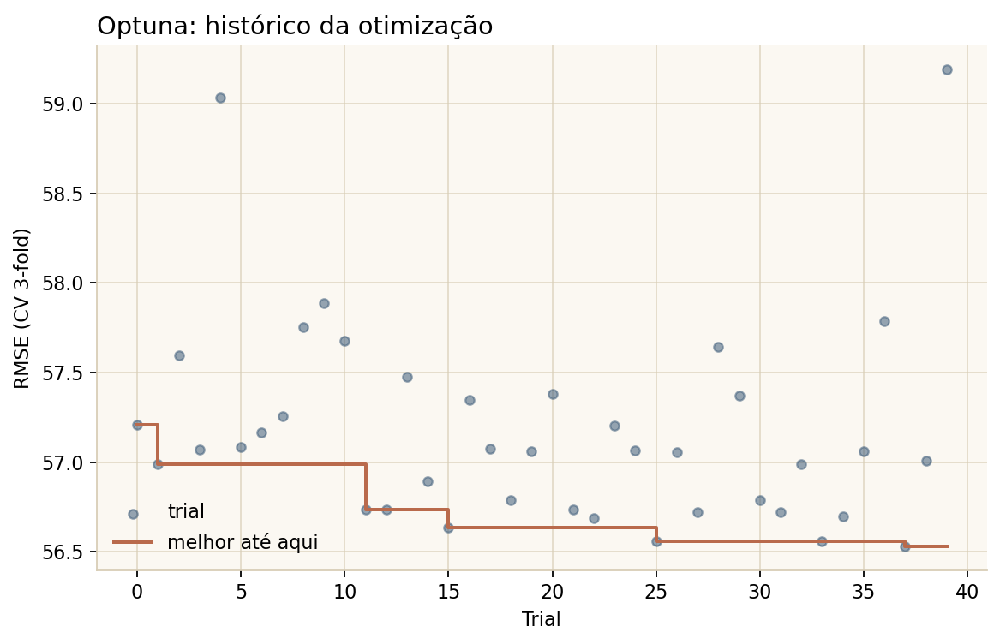
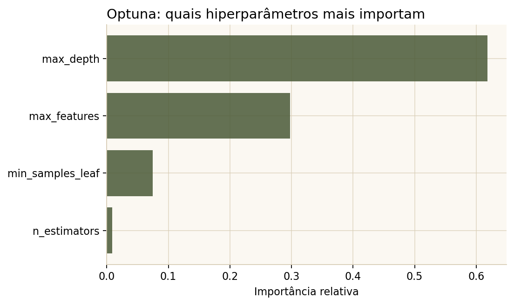

<div class="page-meta">Nível: intermediário · Tempo: 20 min · Pré-requisito: Grid e random search</div>

<div class="objetivo">
<b>Objetivo:</b> montar um estudo Optuna, definir o espaço de busca, ler o histórico, a
importância dos hiperparâmetros e usar poda sem vazar o teste.
</div>

## O que é

Optuna é um framework de otimização de hiperparâmetros. Você escreve uma função
(`objective`) que recebe um `trial`, sugere valores, treina o modelo e devolve a métrica.
O Optuna aprende com os trials anteriores e escolhe os próximos pontos de forma mais
inteligente que o random.

O estilo **define-by-run**: o espaço de busca é escrito dentro da função, com `if` e
laços se necessário. Isso permite espaços condicionais (um hiperparâmetro só existe se
outro tiver certo valor).

::: {.callout-note}
## E no R?
O Optuna é Python. No R, os equivalentes são `tidymodels`/`tune` e `mlr3tuning`; também é
possível chamar o Optuna via `reticulate`. Os conceitos (espaço, trials, poda) são os
mesmos.
:::

## A intuição do TPE

O sampler padrão é o **TPE** (Tree-structured Parzen Estimator). Em vez de modelar
`P(score | hiperparâmetros)`, ele modela `P(hiperparâmetros | score bom)` e
`P(hiperparâmetros | score ruim)`. A cada trial, ele propõe pontos que parecem vir da
distribuição dos bons, equilibrando:

- **exploração:** testar regiões ainda não visitadas;
- **explotação:** insistir perto do que já deu certo.

É por isso que o histórico do Optuna costuma melhorar mais rápido que o random.

## Anatomia de um estudo

```python
import optuna

def objetivo(trial):
    x = trial.suggest_float("x", 0.0, 1.0)
    y = trial.suggest_int("y", 1, 10, log=True)
    z = trial.suggest_categorical("z", ["a", "b", "c"])
    return avaliar(x, y, z)

estudo = optuna.create_study(
    direction="minimize",
    sampler=optuna.samplers.TPESampler(seed=42),
)
estudo.optimize(objetivo, n_trials=50)

print(estudo.best_params)
print(estudo.best_value)
```

| Peça | Papel |
|---|---|
| `trial` | uma tentativa; sorteia valores e reporta o resultado |
| `suggest_float/int/categorical` | define o espaço de busca |
| `direction="minimize"` | queremos menor RMSE (use `maximize` para R², F1 etc.) |
| `sampler` | estratégia de busca (TPE, random, CMA-ES) |
| `n_trials` | orçamento de avaliações |
| `study.best_params` | melhor configuração encontrada |
| `study.trials_dataframe()` | histórico completo, para auditar |

## Exemplo completo

O exemplo calibra um Random Forest para prever `diabetes` (RMSE, 3 folds). O espaço tem
quatro hiperparâmetros, incluindo um em escala log.

```python
import optuna
from sklearn.datasets import load_diabetes
from sklearn.ensemble import RandomForestRegressor
from sklearn.model_selection import KFold, cross_val_score

optuna.logging.set_verbosity(optuna.logging.WARNING)

X, y = load_diabetes(return_X_y=True)
cv = KFold(n_splits=3, shuffle=True, random_state=42)

def objetivo(trial):
    modelo = RandomForestRegressor(
        n_estimators=trial.suggest_int("n_estimators", 50, 200, step=50),
        max_depth=trial.suggest_int("max_depth", 2, 20),
        min_samples_leaf=trial.suggest_int("min_samples_leaf", 1, 20, log=True),
        max_features=trial.suggest_categorical(
            "max_features", ["sqrt", "log2", 0.5, 1.0]
        ),
        random_state=42,
        n_jobs=-1,
    )
    scores = cross_val_score(
        modelo, X, y, cv=cv, scoring="neg_root_mean_squared_error", n_jobs=1
    )
    return -scores.mean()

estudo = optuna.create_study(
    direction="minimize",
    sampler=optuna.samplers.TPESampler(seed=42),
)
estudo.optimize(objetivo, n_trials=40)

print("melhor:", estudo.best_params)
print("RMSE  :", round(estudo.best_value, 2))
```

**Resultado deste exemplo** (semente 42, versões atuais):

```
melhor: {'n_estimators': 200, 'max_depth': 11,
         'min_samples_leaf': 3, 'max_features': 'log2'}
RMSE  : 56.53
```

::: {.callout-warning}
## O melhor caiu na borda
`n_estimators = 200` é o **limite superior** da faixa. Isso é um aviso, não um troféu:
amplie para 300 ou 500 e rode de novo. O ótimo pode estar fora do espaço que você definiu.
:::

## Como ler o histórico

{fig-align="center" width="80%"}

- **Pontos:** RMSE de cada trial. A dispersão mostra o quanto o espaço ainda tem de
  ruim.
- **Linha em degraus:** melhor resultado acumulado. Se ela fica plana por muitos trials,
  o orçamento está saturando.
- **Trial com score muito alto:** configuração ruim, não necessariamente erro. Confira os
  parâmetros antes de descartar.

## Como ler a importância

{fig-align="center" width="78%"}

A importância responde: "se eu pudesse calibrar só um, qual mudaria mais o resultado?".
No exemplo, `max_depth` domina; `n_estimators` quase não importa **dentro da faixa
testada**. Isso orienta o próximo passo: gaste orçamento onde importa.

::: {.callout-note}
## Importância não é causalidade
A importância depende do espaço de busca e dos outros hiperparâmetros. Mudar a faixa pode
mudar o ranking. Use como bússola, não como lei.
:::

## Poda (pruning)

Poda interrompe trials ruins antes do fim. É mais útil em modelos iterativos (boosting,
redes neurais), que reportam o score por época:

```python
def objetivo(trial):
    modelo = criar_modelo(trial)
    for epoca in range(1, 100):
        score = treinar_uma_epoca(modelo, epoca)
        trial.report(score, epoca)
        if trial.should_prune():
            raise optuna.TrialPruned()
    return score

estudo = optuna.create_study(
    direction="minimize",
    pruner=optuna.pruners.MedianPruner(n_startup_trials=5, n_warmup_steps=10),
)
```

Para Random Forest, que não treina por época, a poda não se aplica do mesmo jeito.

## Erros comuns

1. Melhor valor na borda e você aceita sem ampliar a faixa.
2. Espaço log faltando em `alpha`, `min_samples_leaf`, `learning_rate`.
3. `n_trials` pequeno demais para tantos hiperparâmetros.
4. Calibrar no teste ou usar o mesmo fold para escolher e avaliar.
5. Não fixar semente e não registrar versões.
6. Comparar trials com folds diferentes.
7. Ignorar a importância e continuar calibrando o que não importa.
8. Usar poda em modelo que não reporta score intermediário.

## Exercício

Um estudo com 30 trials tem `best_params` com `max_depth = 20` (limite superior) e
`min_samples_leaf = 1` (limite inferior). O que isso indica? Qual o próximo passo?

::: {.callout-note collapse="true" title="Solução"}
Os dois melhores valores estão nas bordas: o espaço provavelmente é pequeno demais.
Amplie `max_depth` para 30–50 (ou remova o limite) e teste `min_samples_leaf` abaixo de
1 não é possível, então investigue `min_samples_split` ou mude o espaço. Rode novamente
com mais trials e confira se o novo ótimo sai da borda.
:::

## Próximo passo

[5. Boas práticas](05-boas-praticas.qmd) — CV aninhada, incerteza e o que reportar.
