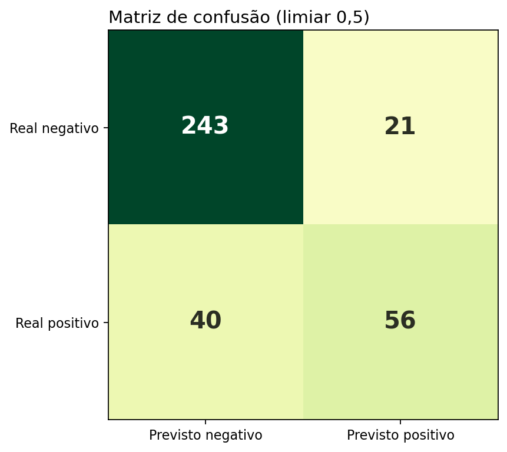

---
title: "Métricas de classificação"
---

<div class="page-meta">Nível: intermediário · Tempo: 20 min · Pré-requisito: Tipos de aprendizado</div>

<div class="objetivo">
<b>Objetivo:</b> ler a matriz de confusão e escolher entre acurácia, acurácia balanceada,
precisão, recall, F1, MCC e kappa — sem cair na armadilha do desbalanceamento.
</div>

::: {.callout-tip}
## Fórmulas comentadas
A página [Fórmulas comentadas](00-formulas-comentadas.qmd) explica cada símbolo, o que a
fórmula premia ou pune e quando ela engana.
:::

## A matriz de confusão é o começo

Toda métrica de classificação binária sai de quatro números:

| | Previsto negativo | Previsto positivo |
|---|---|---|
| **Real negativo** | TN (verdadeiro negativo) | FP (falso positivo) |
| **Real positivo** | FN (falso negativo) | TP (verdadeiro positivo) |

{fig-align="center" width="62%"}

**Leitura do exemplo:** o modelo acerta 243 negativos e 56 positivos, mas deixa passar
**40 positivos** (FN) e gera **21 alarmes falsos** (FP). Nenhuma métrica sozinha conta essa
história.

## As métricas

$$
\text{Acurácia} = \frac{TP + TN}{TP + TN + FP + FN}
$$

$$
\text{Acurácia balanceada} = \frac{1}{2}\left(\frac{TP}{TP+FN} + \frac{TN}{TN+FP}\right)
$$

$$
\text{Precisão} = \frac{TP}{TP + FP}
\qquad
\text{Recall} = \frac{TP}{TP + FN}
$$

$$
F_1 = \frac{2 \cdot \text{precisão} \cdot \text{recall}}{\text{precisão} + \text{recall}}
$$

| Métrica | Pergunta que responde | Quando usar | Cuidado |
|---|---|---|---|
| **Acurácia** | quantos acertei no total? | classes equilibradas | mente em desbalanceamento |
| **Acurácia balanceada** | acerto médio por classe | classes desbalanceadas | ainda ignora o custo do erro |
| **Precisão** | dos que previ positivo, quantos eram? | falso positivo é caro | pode ser alta prevendo pouco |
| **Recall** | dos positivos reais, quantos achei? | falso negativo é caro | pode gerar muitos FP |
| **F1** | equilíbrio entre precisão e recall | precisa dos dois | esconde o custo real |
| **MCC** | correlação entre real e previsto | visão única e robusta | menos intuitivo |
| **Kappa** | acerto acima do acaso | concordância corrigida | sensível à prevalência |

## O exemplo, número por número

Com TN = 243, FP = 21, FN = 40, TP = 56:

| Métrica | Conta | Valor |
|---|---|---|
| Acurácia | (243 + 56) / 360 | **0,831** |
| Acurácia balanceada | (243/264 + 56/96) / 2 | **0,752** |
| Precisão | 56 / (56 + 21) | **0,727** |
| Recall | 56 / (56 + 40) | **0,583** |
| Especificidade | 243 / (243 + 21) | **0,920** |
| F1 | 2 × 0,727 × 0,583 / (0,727 + 0,583) | **0,647** |

::: {.callout-warning}
## A armadilha da acurácia
A acurácia é 0,831, mas o recall é 0,583: o modelo **deixa passar 40 de 96 positivos**.
Se o positivo for fogo, doença ou fraude, 0,83 não é bom o suficiente. A acurácia parece
boa porque a classe negativa é maioria (73%).
:::

## Desbalanceamento

Com 95% de negativos, um modelo que prevê sempre "negativo" acerta 95%. A acurácia
celebra; o recall é zero. O que fazer:

- Reporte **matriz de confusão**, precisão, recall, F1 e PR-AUC.
- Use **acurácia balanceada**.
- Considere `class_weight="balanced"`, reamostragem ou ajuste de limiar.
- Nunca reporte acurácia sozinha em classe desbalanceada.

## Multiclasse

| Média | O que faz | Quando usar |
|---|---|---|
| **Macro** | média das métricas por classe | todas as classes importam igual |
| **Micro** | soma TP/FP/FN global | cada observação importa igual |
| **Weighted** | média ponderada pelo suporte | classes com tamanhos diferentes |

Em multiclasse desbalanceada, `macro` costuma ser mais honesta que `weighted`.

## Código

::: {.panel-tabset}
## Python

```python
import numpy as np
from sklearn.datasets import make_classification
from sklearn.linear_model import LogisticRegression
from sklearn.metrics import (
    accuracy_score, balanced_accuracy_score, classification_report,
    cohen_kappa_score, confusion_matrix, f1_score, matthews_corrcoef,
    precision_score, recall_score,
)
from sklearn.model_selection import train_test_split
from sklearn.pipeline import make_pipeline
from sklearn.preprocessing import StandardScaler

X, y = make_classification(
    n_samples=1200, n_features=12, n_informative=6, n_redundant=3,
    class_sep=1.3, flip_y=0.05, weights=[0.75, 0.25], random_state=42,
)
X_tr, X_te, y_tr, y_te = train_test_split(
    X, y, test_size=0.3, stratify=y, random_state=42
)

modelo = make_pipeline(
    StandardScaler(),
    LogisticRegression(max_iter=5000, random_state=42),
).fit(X_tr, y_tr)

pred = modelo.predict(X_te)

print(confusion_matrix(y_te, pred))
print("acurácia          :", round(accuracy_score(y_te, pred), 3))
print("acurácia balanceada:", round(balanced_accuracy_score(y_te, pred), 3))
print("precisão          :", round(precision_score(y_te, pred), 3))
print("recall            :", round(recall_score(y_te, pred), 3))
print("F1                :", round(f1_score(y_te, pred), 3))
print("MCC               :", round(matthews_corrcoef(y_te, pred), 3))
print("kappa             :", round(cohen_kappa_score(y_te, pred), 3))
print(classification_report(y_te, pred, target_names=["negativo", "positivo"]))
```

## R

```r
library(MASS)

dados <- birthwt
dados$race <- factor(dados$race)
dados$smoke <- factor(dados$smoke)

set.seed(42)
idx <- sample(nrow(dados), floor(0.7 * nrow(dados)))
treino <- dados[idx, ]
teste  <- dados[-idx, ]

modelo <- glm(low ~ age + lwt + smoke + race + ptl + ht + ui,
              data = treino, family = binomial)
prob <- predict(modelo, teste, type = "response")
pred <- ifelse(prob >= 0.5, 1, 0)

tab <- table(real = teste$low, previsto = pred)
print(tab)

tp <- tab["1", "1"]; tn <- tab["0", "0"]
fp <- tab["0", "1"]; fn <- tab["1", "0"]

acuracia <- (tp + tn) / sum(tab)
precisao <- tp / (tp + fp)
recall   <- tp / (tp + fn)
especificidade <- tn / (tn + fp)
f1 <- 2 * precisao * recall / (precisao + recall)

po <- acuracia
pe <- sum(rowSums(tab) * colSums(tab)) / sum(tab)^2
kappa <- (po - pe) / (1 - pe)

cat("acurácia          :", round(acuracia, 3), "\n")
cat("acurácia balanceada:", round((recall + especificidade) / 2, 3), "\n")
cat("precisão          :", round(precisao, 3), "\n")
cat("recall            :", round(recall, 3), "\n")
cat("F1                :", round(f1, 3), "\n")
cat("kappa             :", round(kappa, 3), "\n")
```
:::

::: {.callout-note}
## A aba R usa outro conjunto
O exemplo R usa `MASS::birthwt`; os números não precisam coincidir com o exemplo Python.
O objetivo é mostrar o cálculo das métricas.
:::

## Erros comuns

1. Reportar acurácia em classe desbalanceada.
2. Escolher a métrica depois de ver o resultado.
3. Otimizar F1 quando o custo real é assimétrico (um FN custa 100 vezes um FP).
4. Comparar F1 entre datasets com prevalências diferentes.
5. Ignorar a matriz de confusão e discutir só o número final.
6. Usar `predict` (classe) quando você precisa da probabilidade.
7. Não definir o limiar: o padrão 0,5 raramente é o melhor.

## Exercício

Com a matriz do exemplo (TN=243, FP=21, FN=40, TP=56), calcule acurácia, recall,
especificidade e F1. Para um teste de triagem em que deixar passar um positivo é muito
caro, qual métrica você prioriza? E para um teste confirmatório?

::: {.callout-note collapse="true" title="Solução"}
Acurácia = 0,831; recall = 0,583; especificidade = 0,920; F1 = 0,647.

Triagem: priorize **recall** (reduzir FN), aceitando mais FP. Confirmatório: priorize
**precisão** (reduzir FP), aceitando mais FN. O limiar deve ser escolhido com o custo do
erro, não com 0,5 por hábito.
:::

## Próximo passo

[ROC, PR e calibração](03-roc-pr-calibracao.qmd) — o que a acurácia e o F1 não mostram.

