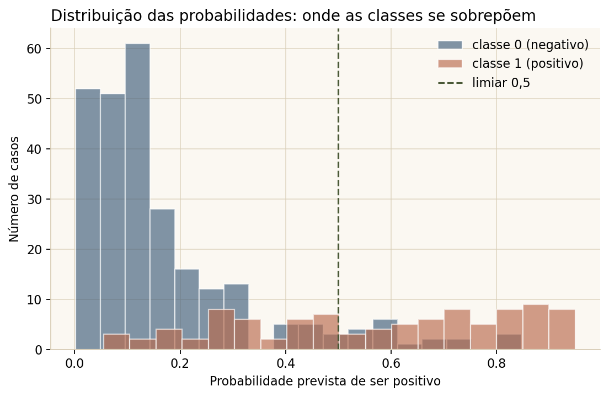
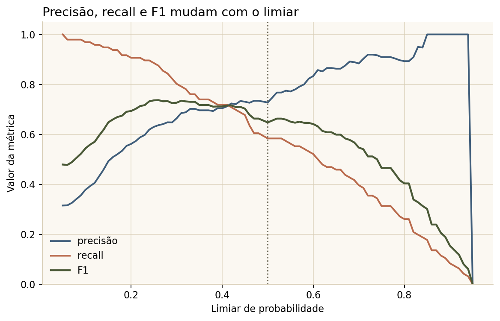
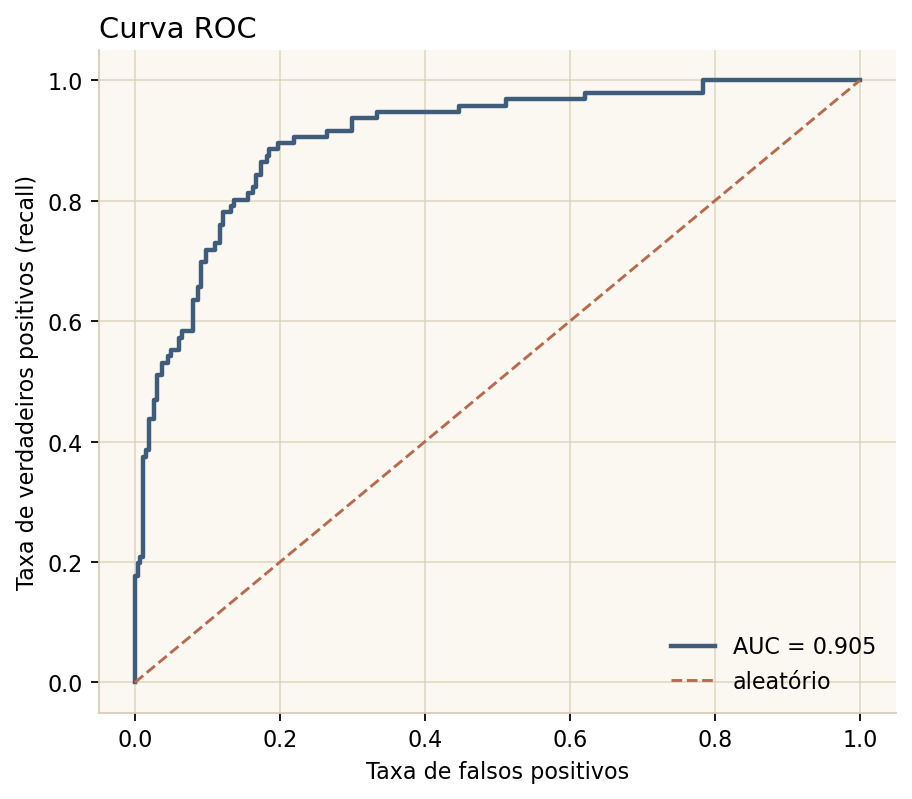
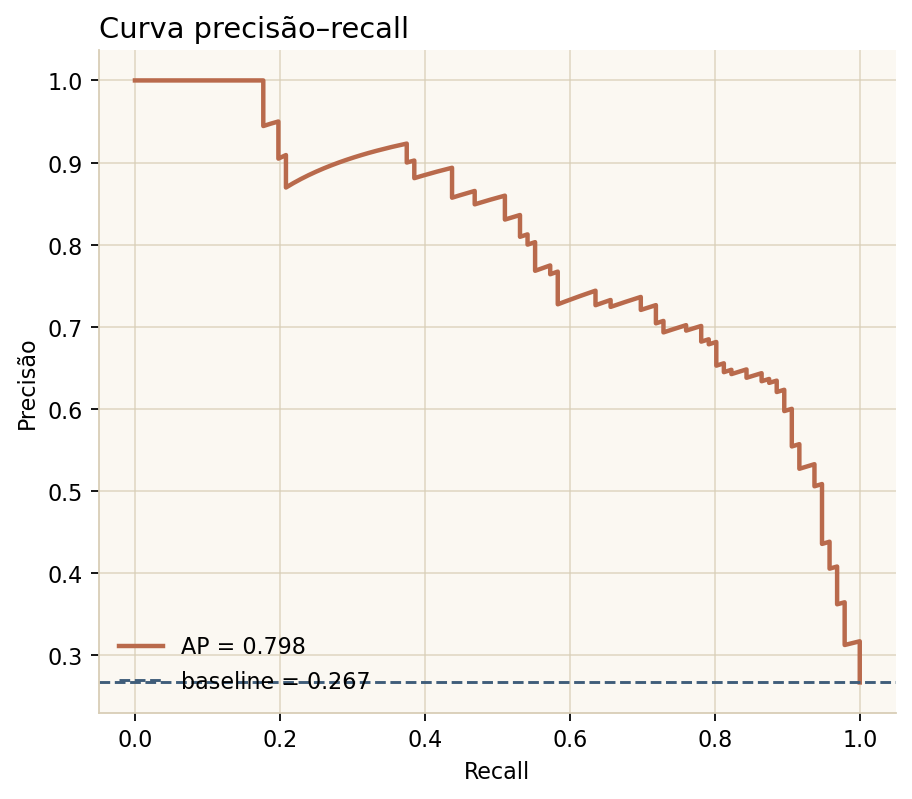
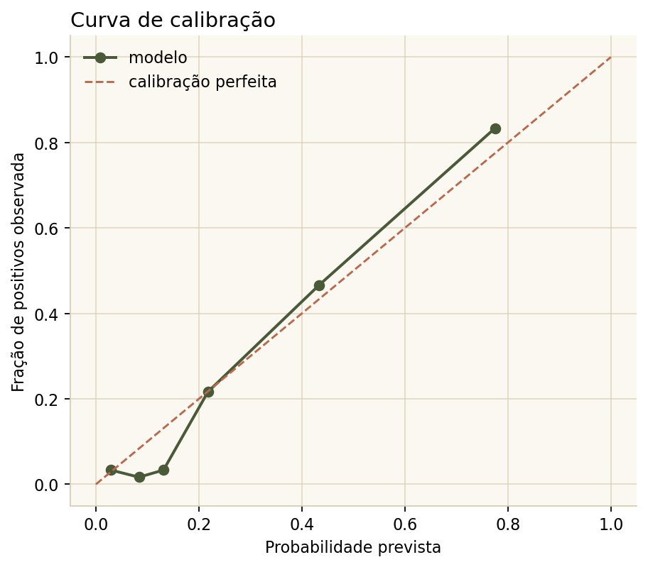
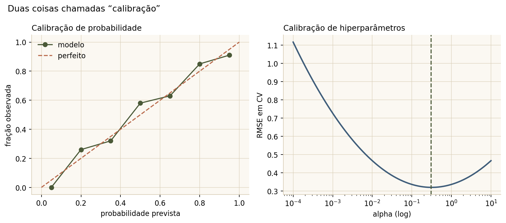

---
title: "ROC, PR e calibração"
---

<div class="page-meta">Nível: avançado · Tempo: 18 min · Pré-requisito: Métricas de classificação</div>

<div class="objetivo">
<b>Objetivo:</b> interpretar curvas ROC e precisão–recall, escolher o limiar pelo custo do
erro e distinguir discriminação de calibração de probabilidade.
</div>

## O limiar 0,5 é um hábito, não uma decisão

Um classificador devolve **probabilidade**. A classe só aparece depois que você escolhe um
limiar. O padrão 0,5 raramente é o melhor: ele só é ótimo se os dois erros custarem igual
e as classes forem equilibradas.

{fig-align="center" width="80%"}

**Leitura:** quanto mais as duas distribuições se sobrepõem, mais o limiar importa. Baixar
o limiar aumenta o recall e os falsos positivos; subir faz o contrário.

## O trade-off do limiar

{fig-align="center" width="82%"}

| Limiar | Acurácia | Precisão | Recall | F1 |
|---|---|---|---|---|
| 0,30 | 0,839 | 0,664 | 0,802 | 0,726 |
| 0,40 | 0,844 | 0,704 | 0,719 | 0,711 |
| **0,50** | **0,831** | **0,727** | **0,583** | **0,647** |
| 0,60 | 0,844 | 0,833 | 0,521 | 0,641 |

**Leitura:** o F1 máximo não está em 0,5; está perto de 0,26. A acurácia também não é
máxima em 0,5. O limiar é uma **decisão de negócio**, não um detalhe técnico.

### Escolhendo pelo custo

Se um falso negativo custa 10 vezes mais que um falso positivo, o limiar ótimo cai para
~0,17. Nesse ponto, o custo total cai de **421** (em 0,5) para **143**:

| Limiar | FN | FP | Custo (10×FN + 1×FP) |
|---|---|---|---|
| 0,50 | 40 | 21 | 421 |
| 0,17 | 6 | 83 | **143** |

O modelo não mudou. A decisão mudou.

## Curva ROC

{fig-align="center" width="62%"}

- **Eixo x:** taxa de falsos positivos (1 − especificidade).
- **Eixo y:** taxa de verdadeiros positivos (recall).
- **AUC:** área sob a curva; 0,5 = aleatório, 1,0 = perfeito.
- **AUC = 0,905** no exemplo: boa separação global.

**Limitação:** a ROC não vê a prevalência. Em classes muito desbalanceadas, uma AUC alta
pode esconder precisão ruim. Aí entra a curva PR.

## Curva precisão–recall

{fig-align="center" width="62%"}

- **Eixo x:** recall.
- **Eixo y:** precisão.
- **Baseline:** a prevalência (0,267 no exemplo). Uma AP de 0,798 é bem acima do acaso.
- **AP (average precision):** área sob a curva PR; mais informativa que a AUC quando a
  classe positiva é rara.

| Situação | Prefira |
|---|---|
| Classes equilibradas, custo simétrico | ROC-AUC |
| Classe positiva rara | PR-AUC / AP |
| Você precisa comparar modelos na mesma prevalência | ROC-AUC |
| Você precisa comunicar o custo de alarmes falsos | PR |

## Log loss e Brier

Duas métricas avaliam a **probabilidade**, não a classe:

$$
\text{Log loss} = -\frac{1}{n}\sum \left[y_i\log(p_i) + (1-y_i)\log(1-p_i)\right]
$$

$$
\text{Brier} = \frac{1}{n}\sum (p_i - y_i)^2
$$

- **Log loss** pune confiança errada com força. Prever 0,99 para a classe errada custa
  muito.
- **Brier** é o erro quadrático médio da probabilidade; mais intuitivo.
- No exemplo: log loss **0,346** e Brier **0,107**.

## Calibração de probabilidade

{fig-align="center" width="62%"}

**O que a figura mostra:** quando o modelo diz "0,4", cerca de 40% dos casos deveriam ser
positivos. A diagonal é a calibração perfeita. Pontos acima da diagonal indicam
subconfiança; abaixo, superconfiança.

::: {.callout-warning}
## Calibração ≠ tuning
**Calibração de probabilidade** ajusta as probabilidades para que elas signifiquem
frequências (Platt, isotônica). **Calibração de hiperparâmetros** é a busca da Parte III.
São coisas diferentes com o mesmo nome.
:::

**Discriminação** (ROC/PR) pergunta: o modelo ordena bem os casos? **Calibração** pergunta:
o número 0,8 significa 80%? Um modelo pode discriminar bem e ser mal calibrado.

{fig-align="center" width="92%"}

## Multiclasse

- ROC/PR são binárias. Para multiclasse, use **one-vs-rest** (uma curva por classe) ou
  **one-vs-one**.
- Reporte `macro` e `micro`; elas contam histórias diferentes.
- A curva de calibração multiclasse é mais complexa; comece pela matriz de confusão e pelo
  log loss.

## Código

::: {.panel-tabset}
## Python

```python
import numpy as np
from sklearn.calibration import calibration_curve
from sklearn.datasets import make_classification
from sklearn.linear_model import LogisticRegression
from sklearn.metrics import (
    average_precision_score, brier_score_loss, log_loss,
    precision_recall_curve, roc_auc_score, roc_curve,
)
from sklearn.model_selection import train_test_split
from sklearn.pipeline import make_pipeline
from sklearn.preprocessing import StandardScaler

X, y = make_classification(
    n_samples=1200, n_features=12, n_informative=6, n_redundant=3,
    class_sep=1.3, flip_y=0.05, weights=[0.75, 0.25], random_state=42,
)
X_tr, X_te, y_tr, y_te = train_test_split(
    X, y, test_size=0.3, stratify=y, random_state=42
)
modelo = make_pipeline(
    StandardScaler(),
    LogisticRegression(max_iter=5000, random_state=42),
).fit(X_tr, y_tr)
prob = modelo.predict_proba(X_te)[:, 1]

fpr, tpr, limiares_roc = roc_curve(y_te, prob)
prec, rec, limiares_pr = precision_recall_curve(y_te, prob)

print("ROC-AUC :", round(roc_auc_score(y_te, prob), 3))
print("PR-AUC  :", round(average_precision_score(y_te, prob), 3))
print("Log loss:", round(log_loss(y_te, prob), 3))
print("Brier   :", round(brier_score_loss(y_te, prob), 3))

f1 = 2 * prec[:-1] * rec[:-1] / (prec[:-1] + rec[:-1])
i = np.argmax(f1)
print("melhor F1:", round(f1[i], 3), "no limiar", round(limiares_pr[i], 3))

frac, media = calibration_curve(y_te, prob, n_bins=6, strategy="quantile")
for m, f in zip(media, frac):
    print(f"previsto {m:.2f} -> observado {f:.2f}")
```

## R

```r
library(MASS)

dados <- birthwt
dados$race <- factor(dados$race)
dados$smoke <- factor(dados$smoke)

set.seed(42)
idx <- sample(nrow(dados), floor(0.7 * nrow(dados)))
treino <- dados[idx, ]
teste  <- dados[-idx, ]

modelo <- glm(low ~ age + lwt + smoke + race + ptl + ht + ui,
              data = treino, family = binomial)
prob <- predict(modelo, teste, type = "response")

roc_base <- function(y, p) {
  limiares <- sort(unique(c(0, p, 1)), decreasing = TRUE)
  tpr <- fpr <- numeric(length(limiares))
  for (i in seq_along(limiares)) {
    pred <- ifelse(p >= limiares[i], 1, 0)
    tp <- sum(pred == 1 & y == 1); fp <- sum(pred == 1 & y == 0)
    fn <- sum(pred == 0 & y == 1); tn <- sum(pred == 0 & y == 0)
    tpr[i] <- tp / (tp + fn)
    fpr[i] <- fp / (fp + tn)
  }
  data.frame(limiar = limiares, tpr = tpr, fpr = fpr)
}

pr_base <- function(y, p) {
  limiares <- sort(unique(c(0, p, 1)), decreasing = TRUE)
  precisao <- recall <- numeric(length(limiares))
  for (i in seq_along(limiares)) {
    pred <- ifelse(p >= limiares[i], 1, 0)
    tp <- sum(pred == 1 & y == 1); fp <- sum(pred == 1 & y == 0)
    fn <- sum(pred == 0 & y == 1)
    precisao[i] <- ifelse(tp + fp == 0, 1, tp / (tp + fp))
    recall[i] <- tp / (tp + fn)
  }
  data.frame(limiar = limiares, precisao = precisao, recall = recall)
}

roc <- roc_base(teste$low, prob)
roc <- roc[order(roc$fpr), ]
auc <- sum(diff(roc$fpr) * (head(roc$tpr, -1) + tail(roc$tpr, -1)) / 2)

pr <- pr_base(teste$low, prob)
pr <- pr[order(pr$recall), ]
ap <- sum(diff(c(0, pr$recall)) * pr$precisao)

logloss <- -mean(teste$low * log(prob) + (1 - teste$low) * log(1 - prob))
brier <- mean((prob - teste$low)^2)

cat("ROC-AUC :", round(auc, 3), "\n")
cat("PR-AUC  :", round(ap, 3), "\n")
cat("Log loss:", round(logloss, 3), "\n")
cat("Brier   :", round(brier, 3), "\n")

cortes <- quantile(prob, probs = seq(0, 1, length.out = 7))
bins <- cut(prob, breaks = cortes, include.lowest = TRUE)
cal <- aggregate(
  cbind(prob, low) ~ bins,
  data = data.frame(prob = prob, low = teste$low, bins = bins),
  FUN = mean
)
print(cal)
```
:::

::: {.callout-note}
## A aba R usa outro conjunto
O exemplo R usa `MASS::birthwt`; os números não precisam coincidir com o exemplo Python.
O objetivo é mostrar o cálculo de AUC, AP, log loss, Brier e calibração.
:::

## Erros comuns

1. Escolher o limiar por hábito (0,5) sem olhar o custo.
2. Comparar ROC-AUC entre datasets com prevalências diferentes.
3. Usar acurácia ou AUC e ignorar a calibração quando a probabilidade será usada.
4. Reportar log loss sem explicar que ele pune confiança errada.
5. Ajustar o limiar no teste.
6. Usar PR-AUC e ROC-AUC como se fossem a mesma coisa.
7. Confundir calibração de probabilidade com tuning de hiperparâmetros.

## Exercício

Um modelo tem AUC = 0,95 e Brier = 0,30. O que pode estar acontecendo? O modelo é bom?

::: {.callout-note collapse="true" title="Solução"}
AUC alta indica boa **discriminação** (ordena bem), mas Brier alto indica **calibração
ruim**: as probabilidades não correspondem às frequências. O modelo pode separar as
classes e ainda assim dizer 0,9 quando a frequência real é 0,6. Se a decisão usa a
probabilidade (não só a ordem), isso importa. Corrija com calibração (Platt/isotônica) ou
reveja o modelo.
:::

## Próximo passo

A Parte V começa com [previsto vs observado](../05-interpretacao/01-ajuste-regressao.qmd).
Na sequência, entram os diagnósticos de resíduos e as figuras de classificação.

