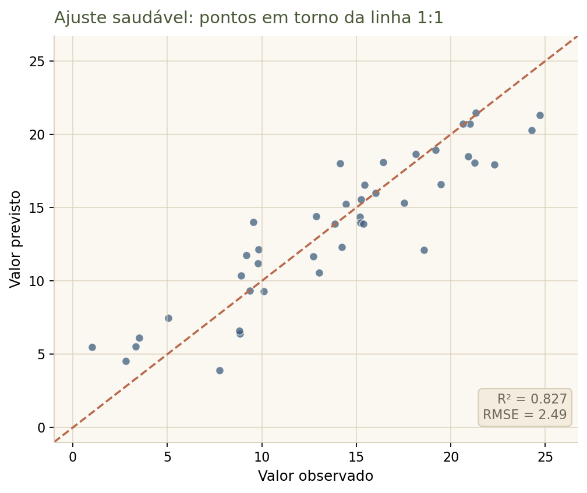
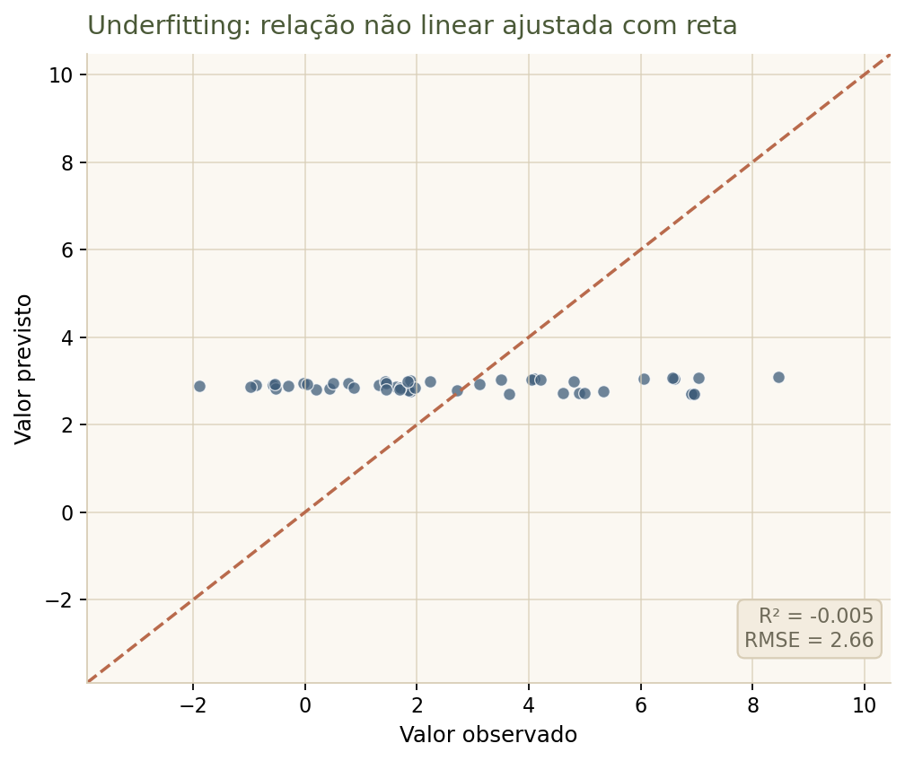
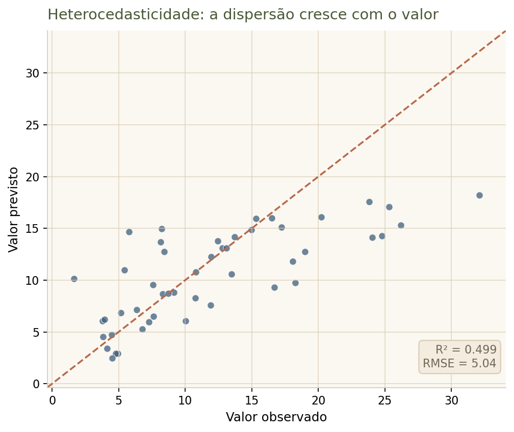
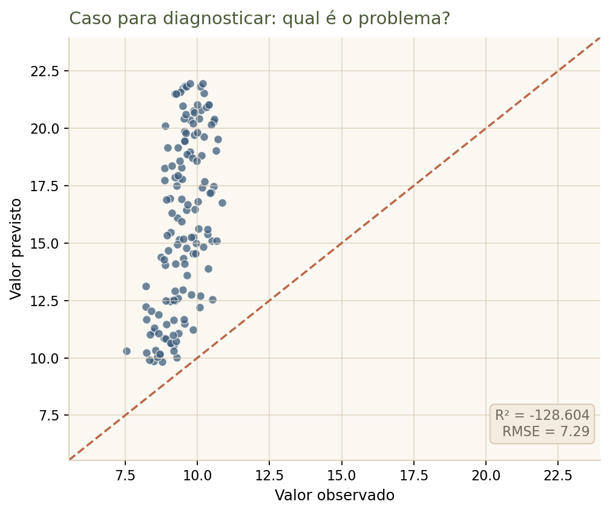

<div class="page-meta">Nível: intermediário · Tempo: 15 min · Pré-requisito: Métricas de regressão</div>

<div class="objetivo">
<b>Objetivo:</b> diagnosticar um modelo de regressão lendo o gráfico de previsto vs
observado: identificar viés, curvatura, heterocedasticidade e extrapolação.
</div>

## Por que este é o gráfico mais importante

O R² resume o ajuste em um número. O gráfico de **previsto vs observado** mostra **onde** o
modelo erra. Um modelo pode ter R² alto e errar sistematicamente em uma faixa; o gráfico
denuncia o que a métrica esconde.

Cada ponto é uma observação:

- eixo x: valor **observado** (`y`);
- eixo y: valor **previsto** (`ŷ`);
- linha tracejada: a linha **1:1** (`ŷ = y`).

Se o modelo fosse perfeito, todos os pontos estariam sobre a linha. Na prática, o que
importa é o **padrão** da nuvem, não a distância de um ponto isolado.

## O que olhar (checklist)

- [ ] A nuvem está centrada na linha 1:1?
- [ ] A dispersão é parecida ao longo de toda a faixa?
- [ ] Existe curvatura (pontos acima no meio, abaixo nos extremos, ou vice-versa)?
- [ ] Existe formato de leque (dispersão cresce com o valor)?
- [ ] Há pontos sistematicamente de um lado da linha?
- [ ] Há grupos separados (dois aglomerados)?
- [ ] A faixa de previsão cobre a faixa observada?
- [ ] O R² é compatível com o que o gráfico mostra?

## Semáforo

| Sinal | Significado | Ação |
|---|---|---|
| <span style="color:#3f6b32">**Verde**</span> | nuvem simétrica em torno da 1:1, dispersão constante, sem padrão | modelo adequado; siga para resíduos |
| <span style="color:#a8761f">**Amarelo**</span> | leve curvatura, dispersão crescendo, poucos pontos extremos | investigar transformação ou modelo não linear |
| <span style="color:#a33b2b">**Vermelho**</span> | pontos sistematicamente de um lado, R² negativo, leque forte, grupos | modelo mal especificado; não reporte como bom |

## Caso 1 — ajuste saudável

{fig-align="center" width="72%"}

**O que está acontecendo:** a nuvem acompanha a linha 1:1, sem curvatura e sem mudança
brusca de dispersão. O R² é alto, mas o mais importante é a ausência de padrão.

**Diagnóstico:** verde. O modelo capturou a tendência principal. Ainda falta olhar os
resíduos para confirmar homocedasticidade e normalidade.

## Caso 2 — underfitting (curvatura)

{fig-align="center" width="72%"}

**O que está acontecendo:** a relação verdadeira é uma curva, mas o modelo é uma reta. As
previsões ficam quase constantes enquanto o observado varia. O R² é praticamente zero (ou
negativo).

**Diagnóstico:** vermelho. É underfitting por modelo errado, não por falta de dado.

**O que fazer:** adicionar termo quadrático, usar spline, árvore ou outro modelo não linear.
Antes disso, olhar o gráfico de `y` vs `x` para confirmar a forma.

## Caso 3 — heterocedasticidade

{fig-align="center" width="72%"}

**O que está acontecendo:** o erro médio pode até ser pequeno, mas a **variância** cresce
com o valor. O modelo é menos confiável nos valores altos.

**Diagnóstico:** amarelo a vermelho, dependendo do uso. Para previsão pontual, o RMSE global
esconde que os erros grandes estão todos na cauda.

**O que fazer:** transformar o alvo (log), usar modelo que modela a variância, ponderar
observações ou reportar a incerteza por faixa.

## Caso 4 — viés por extrapolação (exercício)

{fig-align="center" width="72%"}

**Pergunta:** o modelo foi treinado apenas com observações de baixo valor e aplicado a
valores altos. Qual é o diagnóstico e o que fazer?

::: {.callout-note collapse="true" title="Solução"}
O modelo está **extrapolando**: aprendeu a tendência na faixa baixa e foi aplicado fora
dela. As previsões ficam sistematicamente acima do observado e o R² fica muito negativo.
Correção: treinar com dados que cubram a faixa de aplicação, restringir a previsão ao
domínio observado ou usar um modelo que respeite a forma da relação (por exemplo, saturação).
:::

## O que fazer se...

| Sintoma | Causa provável | Correção |
|---|---|---|
| Curvatura | relação não linear | termo polinomial, spline, modelo não linear |
| Leque | heterocedasticidade | transformação do alvo, modelo de variância |
| Pontos de um lado só | viés/extrapolação | revisar faixa, variável omitida, intercepto |
| Dois aglomerados | grupo omitido | incluir categórica ou modelar por grupo |
| R² negativo | modelo pior que a média | revisar split, vazamento, métrica e modelo |
| Pontos extremos isolados | outliers | investigar antes de remover; considerar modelo robusto |

::: {.callout-warning}
## R² negativo é possível
Fora da amostra, o R² pode ser negativo. Isso significa que o modelo erra mais que prever
sempre a média. Não é bug: é diagnóstico.
:::

## Como reproduzir as figuras

::: {.panel-tabset}
## Python

```python
import numpy as np
import matplotlib.pyplot as plt
from sklearn.linear_model import LinearRegression
from sklearn.model_selection import train_test_split
from sklearn.metrics import r2_score, mean_squared_error

rng = np.random.default_rng(42)
x = rng.uniform(0, 10, 140)
y = 4 + 1.8 * x + rng.normal(0, 2.2, x.size)

X_tr, X_te, y_tr, y_te = train_test_split(
    x.reshape(-1, 1), y, test_size=0.3, random_state=42
)
modelo = LinearRegression().fit(X_tr, y_tr)
pred = modelo.predict(X_te)

plt.figure(figsize=(6, 5))
plt.scatter(y_te, pred, alpha=0.75, edgecolor="white")
lim = [min(y_te.min(), pred.min()), max(y_te.max(), pred.max())]
plt.plot(lim, lim, "--", color="#b96a4c")
plt.xlabel("Valor observado")
plt.ylabel("Valor previsto")
plt.title(f"R² = {r2_score(y_te, pred):.3f} | "
          f"RMSE = {mean_squared_error(y_te, pred) ** 0.5:.2f}")
plt.show()
```

## R

```r
set.seed(42)
x <- runif(140, 0, 10)
y <- 4 + 1.8 * x + rnorm(140, 0, 2.2)
dados <- data.frame(x, y)

idx <- sample(nrow(dados), floor(0.7 * nrow(dados)))
treino <- dados[idx, ]
teste  <- dados[-idx, ]

modelo <- lm(y ~ x, data = treino)
teste$pred <- predict(modelo, teste)

library(ggplot2)
ggplot(teste, aes(x = y, y = pred)) +
  geom_point(color = "#3f5d7a", alpha = 0.75) +
  geom_abline(slope = 1, intercept = 0, color = "#b96a4c", linetype = "dashed") +
  labs(x = "Valor observado", y = "Valor previsto") +
  coord_equal() +
  theme_minimal()
```
:::

## Próximo passo

O próximo diagnóstico é o dos **resíduos** (em construção na Fase 3). Enquanto isso,
revise as [métricas de regressão](../04-avaliacao/01-regressao.qmd) e a
[ficha da regressão linear](../02-modelos/02-regressao-linear.qmd).

