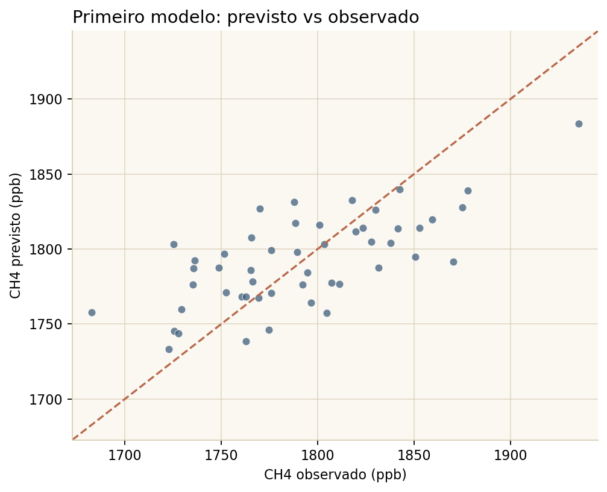

<div class="page-meta">Nível: iniciante · Tempo: 30 min · Pré-requisito: Fundamentos 1–4</div>

<div class="objetivo">
<b>Objetivo:</b> rodar o ciclo completo — pergunta, dados, split, baseline, modelo, métrica
e diagnóstico — em um único exemplo.
</div>

## A pergunta

> "Consigo prever a concentração de CH4 (ppb) a partir da temperatura e do vento?"

Essa pergunta tem alvo contínuo, então é **regressão**. O modelo é uma primeira aproximação,
não a resposta final.

## Os dados

`data/exemplo_ch4.csv` tem 200 linhas e cinco colunas:

| Coluna | Unidade | Papel |
|---|---|---|
| `temperatura` | °C | feature |
| `umidade` | % | feature (não usada neste primeiro modelo) |
| `vento` | m/s | feature |
| `pressao` | hPa | feature (não usada neste primeiro modelo) |
| `ch4` | ppb | alvo |

## O contrato dos 10 passos

1. Escrever a pergunta.
2. Carregar e inspecionar os dados.
3. Fazer uma análise exploratória mínima.
4. Separar treino e teste.
5. Calcular o baseline.
6. Treinar o modelo.
7. Avaliar no teste.
8. Olhar o gráfico de previsto vs observado.
9. Interpretar os coeficientes.
10. Escrever o que o modelo **não** faz.

## Código

::: {.panel-tabset}
## Python

```python
import pandas as pd
from sklearn.linear_model import LinearRegression
from sklearn.metrics import mean_absolute_error, mean_squared_error
from sklearn.model_selection import train_test_split

dados = pd.read_csv("data/exemplo_ch4.csv")
print(dados.shape)
print(dados.head())
print(dados.isna().sum())
print(dados.describe().round(2))

X = dados[["temperatura", "vento"]]
y = dados["ch4"]

X_tr, X_te, y_tr, y_te = train_test_split(
    X, y, test_size=0.25, random_state=42
)

# baseline: prever sempre a média do treino
baseline = y_tr.mean()
rmse_base = ((y_te - baseline) ** 2).mean() ** 0.5

modelo = LinearRegression().fit(X_tr, y_tr)
pred = modelo.predict(X_te)

rmse = ((y_te - pred) ** 2).mean() ** 0.5
mae = (y_te - pred).abs().mean()
r2 = 1 - ((y_te - pred) ** 2).sum() / ((y_te - y_te.mean()) ** 2).sum()

print("intercepto:", round(modelo.intercept_, 2))
print("coeficientes:", dict(zip(X.columns, modelo.coef_.round(2))))
print("RMSE baseline:", round(rmse_base, 2))
print("RMSE modelo  :", round(rmse, 2))
print("MAE          :", round(mae, 2))
print("R²           :", round(r2, 3))
```

## R

```r
dados <- read.csv("data/exemplo_ch4.csv")
str(dados)
summary(dados)

set.seed(42)
idx <- sample(nrow(dados), floor(0.75 * nrow(dados)))
treino <- dados[idx, ]
teste  <- dados[-idx, ]

baseline <- mean(treino$ch4)
rmse_base <- sqrt(mean((teste$ch4 - baseline)^2))

modelo <- lm(ch4 ~ temperatura + vento, data = treino)
pred <- predict(modelo, teste)

rmse <- sqrt(mean((teste$ch4 - pred)^2))
mae <- mean(abs(teste$ch4 - pred))
r2 <- 1 - sum((teste$ch4 - pred)^2) / sum((teste$ch4 - mean(teste$ch4))^2)

cat("intercepto:", round(coef(modelo)[1], 2), "\n")
print(round(coef(modelo), 2))
cat("RMSE baseline:", round(rmse_base, 2), "\n")
cat("RMSE modelo  :", round(rmse, 2), "\n")
cat("MAE          :", round(mae, 2), "\n")
cat("R²           :", round(r2, 3), "\n")
```
:::

::: {.callout-note}
## Os números não precisam bater entre Python e R
As duas abas usam splits aleatórios diferentes. O que precisa bater é a **história**:
baseline pior, modelo melhor, resíduos com padrão. Se os números divergirem muito, algo
está errado.
:::

## O diagnóstico

{fig-align="center" width="68%"}

**Leitura:** o modelo captura a tendência (R² ≈ 0,47), mas a dispersão é grande. Ainda
faltam variáveis (umidade, pressão) e talvez um termo não linear. Este é o **primeiro**
modelo, não o final.

## O que os coeficientes dizem

Com temperatura e vento:

- **Temperatura:** +1 °C associa-se a ~+7 ppb de CH4, mantendo o vento constante.
- **Vento:** +1 m/s associa-se a ~-19 ppb, mantendo a temperatura constante.
- **Intercepto:** valor previsto quando temperatura = 0 e vento = 0 — fora da faixa
  observada, então não interprete como realidade.

::: {.callout-warning}
## Não extrapole
O intercepto é uma extrapolação física. Ele ajuda a equação, não a explicação. Interprete
coeficientes dentro da faixa dos dados.
:::

## O que este modelo NÃO faz

- Não usa umidade nem pressão.
- Não testa não linearidade.
- Não usa validação cruzada.
- Não compara modelos.
- Não mede incerteza.

O [projeto de regressão](02-regressao.qmd) faz isso.

## Exercício

Rode o modelo sem `vento`. O RMSE piora? O que isso diz sobre a importância do vento?
Depois, adicione `umidade` e veja o efeito.

::: {.callout-note collapse="true" title="Solução"}
Sem `vento`, o RMSE deve piorar de forma visível: o vento tem coeficiente grande e ajuda a
explicar a variabilidade. Adicionar `umidade` também melhora, porque ela tem relação
negativa com o CH4. O ganho de cada variável deve ser comparado com a incerteza, não só
com o número.
:::

## Relatório mínimo

```text
Pergunta: prever CH4 a partir de temperatura e vento.
Dados: 200 linhas; 25% no teste; sem missing.
Baseline: RMSE = ...
Modelo: regressão linear; RMSE = ...; MAE = ...; R² = ...
Diagnóstico: dispersão alta; faltam variáveis.
Limitação: sem CV, sem não linearidade, sem incerteza.
Próximo passo: projeto de regressão completo.
```

## Próximo passo

[Projeto de regressão](02-regressao.qmd) — baseline, CV, resíduos e decisão de complexidade.
