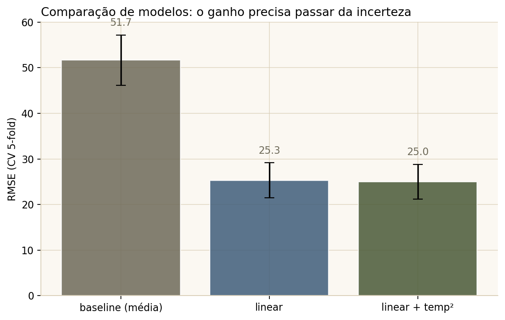
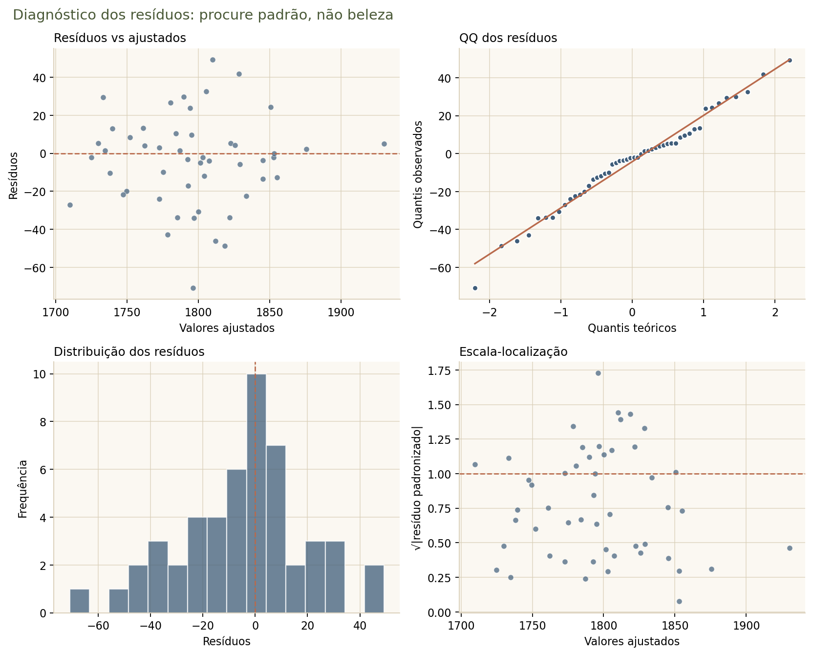

<div class="page-meta">Nível: intermediário · Tempo: 35 min · Pré-requisito: Primeiro modelo + Calibração</div>

<div class="objetivo">
<b>Objetivo:</b> conduzir uma regressão completa — EDA, baseline, CV, resíduos, teste de
complexidade e decisão final — sem transformar o resultado em overclaim.
</div>

## A pergunta

> "Quanto a temperatura, a umidade, o vento e a pressão explicam do CH4, e o modelo linear
> é suficiente?"

O objetivo é **prever** e **entender** a direção das associações, não provar causalidade.

## Os dados

`data/exemplo_ch4.csv` (200 linhas):

| Coluna | Unidade | Papel |
|---|---|---|
| `temperatura` | °C | feature |
| `umidade` | % | feature |
| `vento` | m/s | feature |
| `pressao` | hPa | feature |
| `ch4` | ppb | alvo |

## Passo 1 — EDA mínima

- 200 linhas, sem missing.
- `ch4` varia em uma faixa fisicamente plausível (~1.700–1.950 ppb).
- Correlação esperada: positiva com temperatura e pressão; negativa com umidade e vento.
- Não há grupos nem série temporal: a CV comum é aceitável.

## Passo 2 — Baseline, CV e modelos

{fig-align="center" width="80%"}

| Modelo | RMSE CV (5 folds) | Leitura |
|---|---|---|
| Baseline (média) | 51,67 ± 5,50 | referência obrigatória |
| Linear | **25,31 ± 3,81** | ganho grande e consistente |
| Linear + temperatura² | 24,99 ± 3,82 | ganho de 0,32, **dentro da incerteza** |

**Decisão:** o termo quadrático melhora o ajuste, mas não o suficiente para justificar a
complexidade. Ficamos com o **modelo linear**. Se o objetivo fosse inferência fina sobre a
curvatura, o termo seria discutido; para previsão, o ganho não paga.

## Passo 3 — Diagnóstico dos resíduos

{fig-align="center" width="92%"}

**O que olhar:**

- **Resíduos vs ajustados:** há um padrão em U (positivos nas pontas, negativos no meio).
  Isso sugere curvatura — coerente com o termo quadrático testado.
- **QQ:** as caudas se afastam da reta; existem valores extremos que merecem investigação.
- **Histograma:** aproximadamente simétrico, sem assimetria grave.
- **Escala-localização:** não há funil forte; a variância não cresce de forma dramática.

::: {.callout-warning}
## Padrão nos resíduos ≠ modelo inútil
O padrão mostra que o modelo não capturou toda a estrutura. A pergunta é se o que falta
importa para a decisão. Neste caso, o ganho preditivo do termo extra ficou dentro da
incerteza; o modelo linear é suficiente para prever, mas não é a "verdade" do processo.
:::

## Passo 4 — Modelo final e coeficientes

Ajuste no treino, avaliação no teste:

| Métrica | Valor |
|---|---|
| R² | 0,762 |
| RMSE | 24,14 ppb |
| MAE | 18,09 ppb |
| Baseline (RMSE) | 51,67 ppb |

Coeficientes (modelo linear):

| Variável | Coeficiente | Leitura |
|---|---|---|
| `temperatura` | +6,36 ppb/°C | +1 °C → +6,36 ppb, mantendo o resto |
| `umidade` | -1,82 ppb/% | +1 ponto percentual → -1,82 ppb |
| `vento` | -19,41 ppb/(m/s) | +1 m/s → -19,41 ppb |
| `pressao` | +0,78 ppb/hPa | +1 hPa → +0,78 ppb |

O vento é a variável de maior efeito por unidade; a temperatura tem efeito positivo e a
umidade, negativo. **Associação condicional**, não causalidade.

## Código

::: {.panel-tabset}
## Python

```python
import numpy as np
import pandas as pd
from sklearn.dummy import DummyRegressor
from sklearn.linear_model import LinearRegression
from sklearn.metrics import mean_absolute_error
from sklearn.model_selection import KFold, cross_val_score, train_test_split

dados = pd.read_csv("data/exemplo_ch4.csv")
dados["temp2"] = (dados["temperatura"] - 25) ** 2

features = ["temperatura", "umidade", "vento", "pressao"]
X = dados[features + ["temp2"]]
y = dados["ch4"]

X_tr, X_te, y_tr, y_te = train_test_split(X, y, test_size=0.25, random_state=42)
cv = KFold(n_splits=5, shuffle=True, random_state=42)

for nome, cols, modelo in [
    ("baseline", features, DummyRegressor(strategy="mean")),
    ("linear", features, LinearRegression()),
    ("linear + temp²", features + ["temp2"], LinearRegression()),
]:
    scores = cross_val_score(
        modelo, X[cols], y, cv=cv, scoring="neg_root_mean_squared_error"
    )
    print(f"{nome:>15}: RMSE {(-scores.mean()):.2f} +/- {scores.std():.2f}")

final = LinearRegression().fit(X_tr[features], y_tr)
pred = final.predict(X_te[features])

print("R²  :", round(1 - ((y_te - pred) ** 2).sum() /
                    ((y_te - y_te.mean()) ** 2).sum(), 3))
print("RMSE:", round(((y_te - pred) ** 2).mean() ** 0.5, 2))
print("MAE :", round(mean_absolute_error(y_te, pred), 2))
print("coeficientes:", dict(zip(features, final.coef_.round(2))))
```

## R

```r
dados <- read.csv("data/exemplo_ch4.csv")
dados$temp2 <- (dados$temperatura - 25)^2

set.seed(42)
idx <- sample(nrow(dados), floor(0.75 * nrow(dados)))
treino <- dados[idx, ]
teste  <- dados[-idx, ]

rmse <- function(obs, pred) sqrt(mean((obs - pred)^2))
cv_rmse <- function(formula, data, k = 5) {
  folds <- cut(seq_len(nrow(data)), breaks = k, labels = FALSE)
  erros <- numeric(k)
  for (f in 1:k) {
    tr <- data[folds != f, ]
    va <- data[folds == f, ]
    m <- lm(formula, data = tr)
    erros[f] <- rmse(va$ch4, predict(m, va))
  }
  c(media = mean(erros), desvio = sd(erros))
}

print(cv_rmse(ch4 ~ temperatura + umidade + vento + pressao, dados))
print(cv_rmse(ch4 ~ temperatura + umidade + vento + pressao + temp2, dados))

modelo <- lm(ch4 ~ temperatura + umidade + vento + pressao, data = treino)
pred <- predict(modelo, teste)
cat("R²  :", round(1 - sum((teste$ch4 - pred)^2) /
                    sum((teste$ch4 - mean(teste$ch4))^2), 3), "\n")
cat("RMSE:", round(rmse(teste$ch4, pred), 2), "\n")
cat("MAE :", round(mean(abs(teste$ch4 - pred)), 2), "\n")
print(round(coef(modelo), 2))

par(mfrow = c(2, 2))
plot(modelo)
par(mfrow = c(1, 1))
```
:::

::: {.callout-note}
## A aba R usa outro split
Os números do R não precisam coincidir com os do Python. O importante é a decisão:
baseline << linear, e o termo quadrático não passa da incerteza.
:::

## Relatório

```text
Pergunta: prever CH4 a partir de variáveis meteorológicas.
Dados: 200 linhas; split 75/25; sem missing.
Baseline: RMSE CV = 51,67.
Modelo: regressão linear; RMSE CV = 25,31; RMSE teste = 24,14; MAE = 18,09; R² = 0,762.
Diagnóstico: resíduos com curvatura; caudas com outliers; sem heterocedasticidade forte.
Complexidade: termo quadrático ganhou 0,32 (< incerteza 3,81) → modelo linear mantido.
Limitação: dados sintéticos; associação, não causalidade; sem validação externa.
```

## Checklist

- [ ] O teste foi separado antes de qualquer decisão.
- [ ] O baseline foi calculado.
- [ ] A CV foi usada para comparar modelos.
- [ ] Os resíduos foram olhados, não só o R².
- [ ] O ganho de complexidade foi comparado com a incerteza.
- [ ] Os coeficientes foram interpretados dentro da faixa dos dados.
- [ ] O relatório separa previsão de causalidade.

## Exercício

Adicione uma interação `temperatura * vento` e compare o RMSE CV com o modelo linear. O
ganho passa da incerteza? Vale a pena?

::: {.callout-note collapse="true" title="Solução"}
Crie `temp_vento = temperatura * vento`, rode a CV e compare. Se o ganho for menor que o
desvio entre folds, não vale a pena. A decisão é sempre **ganho vs incerteza**, não o menor
número absoluto.
:::

## Próximo passo

[Projeto de classificação](03-classificacao.qmd) — desbalanceamento, limiar e custo.
