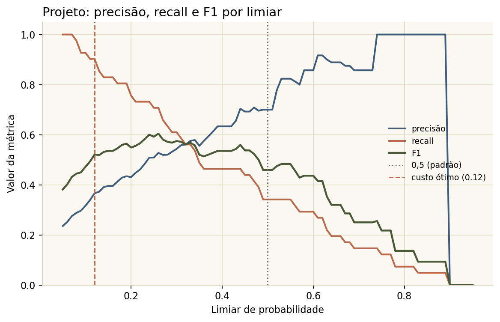
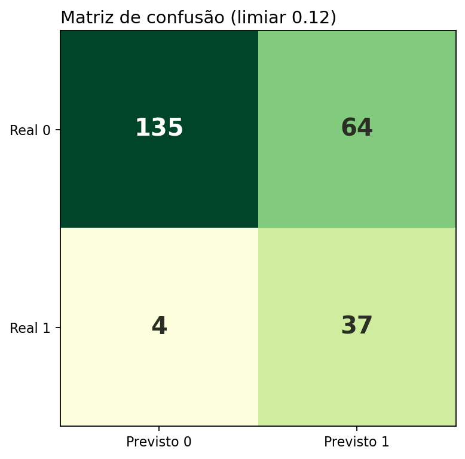
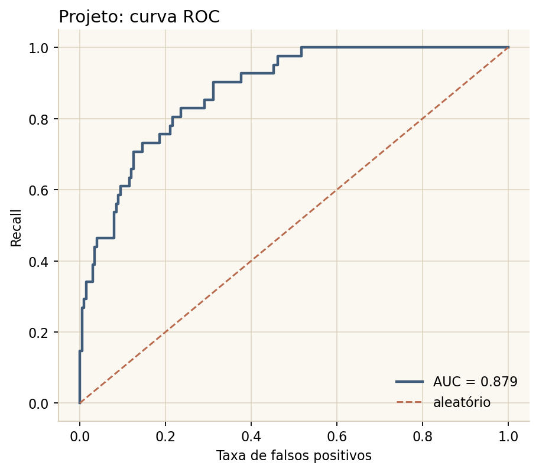
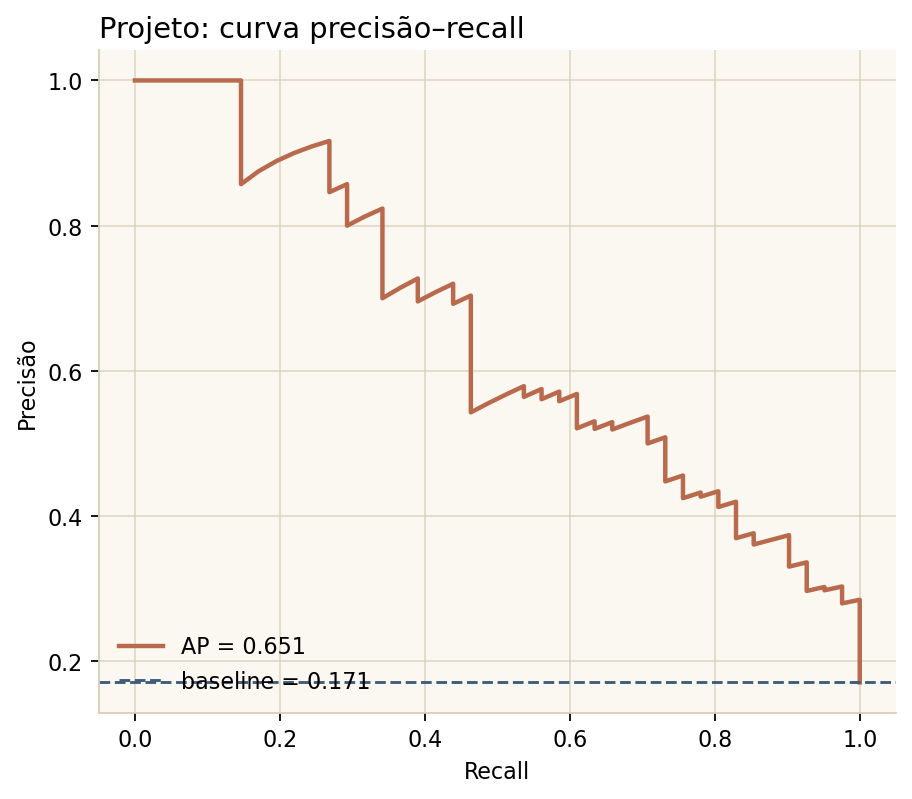

<div class="page-meta">Nível: avançado · Tempo: 35 min · Pré-requisito: Métricas de classificação + ROC/PR</div>

<div class="objetivo">
<b>Objetivo:</b> conduzir uma classificação desbalanceada, escolher o limiar pelo custo do
erro e relatar o resultado sem se esconder atrás da acurácia.
</div>

## A pergunta

> "Consigo prever `risco` (0/1) a partir de variáveis ambientais e de distância à estrada —
> e qual limiar usar para a decisão?"

O alvo é binário e desbalanceado: **17% de positivos**. A acurácia sozinha não serve.

## Os dados

`data/exemplo_classificacao.csv` (800 linhas):

| Coluna | Papel |
|---|---|
| `temperatura`, `umidade`, `vento`, `ndvi`, `dist_estrada` | features |
| `risco` | alvo binário (17% de positivos) |

## Passo 1 — EDA e baseline

- 800 linhas, sem missing.
- Prevalência: 17% de positivos.
- Baseline (classe majoritária): acurácia ≈ 83%, recall = 0. O modelo "burro" parece bom.

::: {.callout-warning}
## A acurácia do baseline engana
Um modelo que prevê sempre "sem risco" acerta 83% e não encontra nenhum positivo. É por
isso que a avaliação começa por recall, precisão e PR-AUC, não por acurácia.
:::

## Passo 2 — Modelo e métricas

Regressão logística com padronização, split estratificado 70/30:

| Métrica | Valor |
|---|---|
| ROC-AUC | 0,879 |
| PR-AUC (AP) | 0,651 |
| Log loss | 0,307 |
| Brier | 0,095 |

Boa discriminação e probabilidades razoavelmente calibradas. Mas a decisão depende do
**limiar**.

## Passo 3 — O limiar pelo custo

{fig-align="center" width="84%"}

Suponha que um falso negativo (deixar passar um caso de risco) custa **10 vezes** um falso
positivo. O limiar de menor custo é **0,12**:

| Limiar | Acurácia | Precisão | Recall | F1 | FN | FP | Custo (10×FN + FP) |
|---|---|---|---|---|---|---|---|
| 0,50 | 0,863 | 0,700 | 0,341 | 0,459 | 27 | 6 | 276 |
| **0,12** | 0,717 | 0,366 | **0,902** | 0,521 | **4** | 64 | **104** |

**Leitura:** a acurácia cai de 86% para 72%, mas o recall sobe de 34% para 90% e os falsos
negativos caem de 27 para 4. O custo total cai de 276 para 104.

{fig-align="center" width="62%"}

Se o objetivo fosse maximizar F1, o limiar seria ~0,26 (F1 ≈ 0,60). O ponto é: **não existe
limiar universal**; existe o limiar que representa o custo do problema.

## Passo 4 — ROC e PR

{fig-align="center" width="58%"}

{fig-align="center" width="58%"}

A ROC mostra boa separação global. A PR é mais informativa porque a classe positiva é rara:
a AP de 0,651 é bem acima da prevalência de 0,171.

## Código

::: {.panel-tabset}
## Python

```python
import numpy as np
import pandas as pd
from sklearn.linear_model import LogisticRegression
from sklearn.metrics import (
    average_precision_score, brier_score_loss, confusion_matrix,
    f1_score, log_loss, precision_score, recall_score, roc_auc_score,
)
from sklearn.model_selection import train_test_split
from sklearn.pipeline import make_pipeline
from sklearn.preprocessing import StandardScaler

dados = pd.read_csv("data/exemplo_classificacao.csv")
X = dados.drop(columns="risco")
y = dados["risco"]

X_tr, X_te, y_tr, y_te = train_test_split(
    X, y, test_size=0.3, stratify=y, random_state=42
)

modelo = make_pipeline(
    StandardScaler(),
    LogisticRegression(max_iter=5000, random_state=42),
).fit(X_tr, y_tr)
prob = modelo.predict_proba(X_te)[:, 1]

print("prevalência:", round(y_te.mean(), 3))
print("ROC-AUC   :", round(roc_auc_score(y_te, prob), 3))
print("PR-AUC    :", round(average_precision_score(y_te, prob), 3))
print("Log loss  :", round(log_loss(y_te, prob), 3))
print("Brier     :", round(brier_score_loss(y_te, prob), 3))

for t in [0.12, 0.26, 0.50]:
    pred = (prob >= t).astype(int)
    fn = ((pred == 0) & (y_te == 1)).sum()
    fp = ((pred == 1) & (y_te == 0)).sum()
    print(
        f"limiar {t:.2f} | acurácia {(pred == y_te).mean():.3f} | "
        f"precisão {precision_score(y_te, pred, zero_division=0):.3f} | "
        f"recall {recall_score(y_te, pred, zero_division=0):.3f} | "
        f"F1 {f1_score(y_te, pred, zero_division=0):.3f} | "
        f"FN {fn} | FP {fp} | custo {10*fn + fp}"
    )
    print(confusion_matrix(y_te, pred))
```

## R

```r
dados <- read.csv("data/exemplo_classificacao.csv")

set.seed(42)
idx <- sample(nrow(dados), floor(0.7 * nrow(dados)))
treino <- dados[idx, ]
teste  <- dados[-idx, ]

modelo <- glm(risco ~ ., data = treino, family = binomial)
prob <- predict(modelo, teste, type = "response")

# AUC pela fórmula de ranks
y <- teste$risco
n1 <- sum(y == 1); n0 <- sum(y == 0)
auc <- (sum(rank(prob)[y == 1]) - n1 * (n1 + 1) / 2) / (n1 * n0)
cat("ROC-AUC:", round(auc, 3), "\n")
cat("prevalência:", round(mean(y), 3), "\n")

for (t in c(0.12, 0.26, 0.50)) {
  pred <- ifelse(prob >= t, 1, 0)
  tab <- table(real = y, previsto = pred)
  tp <- tab["1", "1"]; tn <- tab["0", "0"]
  fp <- tab["0", "1"]; fn <- tab["1", "0"]
  precisao <- tp / (tp + fp)
  recall   <- tp / (tp + fn)
  f1 <- 2 * precisao * recall / (precisao + recall)
  cat(sprintf(
    "limiar %.2f | acurácia %.3f | precisão %.3f | recall %.3f | F1 %.3f | FN %d | FP %d | custo %d\n",
    t, (tp + tn) / sum(tab), precisao, recall, f1, fn, fp, 10 * fn + fp
  ))
  print(tab)
}
```
:::

::: {.callout-note}
## A aba R usa outro split
Os números do R não precisam coincidir com os do Python. O que precisa coincidir é a
conclusão: baixar o limiar reduz FN e aumenta FP; o custo decide.
:::

## Relatório

```text
Pergunta: prever risco binário a partir de variáveis ambientais.
Dados: 800 linhas; 17% positivos; split estratificado 70/30.
Baseline: acurácia 83%, recall 0.
Modelo: regressão logística; ROC-AUC 0,879; PR-AUC 0,651; log loss 0,307; Brier 0,095.
Limiar 0,50: acurácia 0,863; recall 0,341; F1 0,459; FN 27; FP 6; custo 276.
Limiar 0,12 (FN = 10×FP): acurácia 0,717; recall 0,902; F1 0,521; FN 4; FP 64; custo 104.
Decisão: usar 0,12 para triagem; revisar o custo com a área fim.
Limitação: dados sintéticos; custo assumido; sem validação externa.
```

## Checklist

- [ ] A prevalência foi reportada.
- [ ] O baseline majoritário foi calculado.
- [ ] O split foi estratificado.
- [ ] A acurácia não foi a única métrica.
- [ ] O limiar foi escolhido pelo custo, não por hábito.
- [ ] A matriz de confusão foi reportada no limiar escolhido.
- [ ] ROC e PR foram interpretadas no contexto da prevalência.
- [ ] O relatório separa o que é decisão do que é modelo.

## Exercício

Se o custo de um falso positivo subir para 10 e o de um falso negativo ficar em 10 (custos
iguais), o limiar ótimo sobe ou desce? Rode a tabela e explique.

::: {.callout-note collapse="true" title="Solução"}
Com custos iguais, o limiar ótimo se aproxima do ponto que equilibra FN e FP — normalmente
sobe em relação ao cenário em que FN custa 10× mais. O limiar não é uma propriedade do
modelo; é uma propriedade da **decisão**.
:::

## Próximo passo

[Projeto de clusterização](04-clusterizacao.qmd) — grupos sem rótulo e interpretação.
