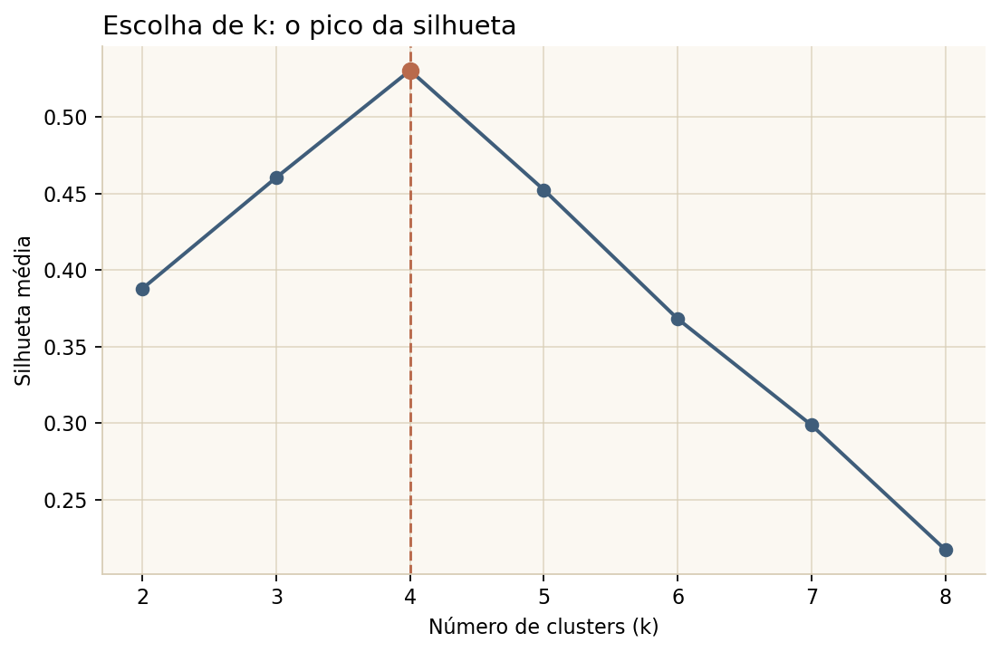
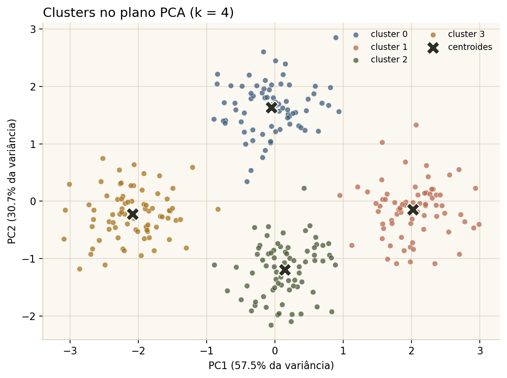

<div class="page-meta">Nível: intermediário · Tempo: 30 min · Pré-requisito: Tipos de aprendizado + PCA</div>

<div class="objetivo">
<b>Objetivo:</b> escolher o número de clusters com silhueta, interpretar os perfis e
reconhecer os limites de uma clusterização.
</div>

## A pergunta

> "Existem perfis distintos de condições ambientais nos dados — e quantos são?"

Não há rótulo. O objetivo é **descrever estrutura**, não prever uma classe. O número de
clusters é uma decisão, não uma verdade.

## Os dados

`data/exemplo_cluster.csv` (300 linhas, 4 features, sem rótulo):

| Coluna | Unidade |
|---|---|
| `temperatura` | °C |
| `umidade` | % |
| `vento` | m/s |
| `ndvi` | índice de vegetação |

## Passo 1 — Escalar

K-means usa distância. Sem padronizar, `umidade` (0–100) domina `ndvi` (0–1). **Sempre**
padronize antes.

## Passo 2 — Escolher k

{fig-align="center" width="78%"}

| k | Silhueta |
|---|---|
| 2 | 0,388 |
| 3 | 0,460 |
| **4** | **0,530** |
| 5 | 0,452 |
| 6 | 0,368 |
| 7 | 0,299 |
| 8 | 0,217 |

**Leitura:** o pico em k = 4 é claro. Silhueta 0,53 é uma separação moderada/boa — não é
perfeita, e isso importa para a interpretação.

## Passo 3 — Ver os clusters

{fig-align="center" width="82%"}

O PCA é só para **visualizar**; o K-means foi ajustado nas 4 dimensões padronizadas. Os
dois primeiros componentes explicam 57,5% + 30,7% = 88,2% da variância.

## Passo 4 — Interpretar os perfis

| Cluster | Temperatura | Umidade | Vento | NDVI | Leitura |
|---|---|---|---|---|---|
| 0 | 21,8 °C | 50,0% | 5,1 m/s | 0,39 | ameno, seco, ventoso, vegetação baixa |
| 1 | 17,4 °C | 78,9% | 3,7 m/s | 0,81 | frio, úmido, vegetação alta |
| 2 | 28,0 °C | 69,7% | 2,1 m/s | 0,70 | quente, úmido, calmo, vegetação alta |
| 3 | 30,2 °C | 40,3% | 1,6 m/s | 0,30 | quente, seco, calmo, vegetação baixa |

::: {.callout-warning}
## O número do cluster é arbitrário
"Cluster 0" não é melhor nem pior que "cluster 3". A ordem muda entre execuções. Nomeie
pelo perfil, não pelo número.
:::

## Passo 5 — Testar a estabilidade

Rode o K-means com sementes diferentes e compare. Se os grupos mudarem muito, a estrutura
não é estável. Duas checagens úteis:

- **ARI** (Adjusted Rand Index) entre duas execuções: perto de 1 = estável.
- **Silhueta por cluster:** um cluster com silhueta negativa tem pontos mais próximos de
  outro cluster.

```python
from sklearn.metrics import adjusted_rand_score
from sklearn.cluster import KMeans

a = KMeans(n_clusters=4, n_init=25, random_state=1).fit_predict(Xs)
b = KMeans(n_clusters=4, n_init=25, random_state=2).fit_predict(Xs)
print("ARI:", round(adjusted_rand_score(a, b), 3))
```

## Código

::: {.panel-tabset}
## Python

```python
import pandas as pd
from sklearn.cluster import KMeans
from sklearn.decomposition import PCA
from sklearn.metrics import silhouette_score
from sklearn.preprocessing import StandardScaler

dados = pd.read_csv("data/exemplo_cluster.csv")
Xs = StandardScaler().fit_transform(dados)

for k in range(2, 9):
    labels = KMeans(n_clusters=k, n_init=25, random_state=42).fit_predict(Xs)
    print(f"k={k}: silhueta {silhouette_score(Xs, labels):.3f}")

km = KMeans(n_clusters=4, n_init=25, random_state=42).fit(Xs)
dados["cluster"] = km.labels_

print(dados.groupby("cluster").mean().round(2))

pca = PCA(n_components=2, random_state=42).fit(Xs)
Z = pca.transform(Xs)
print("variância explicada:", pca.explained_variance_ratio_.round(3))
```

## R

```r
library(cluster)

dados <- read.csv("data/exemplo_cluster.csv")
Xs <- scale(dados)

for (k in 2:8) {
  km <- kmeans(Xs, centers = k, nstart = 25)
  sil <- silhouette(km$cluster, dist(Xs))
  cat("k =", k, "| silhueta =", round(mean(sil[, 3]), 3), "\n")
}

set.seed(42)
km <- kmeans(Xs, centers = 4, nstart = 25)
dados$cluster <- km$cluster
print(round(aggregate(dados[, -5], by = list(cluster = dados$cluster), mean), 2))

pc <- prcomp(Xs)
cat("variância explicada:", round(pc$sdev^2 / sum(pc$sdev^2), 3)[1:2], "\n")
```
:::

::: {.callout-note}
## Se o pacote `cluster` não estiver instalado
Rode `install.packages("cluster")`. Ele é um pacote recomendado do R e costuma vir na
instalação padrão.
:::

## Relatório

```text
Pergunta: existem perfis ambientais distintos? Quantos?
Dados: 300 linhas, 4 features, sem rótulo; padronizados.
Escolha de k: silhueta máxima em k = 4 (0,530).
Perfis: ameno/seco/ventoso; frio/úmido/vegetado; quente/úmido/calmo/vegetado;
        quente/seco/calmo/vegetação baixa.
Estabilidade: [ARI entre sementes].
Limitação: K-means assume clusters esféricos; a estrutura é descritiva, não uma classe natural.
```

## Checklist

- [ ] As features foram padronizadas.
- [ ] O k foi escolhido com mais de um critério (silhueta + interpretabilidade).
- [ ] A silhueta foi reportada.
- [ ] Os perfis foram descritos em unidades originais.
- [ ] A estabilidade foi testada.
- [ ] O relatório não trata cluster como classe natural.
- [ ] O PCA foi usado só para visualizar.

## Exercício

Rode com k = 3 e k = 5. Quais perfis aparecem ou desaparecem? A silhueta justifica a
diferença? O que você reportaria para uma pessoa que precisa tomar decisão?

::: {.callout-note collapse="true" title="Solução"}
Com k = 3, dois perfis provavelmente se fundem; com k = 5, um perfil se divide. A silhueta
mais alta em k = 4 sustenta a escolha, mas a decisão final também considera se os perfis
fazem sentido para o problema. Reporte o k, a silhueta e a descrição dos perfis; não venda
os grupos como categorias naturais.
:::

## Próximo passo

A Parte VII entra em reprodutibilidade e nos checklists finais. Enquanto isso, revise as
[métricas de classificação](../04-avaliacao/02-classificacao.qmd) e a
[calibração](../03-calibracao/05-boas-praticas.qmd).
