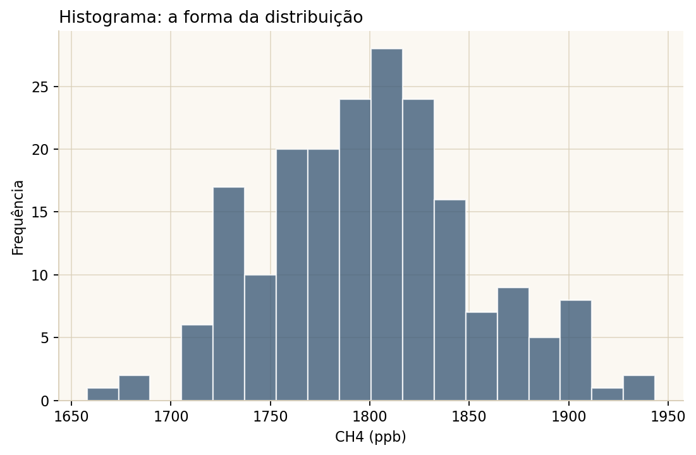
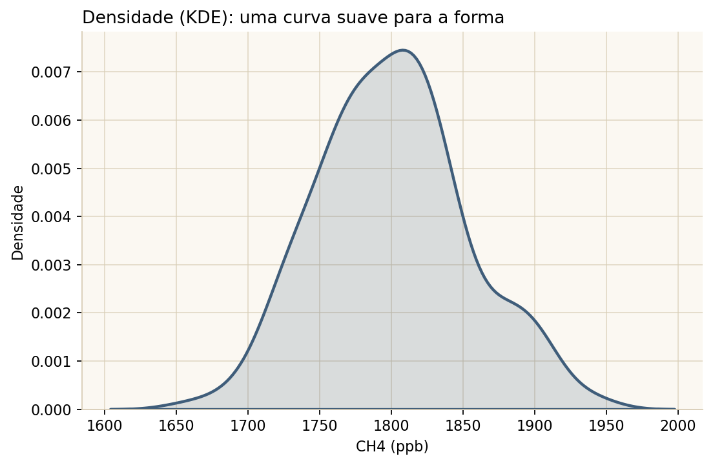
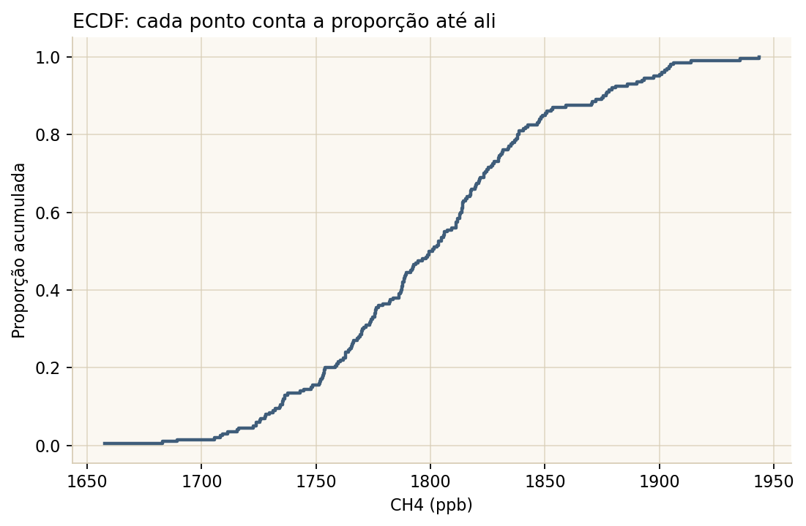
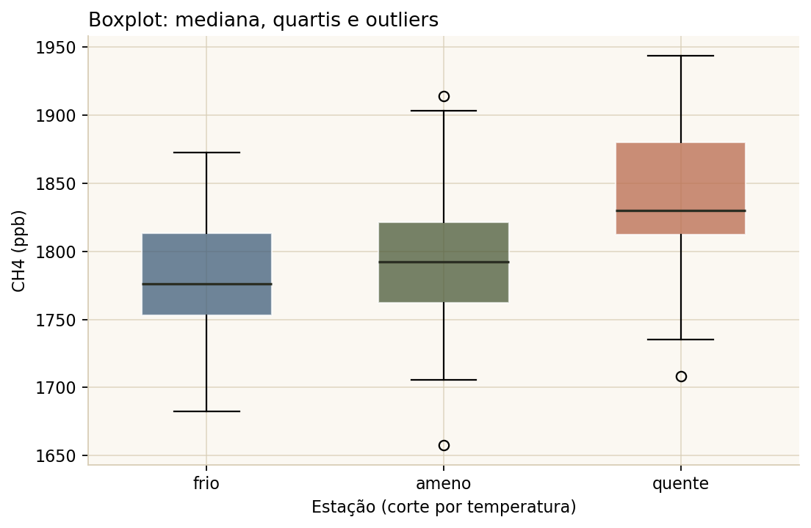
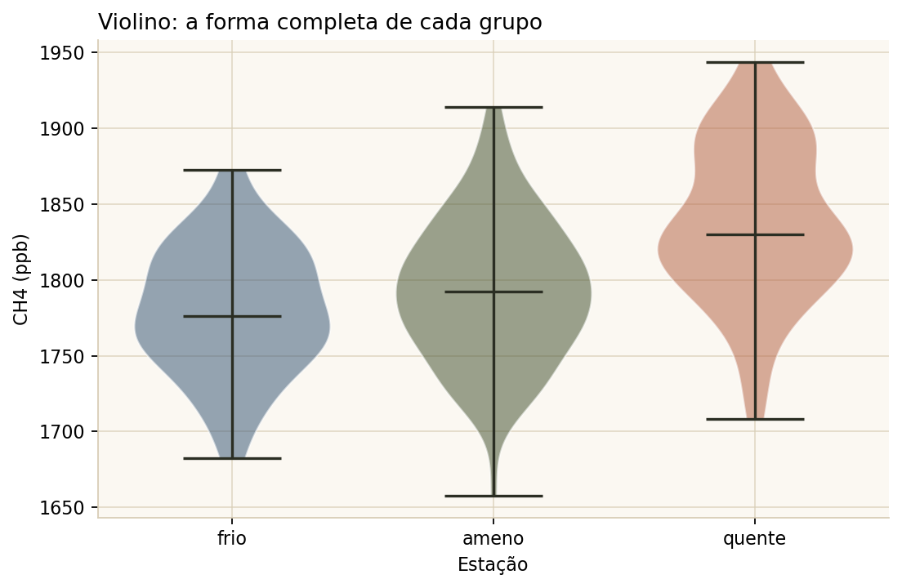
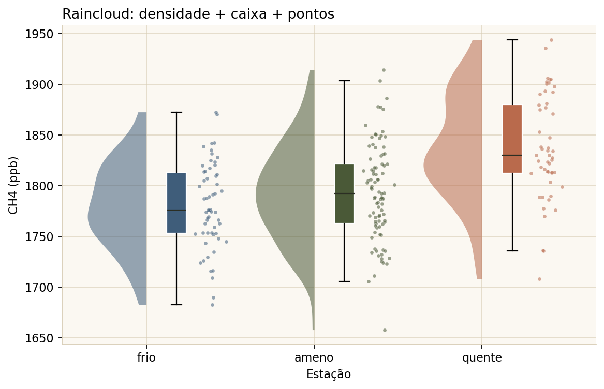
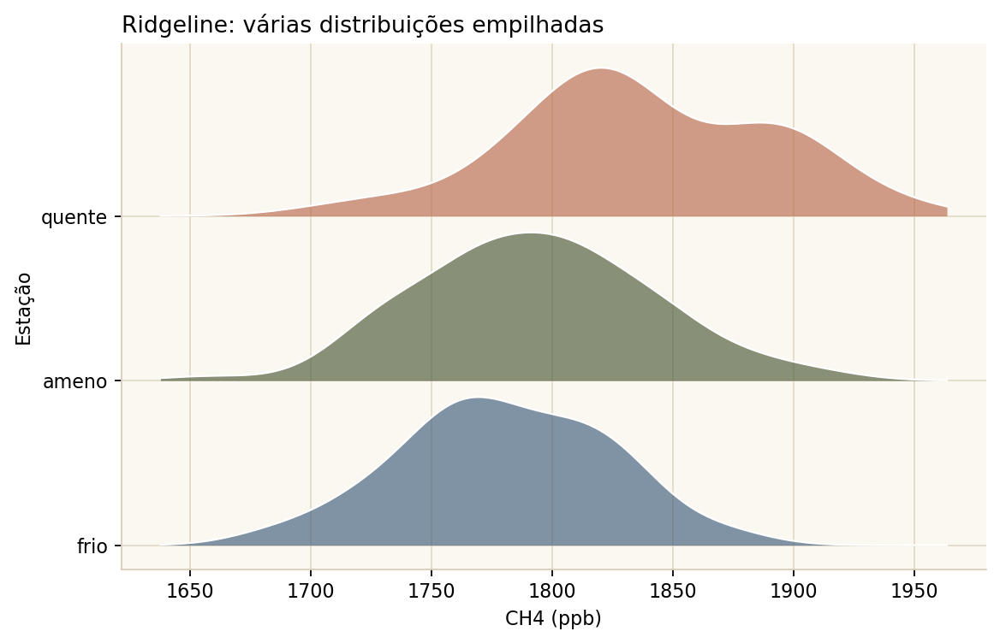
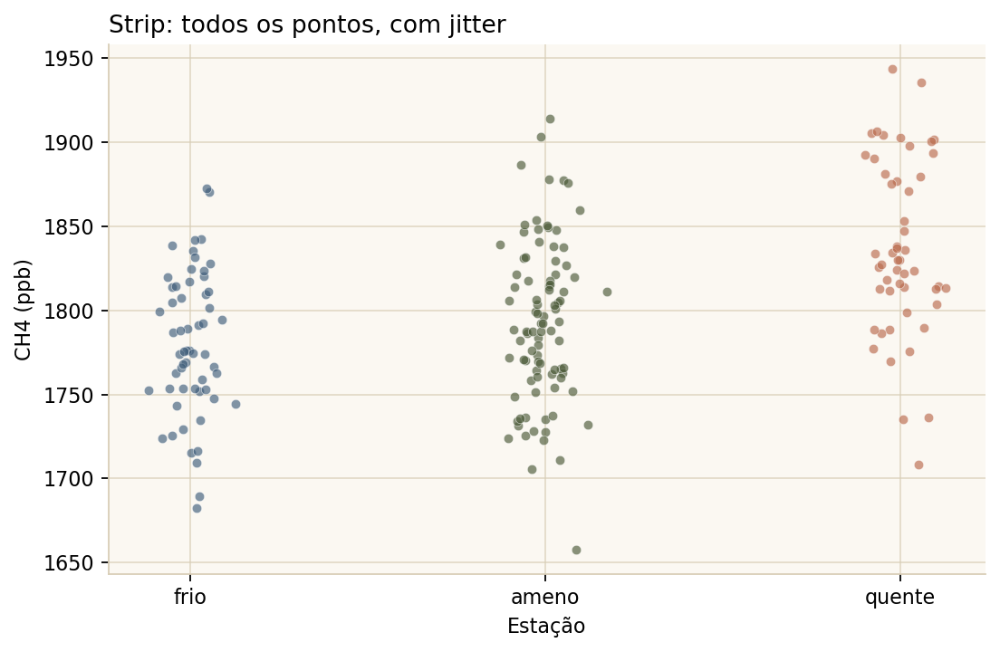

<div class="page-meta">Nível: todos · Tempo: 15 min · Pré-requisito: nenhum</div>

<div class="objetivo">
<b>Objetivo:</b> mostrar forma, centro, dispersão e extremos de uma variável — e saber o
que cada gráfico esconde.
</div>

## Nunca só a média

A média é um número só. Ela não mostra se a distribuição é simétrica, bimodal, se tem
outliers ou se dois grupos foram misturados. Os gráficos abaixo mostram o que a média
esconde.

## Histograma

{fig-align="center" width="78%"}

- **O que mostra:** a forma da distribuição e onde estão as massas.
- **O que esconde:** o número de classes muda a forma; picos podem ser artefato de binning.
- **Quando usar:** primeira olhada, `n` médio/grande.
- **Acessibilidade:** use uma cor de preenchimento com contraste; evite barras com borda
  fina demais.

## Densidade (KDE)

{fig-align="center" width="78%"}

- **O que mostra:** uma versão suave da forma, sem depender de classes.
- **O que esconde:** o `bandwidth` escolhido; caudas podem ser inventadas.
- **Quando usar:** comparar formas entre grupos, `n` razoável.
- **Cuidado:** KDE com poucos pontos vira desenho, não estimativa.

## ECDF

{fig-align="center" width="78%"}

- **O que mostra:** a proporção de observações até cada valor; mediana e quantis ficam
  visíveis.
- **O que esconde:** a forma local (picos e vales) fica suavizada.
- **Quando usar:** comunicar quantis, comparar grupos, evitar escolha de bins.
- **Acessibilidade:** a linha funciona bem em preto e branco.

## Boxplot

{fig-align="center" width="78%"}

- **O que mostra:** mediana, quartis, amplitude e outliers.
- **O que esconde:** bimodalidade; dois grupos podem ter a mesma caixa.
- **Quando usar:** comparação rápida entre poucos grupos.
- **Cuidado:** o boxplot não mostra o tamanho da amostra nem a forma.

## Violino

{fig-align="center" width="78%"}

- **O que mostra:** a forma completa da distribuição por grupo.
- **O que esconde:** o número de observações; violinos largos podem enganar.
- **Quando usar:** comparar formas entre grupos.
- **Cuidado:** com `n` pequeno, o violino é instável.

## Raincloud

{fig-align="center" width="88%"}

- **O que mostra:** densidade + resumo + todos os pontos. É o gráfico mais completo desta
  família.
- **O que esconde:** ainda depende do KDE e do jitter; muitos pontos podem poluir.
- **Quando usar:** quando você quer mostrar o dado bruto e o resumo ao mesmo tempo.
- **Acessibilidade:** combine cor com posição e forma; não dependa só da cor.

## Ridgeline

{fig-align="center" width="88%"}

- **O que mostra:** várias distribuições empilhadas, fáceis de comparar.
- **O que esconde:** a sobreposição pode sugerir separação que não existe.
- **Quando usar:** muitos grupos (5+) e comparação de forma.
- **Cuidado:** não é bom para ler valores exatos.

## Strip

{fig-align="center" width="78%"}

- **O que mostra:** cada observação; bom para `n` pequeno.
- **O que esconde:** a densidade; pontos sobrepostos viram borrão.
- **Quando usar:** `n` pequeno/médio, quando cada ponto importa.
- **Acessibilidade:** jitter ajuda, mas não resolve sobreposição extrema.

## Qual escolher?

| Situação | Primeira escolha | Alternativa |
|---|---|---|
| `n` pequeno | strip | box |
| comparar 2–4 grupos | box ou violino | raincloud |
| comparar muitos grupos | ridgeline | box |
| forma da distribuição | histograma ou KDE | ECDF |
| quantis e proporções | ECDF | box |
| mostrar tudo | raincloud | strip |

## Código

::: {.panel-tabset}
## Python

```python
import matplotlib.pyplot as plt
import pandas as pd
import seaborn as sns

dados = pd.read_csv("data/exemplo_ch4.csv")
dados["estacao"] = pd.cut(
    dados["temperatura"], bins=[-float("inf"), 23, 27, float("inf")],
    labels=["frio", "ameno", "quente"],
)

fig, eixos = plt.subplots(2, 2, figsize=(10, 8))

sns.histplot(dados["ch4"], bins=18, ax=eixos[0, 0], color="#3f5d7a")
eixos[0, 0].set_title("Histograma")

sns.ecdfplot(dados["ch4"], ax=eixos[0, 1], color="#3f5d7a")
eixos[0, 1].set_title("ECDF")

sns.boxplot(data=dados, x="estacao", y="ch4", ax=eixos[1, 0])
eixos[1, 0].set_title("Boxplot")

sns.violinplot(data=dados, x="estacao", y="ch4", ax=eixos[1, 1])
eixos[1, 1].set_title("Violino")

plt.tight_layout()
plt.show()
```

## R

```r
library(ggplot2)

dados <- read.csv("data/exemplo_ch4.csv")
dados$estacao <- cut(
  dados$temperatura,
  breaks = c(-Inf, 23, 27, Inf),
  labels = c("frio", "ameno", "quente")
)

ggplot(dados, aes(ch4)) +
  geom_histogram(bins = 18, fill = "#3f5d7a", color = "white")

ggplot(dados, aes(ch4)) +
  stat_ecdf(color = "#3f5d7a", linewidth = 1)

ggplot(dados, aes(estacao, ch4)) +
  geom_boxplot(fill = "#3f5d7a", alpha = 0.6)

ggplot(dados, aes(estacao, ch4)) +
  geom_violin(fill = "#3f5d7a", alpha = 0.5)
```
:::

## Próximo passo

[Relação](02-relacao.qmd).
