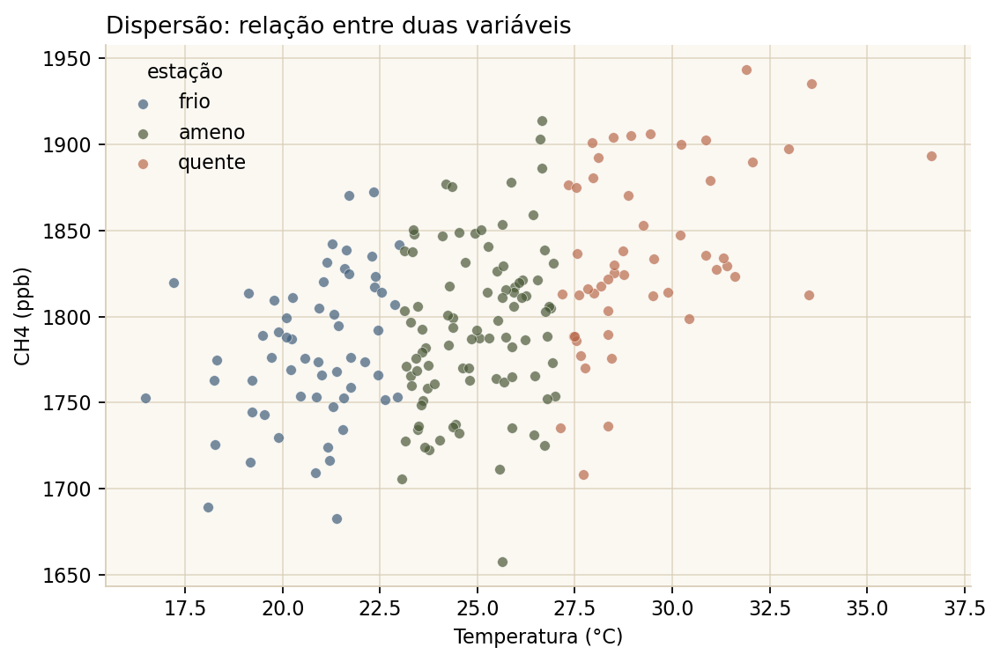
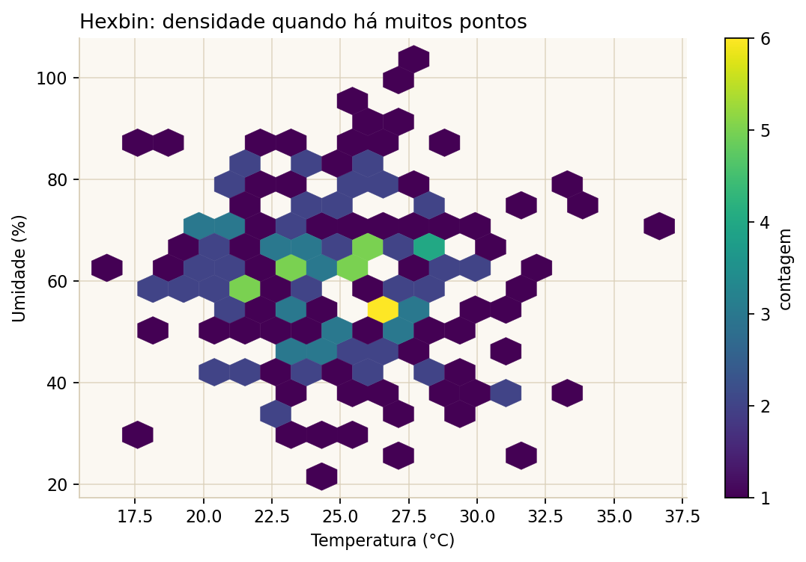
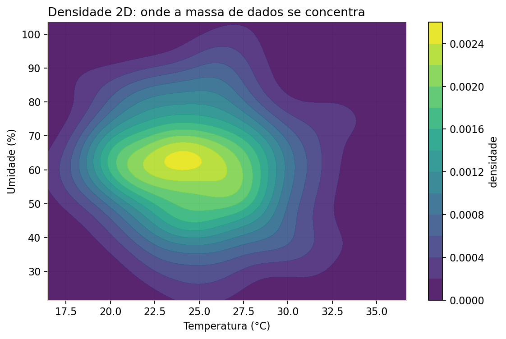
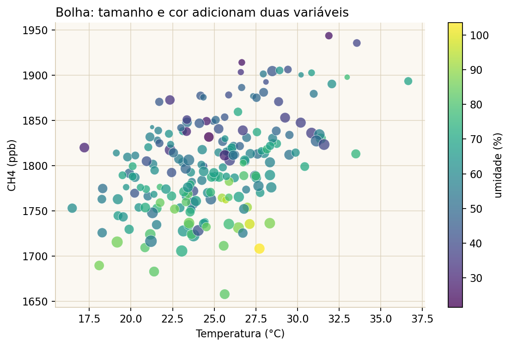
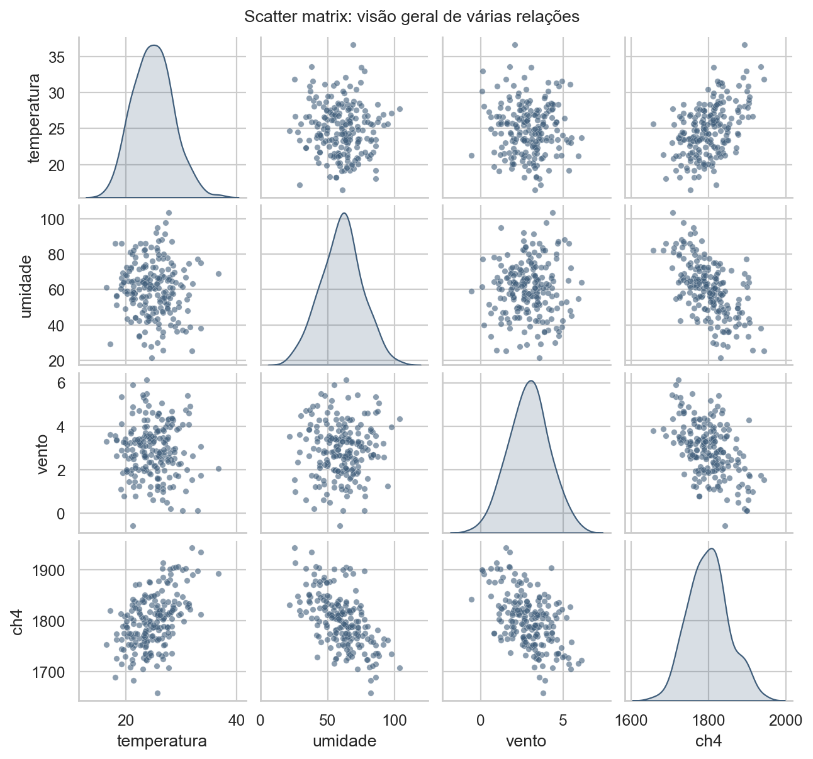
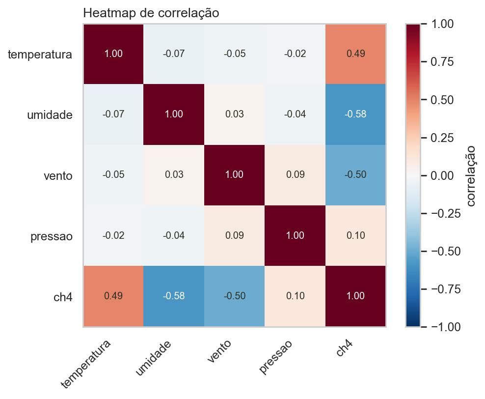
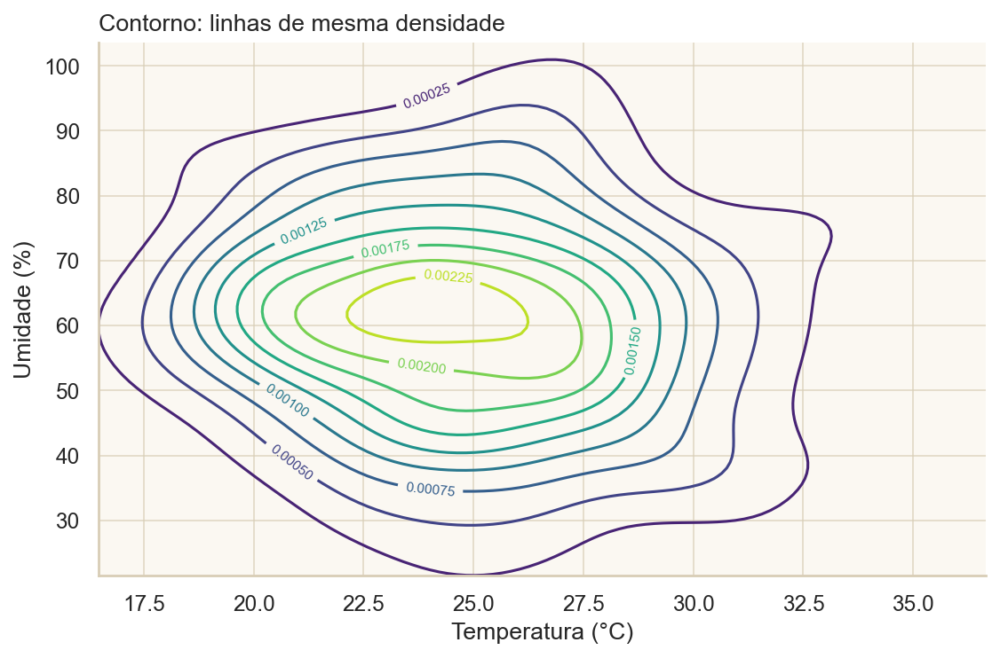

<div class="page-meta">Nível: todos · Tempo: 15 min · Pré-requisito: Distribuição</div>

<div class="objetivo">
<b>Objetivo:</b> mostrar relação entre duas variáveis sem esconder densidade, outliers ou
grupos.
</div>

## O problema central: sobreposição

Com muitos pontos, a dispersão vira uma mancha. As soluções são transparência, jitter,
hexbin, densidade 2D ou amostragem. Cada uma conta uma história diferente.

## Dispersão

{fig-align="center" width="80%"}

- **O que mostra:** direção, força e forma da relação; outliers.
- **O que esconde:** densidade onde os pontos se sobrepõem.
- **Quando usar:** `n` pequeno/médio, quando cada ponto importa.
- **Cuidado:** a cor por grupo pode sugerir separação que é só gradiente.

## Hexbin

{fig-align="center" width="80%"}

- **O que mostra:** densidade em uma grade hexagonal; bom para muitos pontos.
- **O que esconde:** o formato da relação dentro de cada célula.
- **Quando usar:** `n` grande, duas variáveis contínuas.
- **Acessibilidade:** use uma paleta sequencial perceptual (viridis/cividis).

## Densidade 2D

{fig-align="center" width="80%"}

- **O que mostra:** onde a massa de dados se concentra.
- **O que esconde:** pontos isolados e a dispersão local.
- **Quando usar:** `n` grande e relação contínua.
- **Cuidado:** o `bandwidth` muda a figura; não trate contorno como fronteira real.

## Bolha

{fig-align="center" width="80%"}

- **O que mostra:** duas variáveis extras por tamanho e cor.
- **O que esconde:** a escala do tamanho não é percebida linearmente; muitas variáveis
  confundem.
- **Quando usar:** quando há uma variável de magnitude e uma de contexto.
- **Cuidado:** tamanho por área, não por raio; use legenda de tamanho.

## Scatter matrix

{fig-align="center" width="88%"}

- **O que mostra:** várias relações de uma vez; bom para exploração.
- **O que esconde:** com muitas variáveis, vira ruído; não é bom para publicação.
- **Quando usar:** EDA com 3–6 variáveis.
- **Cuidado:** a diagonal (distribuição) e a escala mudam entre painéis.

## Heatmap de correlação

{fig-align="center" width="72%"}

- **O que mostra:** correlação linear par a par.
- **O que esconde:** relações não lineares, grupos e causalidade.
- **Quando usar:** triagem inicial, muitas variáveis.
- **Cuidado:** use paleta divergente centrada em zero; correlação não é causalidade.

## Contorno

{fig-align="center" width="80%"}

- **O que mostra:** linhas de mesma densidade; bom para mapas e superfícies.
- **O que esconde:** a variabilidade dentro de cada faixa.
- **Quando usar:** quando a Densidade 2D precisa ser lida em valores.
- **Cuidado:** muitas linhas confundem; rotule as principais.

## Escolha rápida

| Situação | Primeira escolha | Evite |
|---|---|---|
| `n` pequeno | dispersão | hexbin |
| muitos pontos | hexbin ou densidade 2D | dispersão pura |
| duas variáveis extras | bolha | muitos canais |
| exploração de várias variáveis | scatter matrix | publicação |
| triagem de correlação | heatmap | inferir causalidade |
| superfície/contorno | contorno | excesso de níveis |

## Código

::: {.panel-tabset}
## Python

```python
import matplotlib.pyplot as plt
import pandas as pd
import seaborn as sns

dados = pd.read_csv("data/exemplo_ch4.csv")

fig, eixos = plt.subplots(2, 2, figsize=(10, 8))

sns.scatterplot(data=dados, x="temperatura", y="ch4", ax=eixos[0, 0], alpha=0.7)
eixos[0, 0].set_title("Dispersão")

eixos[0, 1].hexbin(dados["temperatura"], dados["umidade"], gridsize=18, cmap="viridis")
eixos[0, 1].set_title("Hexbin")

sns.kdeplot(data=dados, x="temperatura", y="umidade", fill=True,
            cmap="viridis", levels=10, ax=eixos[1, 0])
eixos[1, 0].set_title("Densidade 2D")

sns.heatmap(dados[["temperatura", "umidade", "vento", "pressao", "ch4"]].corr(),
            cmap="RdBu_r", vmin=-1, vmax=1, annot=True, fmt=".2f", ax=eixos[1, 1])
eixos[1, 1].set_title("Correlação")

plt.tight_layout()
plt.show()
```

## R

```r
library(ggplot2)

dados <- read.csv("data/exemplo_ch4.csv")

ggplot(dados, aes(temperatura, ch4)) +
  geom_point(alpha = 0.6, color = "#3f5d7a")

ggplot(dados, aes(temperatura, umidade)) +
  geom_bin2d() +
  scale_fill_viridis_c()

ggplot(dados, aes(temperatura, umidade)) +
  geom_density_2d_filled(alpha = 0.8) +
  geom_density_2d(color = "white")
```
:::

## Próximo passo

[3D](03-3d.qmd) — quando a profundidade é parte do dado.
