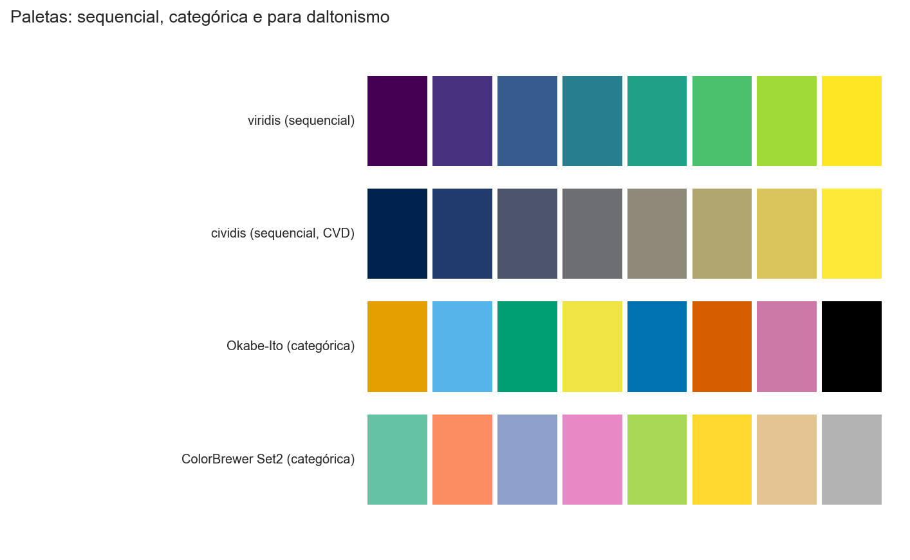
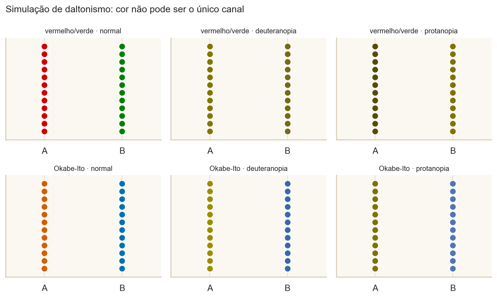

<div class="page-meta">Nível: todos · Tempo: 12 min · Pré-requisito: nenhum</div>

<div class="objetivo">
<b>Objetivo:</b> escolher paletas que funcionem para leitores com e sem daltonismo, em
tela, impressão e escala de cinza.
</div>

## Cor não é decoração

Cor codifica dado. Se a escolha for ruim, o leitor perde informação — ou vê informação que
não existe. Uma figura acessível não é “mais bonita”: é **mais honesta**.

## Tipos de paleta

| Tipo | Use para | Exemplos |
|---|---|---|
| **Sequencial** | magnitude, densidade, intensidade | viridis, cividis, Blues |
| **Divergente** | desvio em torno de um centro | RdBu, PuOr, BrBG |
| **Categórica** | grupos sem ordem | Okabe-Ito, ColorBrewer Set2, Paul Tol |
| **Cíclica** | direção/fase | twilight, hsv (com cautela) |

{fig-align="center" width="92%"}

**Leitura:** viridis e cividis são perceptualmente uniformes e funcionam em escala de
cinza. Okabe-Ito é categórica e desenhada para daltonismo. Set2 é categórica, mas tem
contraste desigual.

## Daltonismo

{fig-align="center" width="92%"}

**Leitura:** na primeira linha, vermelho e verde colapsam para tons parecidos de oliva.
Na segunda, laranja e azul continuam distinguíveis. A simulação é aproximada; serve para
mostrar o risco, não para certificar a paleta.

::: {.callout-warning}
## Nunca use cor como único canal
Repita a informação com **forma do marcador**, **tipo de linha**, **rótulo direto**,
**posição** ou **padrão**. Assim a figura funciona em preto e branco, em impressão e para
quem não distingue cores.
:::

## Contraste

- Texto: contraste mínimo de **4,5:1** (WCAG AA).
- Elementos gráficos e ícones: pelo menos **3:1**.
- Evite cinza claro sobre bege, amarelo sobre branco e linhas finas de baixo contraste.
- Teste em escala de cinza e no tamanho final de publicação.

## Boas práticas

1. Use **Okabe-Ito**, **viridis**, **cividis**, **ColorBrewer** ou **Paul Tol**.
2. Evite **rainbow/jet**, vermelho-verde e saturação máxima.
3. Use **rótulos diretos** em vez de legenda quando houver poucas categorias.
4. Diferencie marcadores e linhas, não só cores.
5. Ordem das categorias: mantenha consistente em todas as figuras.
6. Fundo branco ou neutro; evite grade pesada.
7. Escreva **alt text** e uma legenda autossuficiente.
8. Teste com um simulador de daltonismo e em escala de cinza.

## Código

::: {.panel-tabset}
## Python

```python
import matplotlib.colors as mcolors
import matplotlib.pyplot as plt
import numpy as np

okabe_ito = [
    "#E69F00", "#56B4E9", "#009E73", "#F0E442",
    "#0072B2", "#D55E00", "#CC79A7", "#000000",
]

def simular_cvd(hexcor, tipo="deuteranopia"):
    rgb = np.array(mcolors.to_rgb(hexcor))
    linear = np.where(rgb <= 0.04045, rgb / 12.92, ((rgb + 0.055) / 1.055) ** 2.4)
    matrizes = {
        "deuteranopia": np.array([[0.367322, 0.860646, -0.227968],
                                  [0.280085, 0.672501, 0.047413],
                                  [-0.011820, 0.042940, 0.968881]]),
        "protanopia": np.array([[0.152286, 1.052583, -0.204868],
                                [0.114503, 0.786281, 0.099216],
                                [-0.003882, -0.048116, 1.051998]]),
    }
    sim = np.clip(matrizes[tipo] @ linear, 0, 1)
    srgb = np.where(sim <= 0.0031308, sim * 12.92, 1.055 * sim ** (1 / 2.4) - 0.055)
    return np.clip(srgb, 0, 1)

# escala sequencial
plt.imshow(np.linspace(0, 1, 256).reshape(1, -1), cmap="viridis", aspect="auto")
plt.axis("off")

# categórica
plt.figure()
for i, cor in enumerate(okabe_ito):
    plt.scatter(i, 0, s=200, color=cor, edgecolor="white")
    plt.scatter(i, 0.3, s=200, color=simular_cvd(cor), edgecolor="white")
plt.ylim(-0.2, 0.5)
plt.axis("off")
```

## R

```r
# install.packages(c("ggplot2", "viridis"))
library(ggplot2)
library(viridis)

dados <- read.csv("data/exemplo_ch4.csv")
dados$estacao <- cut(
  dados$temperatura,
  breaks = c(-Inf, 23, 27, Inf),
  labels = c("frio", "ameno", "quente")
)

okabe_ito <- c(
  "#E69F00", "#56B4E9", "#009E73", "#F0E442",
  "#0072B2", "#D55E00", "#CC79A7"
)

ggplot(dados, aes(temperatura, ch4, color = estacao)) +
  geom_point(size = 2.5) +
  scale_color_manual(values = okabe_ito) +
  theme_minimal()

ggplot(dados, aes(temperatura, umidade, color = ch4)) +
  geom_point(size = 2.5) +
  scale_color_viridis_c()
```
:::

## Checklist de acessibilidade

- [ ] A paleta é adequada ao tipo de dado (sequencial, divergente, categórica).
- [ ] A figura funciona em escala de cinza.
- [ ] A figura funciona com simulação de deuteranopia/protanopia.
- [ ] A cor não é o único canal de informação.
- [ ] Há contraste suficiente entre texto/fundo e linhas/fundo.
- [ ] Há rótulos diretos ou legenda clara.
- [ ] A legenda e o alt text são autossuficientes.
- [ ] O tamanho final de fonte é legível.

## Referências

- Rougier, N. P.; Droettboom, M.; Bourne, P. E. Ten Simple Rules for Better Figures.
  *PLoS Computational Biology*, 2014. DOI: 10.1371/journal.pcbi.1003833.
- Crameri, F.; Shephard, G. E.; Heron, P. J. The Misuse of Colour in Science
  Communication. *Nature Communications*, 2020.
- Nuñez, J. R.; Anderton, C. R.; Renslow, R. S. Optimizing Colormaps with Consideration
  for Color Vision Deficiency. *PLoS ONE*, 2018.
- Okabe, M.; Ito, K. Color Universal Design (CUD).
- Wilke, C. O. *Fundamentals of Data Visualization*. 2019.

## Próximo passo

Volte ao [mapa de decisão](index.qmd) ou veja as [métricas](../04-avaliacao/01-regressao.qmd).
