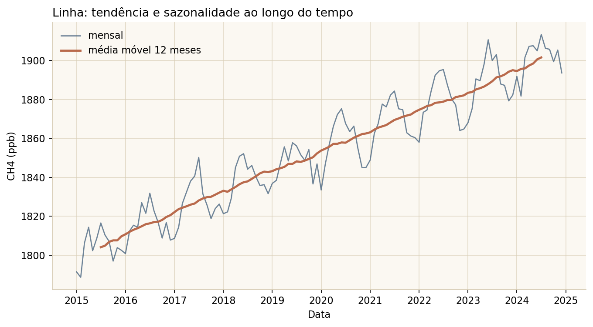
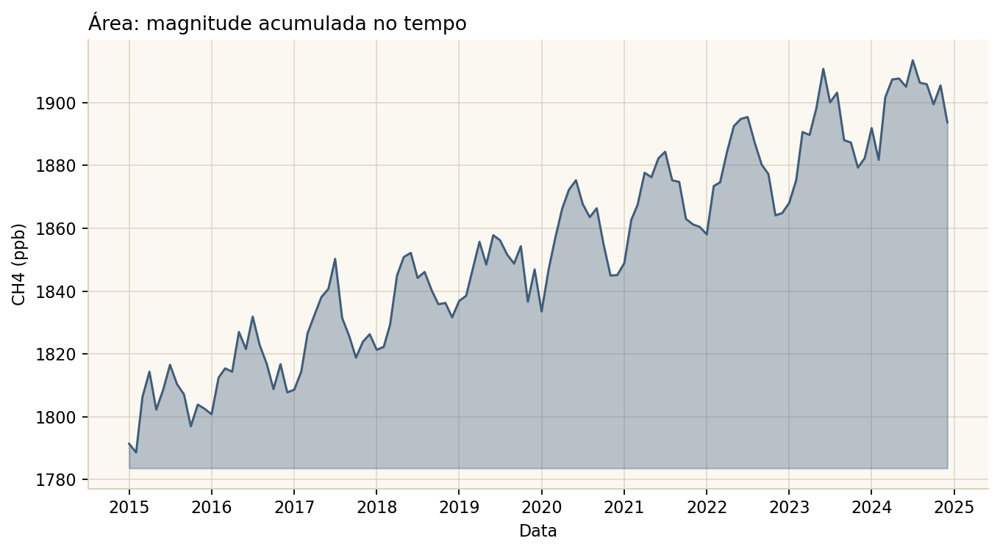
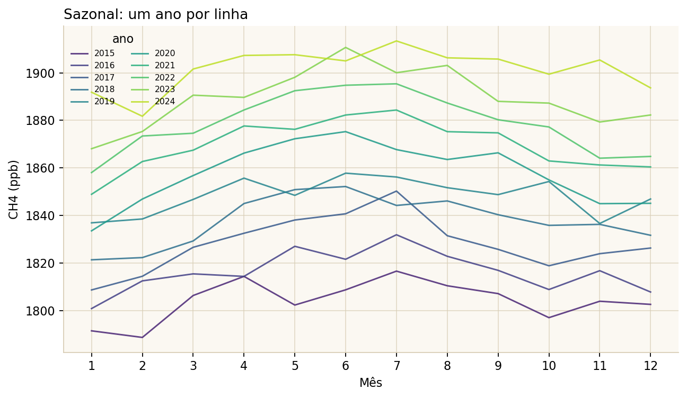
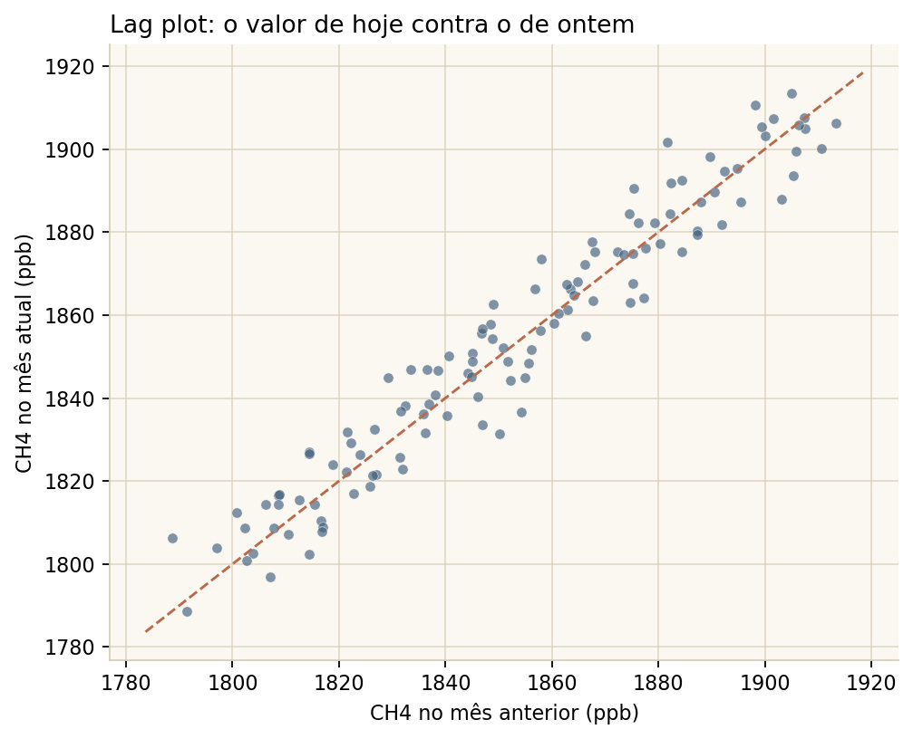
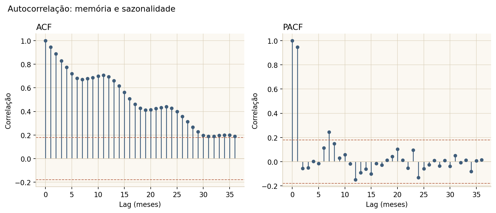
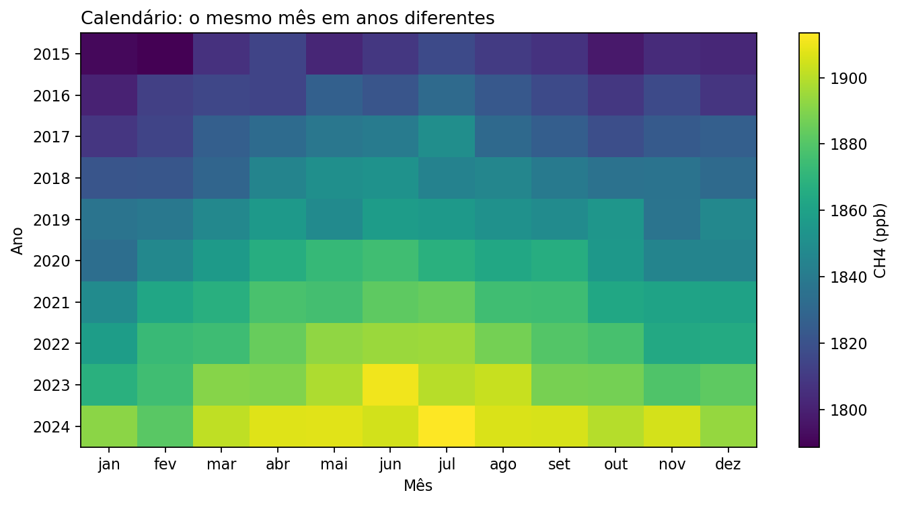
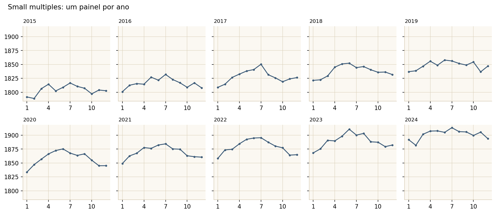
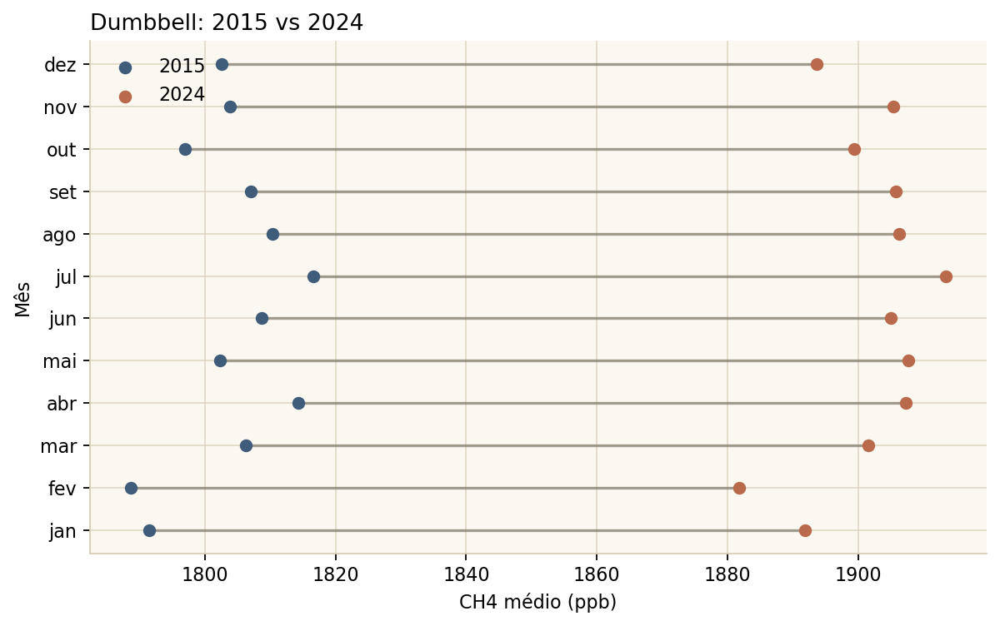

<div class="page-meta">Nível: todos · Tempo: 18 min · Pré-requisito: Relação</div>

<div class="objetivo">
<b>Objetivo:</b> separar tendência, sazonalidade e dependência temporal — e escolher o
gráfico que mostra cada uma.
</div>

## Três perguntas antes do gráfico

1. Existe **tendência** de longo prazo?
2. Existe **sazonalidade** (ciclo que se repete)?
3. O valor de hoje depende do de ontem (**autocorrelação**)?

Um gráfico de linha responde à primeira; a sazonal e a ACF respondem à segunda e à terceira.

## Dados

`data/exemplo_serie.csv`: 120 observações mensais (2015–2024) de CH4, temperatura e vento.

## Linha

{fig-align="center" width="92%"}

- **O que mostra:** tendência, ciclos e choques ao longo do tempo.
- **O que esconde:** a escala e a suavização; uma média móvel pode esconder viradas.
- **Quando usar:** primeira olhada em uma série temporal.
- **Acessibilidade:** use uma linha grossa para a tendência e uma mais fina para o dado bruto.

::: {.callout-note collapse="true" title="Código Python"}
```python
import pandas as pd
import matplotlib.pyplot as plt

dados = pd.read_csv("data/exemplo_serie.csv", parse_dates=["data"])

fig, ax = plt.subplots(figsize=(9, 5))
ax.plot(dados["data"], dados["ch4"], color="#3f5d7a", linewidth=1.2, label="mensal")
ax.plot(dados["data"], dados["ch4"].rolling(12, center=True).mean(),
        color="#b96a4c", linewidth=2.2, label="média móvel 12 meses")
ax.set_xlabel("Data")
ax.set_ylabel("CH4 (ppb)")
ax.legend(frameon=False)
plt.show()
```
:::

## Área

{fig-align="center" width="92%"}

- **O que mostra:** magnitude acumulada e continuidade.
- **O que esconde:** a linha de base escolhida; área preenchida até zero exagera diferenças.
- **Quando usar:** quando a magnitude total importa.
- **Cuidado:** área não é boa para ler valores exatos.

::: {.callout-note collapse="true" title="Código Python"}
```python
import pandas as pd
import matplotlib.pyplot as plt

dados = pd.read_csv("data/exemplo_serie.csv", parse_dates=["data"])

fig, ax = plt.subplots(figsize=(9, 5))
ax.fill_between(dados["data"], dados["ch4"], dados["ch4"].min() - 5,
                color="#3f5d7a", alpha=0.35)
ax.plot(dados["data"], dados["ch4"], color="#3f5d7a", linewidth=1.3)
ax.set_xlabel("Data")
ax.set_ylabel("CH4 (ppb)")
plt.show()
```
:::

## Sazonal: um ano por linha

{fig-align="center" width="90%"}

- **O que mostra:** o ciclo mensal e como ele muda entre anos.
- **O que esconde:** a tendência de longo prazo; anos diferentes estão em níveis diferentes.
- **Quando usar:** quando a pergunta é “o padrão sazonal mudou?”.
- **Acessibilidade:** use uma paleta sequencial para o ano, não 10 cores categóricas.

::: {.callout-note collapse="true" title="Código Python"}
```python
import pandas as pd
import matplotlib.pyplot as plt
import numpy as np

dados = pd.read_csv("data/exemplo_serie.csv", parse_dates=["data"])
dados["ano"] = dados["data"].dt.year
dados["mes"] = dados["data"].dt.month

fig, ax = plt.subplots(figsize=(9, 5))
cores = plt.cm.viridis(np.linspace(0.1, 0.9, dados["ano"].nunique()))
for cor, (ano, sub) in zip(cores, dados.groupby("ano")):
    ax.plot(sub["mes"], sub["ch4"], color=cor, linewidth=1.3, label=str(ano))
ax.set_xticks(range(1, 13))
ax.set_xlabel("Mês")
ax.set_ylabel("CH4 (ppb)")
ax.legend(frameon=False, fontsize=7, ncol=2, title="ano")
plt.show()
```
:::

## Lag plot

{fig-align="center" width="68%"}

- **O que mostra:** dependência de curto prazo; se os pontos seguem a diagonal, há memória.
- **O que esconde:** a ordem temporal e a sazonalidade; um lag plot isolado não conta a história.
- **Quando usar:** antes de modelos de série temporal.
- **Cuidado:** correlação entre `t` e `t-1` não prova causalidade.

::: {.callout-note collapse="true" title="Código Python"}
```python
import pandas as pd
import matplotlib.pyplot as plt

dados = pd.read_csv("data/exemplo_serie.csv", parse_dates=["data"])

fig, ax = plt.subplots(figsize=(6, 5))
ax.scatter(dados["ch4"].shift(1), dados["ch4"], s=26,
           color="#3f5d7a", alpha=0.65, edgecolor="white")
lim = [dados["ch4"].min() - 5, dados["ch4"].max() + 5]
ax.plot(lim, lim, color="#b96a4c", linestyle="--")
ax.set_xlabel("CH4 no mês anterior (ppb)")
ax.set_ylabel("CH4 no mês atual (ppb)")
plt.show()
```
:::

## ACF e PACF

{fig-align="center" width="92%"}

- **O que mostra:** ACF mede a correlação com lags; PACF mede a correlação direta, removendo
  os lags intermediários.
- **O que esconde:** a tendência domina a ACF; uma série com tendência parece ter memória
  longa.
- **Quando usar:** diagnosticar dependência e escolher ordens de modelos AR/MA.
- **Cuidado:** faça a diferença ou remova a tendência antes de interpretar a ACF.

::: {.callout-note collapse="true" title="Código Python"}
```python
import pandas as pd
import numpy as np
import matplotlib.pyplot as plt
from statsmodels.tsa.stattools import acf, pacf

dados = pd.read_csv("data/exemplo_serie.csv", parse_dates=["data"])
acf_vals = acf(dados["ch4"], nlags=36, fft=True)
pacf_vals = pacf(dados["ch4"], nlags=36, method="ywm")
conf = 1.96 / np.sqrt(len(dados))

fig, eixos = plt.subplots(1, 2, figsize=(10, 4.5))
for ax, vals, titulo in zip(eixos, [acf_vals, pacf_vals], ["ACF", "PACF"]):
    ax.vlines(range(len(vals)), 0, vals, color="#3f5d7a")
    ax.scatter(range(len(vals)), vals, color="#3f5d7a", s=18)
    ax.axhline(conf, color="#b96a4c", linestyle="--")
    ax.axhline(-conf, color="#b96a4c", linestyle="--")
    ax.set_title(titulo, loc="left")
    ax.set_xlabel("Lag (meses)")
    ax.set_ylabel("Correlação")
plt.show()
```
:::

## Calendário

{fig-align="center" width="92%"}

- **O que mostra:** o mesmo mês em anos diferentes; tendência e sazonalidade juntas.
- **O que esconde:** a continuidade entre meses; células são discretas.
- **Quando usar:** séries longas, quando você quer ver o padrão ano a ano.
- **Acessibilidade:** use paleta sequencial perceptual e não dependa de vermelho/verde.

::: {.callout-note collapse="true" title="Código Python"}
```python
import pandas as pd
import matplotlib.pyplot as plt

dados = pd.read_csv("data/exemplo_serie.csv", parse_dates=["data"])
dados["ano"] = dados["data"].dt.year
dados["mes"] = dados["data"].dt.month
cal = dados.pivot_table(index="ano", columns="mes", values="ch4")

fig, ax = plt.subplots(figsize=(9, 5))
im = ax.imshow(cal, aspect="auto", cmap="viridis")
ax.set_xticks(range(12), ["jan", "fev", "mar", "abr", "mai", "jun",
                          "jul", "ago", "set", "out", "nov", "dez"])
ax.set_yticks(range(len(cal.index)), cal.index)
ax.set_xlabel("Mês")
ax.set_ylabel("Ano")
fig.colorbar(im, ax=ax, label="CH4 (ppb)")
plt.show()
```
:::

## Small multiples

{fig-align="center" width="96%"}

- **O que mostra:** a mesma estrutura em cada ano, sem sobrepor linhas.
- **O que esconde:** comparações entre anos exigem olhar vários painéis.
- **Quando usar:** quando há muitos anos/grupos e a sobreposição atrapalha.
- **Acessibilidade:** compartilhe a escala do eixo y; caso contrário, a comparação engana.

::: {.callout-note collapse="true" title="Código Python"}
```python
import pandas as pd
import matplotlib.pyplot as plt

dados = pd.read_csv("data/exemplo_serie.csv", parse_dates=["data"])
dados["ano"] = dados["data"].dt.year
dados["mes"] = dados["data"].dt.month
anos = sorted(dados["ano"].unique())

fig, eixos = plt.subplots(2, 5, figsize=(12, 5), sharey=True)
for ax, ano in zip(eixos.ravel(), anos):
    sub = dados[dados["ano"] == ano]
    ax.plot(sub["mes"], sub["ch4"], color="#3f5d7a", marker="o", markersize=2.5)
    ax.set_title(str(ano), fontsize=9, loc="left")
    ax.set_xticks([1, 4, 7, 10])
plt.show()
```
:::

## Dumbbell antes/depois

{fig-align="center" width="80%"}

- **O que mostra:** mudança entre dois momentos para cada categoria.
- **O que esconde:** o caminho entre os dois momentos.
- **Quando usar:** antes/depois, rankings, comparações pareadas.
- **Acessibilidade:** use cor para o momento e posição para o valor; o comprimento da linha é a mudança.

::: {.callout-note collapse="true" title="Código Python"}
```python
import pandas as pd
import matplotlib.pyplot as plt

dados = pd.read_csv("data/exemplo_serie.csv", parse_dates=["data"])
dados["ano"] = dados["data"].dt.year
dados["mes"] = dados["data"].dt.month
anos = sorted(dados["ano"].unique())
primeiro = dados[dados["ano"] == anos[0]].groupby("mes")["ch4"].mean()
ultimo = dados[dados["ano"] == anos[-1]].groupby("mes")["ch4"].mean()

fig, ax = plt.subplots(figsize=(8, 5))
for m in range(1, 13):
    ax.plot([primeiro[m], ultimo[m]], [m, m], color="#6e6a59", alpha=0.6)
    ax.scatter(primeiro[m], m, color="#3f5d7a", s=35)
    ax.scatter(ultimo[m], m, color="#b96a4c", s=35)
ax.set_yticks(range(1, 13), ["jan", "fev", "mar", "abr", "mai", "jun",
                              "jul", "ago", "set", "out", "nov", "dez"])
ax.set_xlabel("CH4 médio (ppb)")
ax.set_ylabel("Mês")
plt.show()
```
:::

## Cuidados com tempo

- **Intervalos irregulares:** um ponto por mês não é o mesmo que um ponto por dia.
- **Missing:** interpolar lacunas longas inventa dado.
- **Mudanças de regime:** COVID, política, sensor novo; a série pode mudar de nível.
- **Fuso e horário:** dados diários precisam de uma regra clara.
- **Validação:** nunca embaralhe o tempo; use split temporal.

## Próximo passo

[Espaço](06-espaco.qmd).
