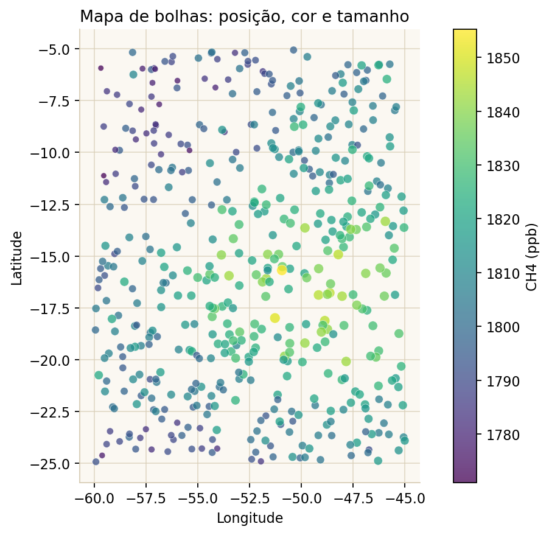
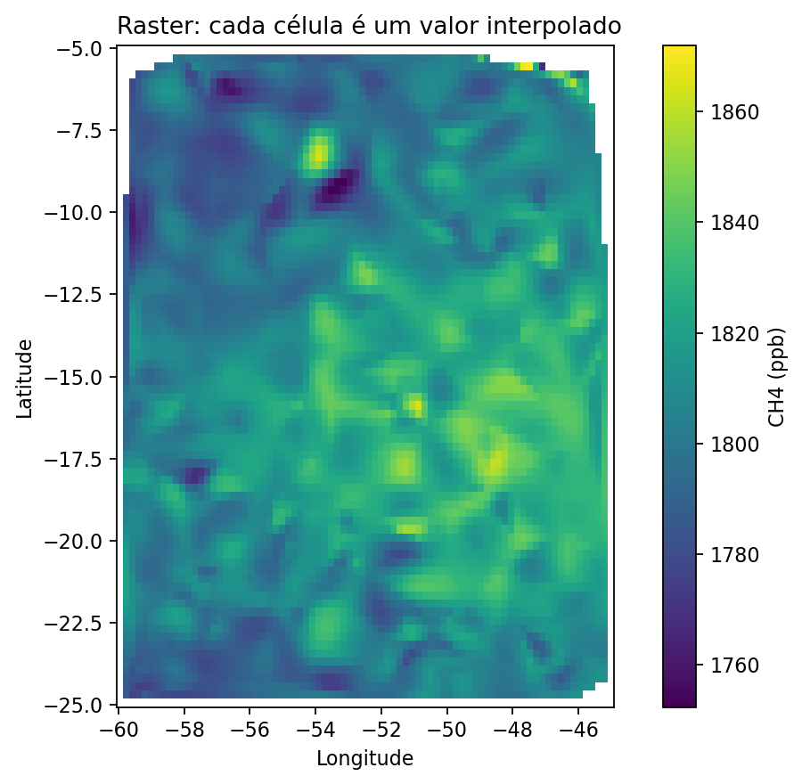
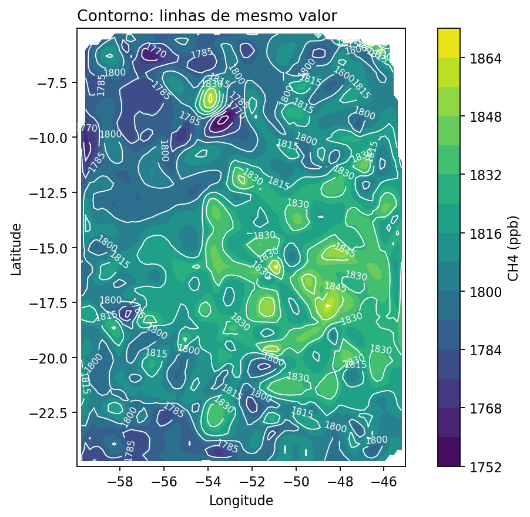
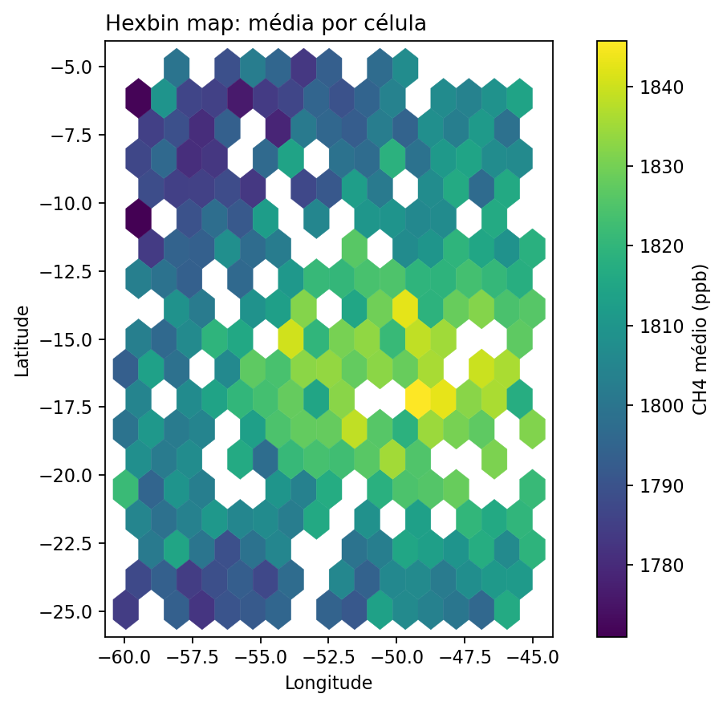
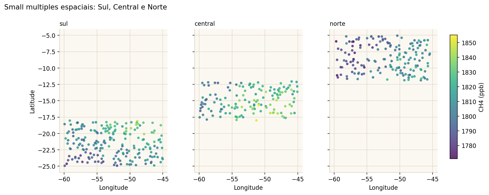
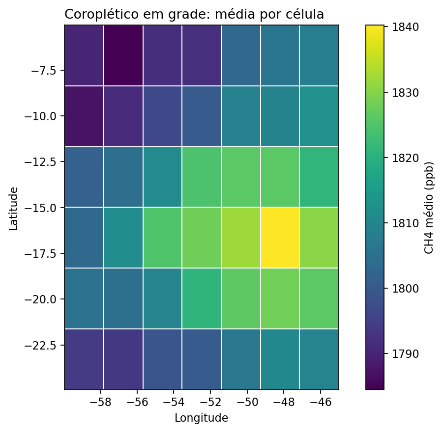

<div class="page-meta">Nível: todos · Tempo: 15 min · Pré-requisito: Relação</div>

<div class="objetivo">
<b>Objetivo:</b> mostrar padrão geográfico sem esconder escala, projeção, densidade e
dependência espacial.
</div>

## Três cuidados antes do mapa

1. **Escala e unidade de análise** — município, pixel, ponto? O padrão muda com a unidade
   (MAUP).
2. **Projeção** — latitude/longitude não preserva distância; para área, use projeção
   adequada.
3. **Dependência espacial** — vizinhos se parecem; validação aleatória vaza informação.

## Dados

`data/exemplo_espacial.csv`: 500 pontos sintéticos com longitude, latitude e CH4. É um
exemplo didático; um mapa real precisa de polígonos ou raster com CRS.

## Mapa de bolhas

{fig-align="center" width="80%"}

- **O que mostra:** posição + valor por cor + magnitude por tamanho.
- **O que esconde:** sobreposição e densidade; pontos grandes escondem pequenos.
- **Quando usar:** dados pontuais, quando há uma variável de magnitude.
- **Acessibilidade:** use legenda de tamanho e paleta sequencial; não confie só na cor.

::: {.callout-note collapse="true" title="Código Python"}
```python
import pandas as pd
import matplotlib.pyplot as plt

dados = pd.read_csv("data/exemplo_espacial.csv")

fig, ax = plt.subplots(figsize=(7, 6))
sc = ax.scatter(
    dados["lon"], dados["lat"], c=dados["ch4"],
    s=18 + 0.5 * (dados["ch4"] - dados["ch4"].min()),
    cmap="viridis", alpha=0.75, edgecolor="white", linewidth=0.3,
)
fig.colorbar(sc, ax=ax, label="CH4 (ppb)")
ax.set_xlabel("Longitude")
ax.set_ylabel("Latitude")
ax.set_aspect("equal")
plt.show()
```
:::

## Raster

{fig-align="center" width="80%"}

- **O que mostra:** superfície contínua em uma grade.
- **O que esconde:** a interpolação; células vazias e bordas podem ser artefato.
- **Quando usar:** dados em grade regular (satélite, modelo, raster).
- **Cuidado:** interpolar pontos esparsos inventa valores onde não há dado.

::: {.callout-note collapse="true" title="Código Python"}
```python
import numpy as np
import pandas as pd
import matplotlib.pyplot as plt
from scipy.interpolate import griddata

dados = pd.read_csv("data/exemplo_espacial.csv")
gx = np.linspace(dados["lon"].min(), dados["lon"].max(), 80)
gy = np.linspace(dados["lat"].min(), dados["lat"].max(), 80)
GX, GY = np.meshgrid(gx, gy)
GZ = griddata((dados["lon"], dados["lat"]), dados["ch4"],
              (GX, GY), method="cubic")

fig, ax = plt.subplots(figsize=(7, 6))
mesh = ax.pcolormesh(GX, GY, GZ, cmap="viridis", shading="auto")
fig.colorbar(mesh, ax=ax, label="CH4 (ppb)")
ax.set_xlabel("Longitude")
ax.set_ylabel("Latitude")
ax.set_aspect("equal")
plt.show()
```
:::

## Contorno

{fig-align="center" width="80%"}

- **O que mostra:** isolinhas de valor; bom para gradientes e máximos.
- **O que esconde:** a variabilidade dentro de cada faixa.
- **Quando usar:** quando você quer ler valores e fronteiras.
- **Cuidado:** muitas linhas confundem; rotule as principais.

::: {.callout-note collapse="true" title="Código Python"}
```python
import numpy as np
import pandas as pd
import matplotlib.pyplot as plt
from scipy.interpolate import griddata

dados = pd.read_csv("data/exemplo_espacial.csv")
gx = np.linspace(dados["lon"].min(), dados["lon"].max(), 80)
gy = np.linspace(dados["lat"].min(), dados["lat"].max(), 80)
GX, GY = np.meshgrid(gx, gy)
GZ = griddata((dados["lon"], dados["lat"]), dados["ch4"],
              (GX, GY), method="cubic")

fig, ax = plt.subplots(figsize=(7, 6))
cf = ax.contourf(GX, GY, GZ, levels=14, cmap="viridis")
cs = ax.contour(GX, GY, GZ, levels=8, colors="white", linewidths=0.8)
ax.clabel(cs, inline=True, fontsize=7)
fig.colorbar(cf, ax=ax, label="CH4 (ppb)")
ax.set_xlabel("Longitude")
ax.set_ylabel("Latitude")
ax.set_aspect("equal")
plt.show()
```
:::

## Hexbin map

{fig-align="center" width="80%"}

- **O que mostra:** densidade e média por célula; bom para muitos pontos.
- **O que esconde:** o valor individual dentro da célula.
- **Quando usar:** dados pontuais densos.
- **Acessibilidade:** use paleta sequencial e legenda de contagem/média.

::: {.callout-note collapse="true" title="Código Python"}
```python
import numpy as np
import pandas as pd
import matplotlib.pyplot as plt

dados = pd.read_csv("data/exemplo_espacial.csv")

fig, ax = plt.subplots(figsize=(7, 6))
hb = ax.hexbin(dados["lon"], dados["lat"], C=dados["ch4"],
               reduce_C_function=np.mean, gridsize=16,
               cmap="viridis", mincnt=1, linewidths=0.2)
fig.colorbar(hb, ax=ax, label="CH4 médio (ppb)")
ax.set_xlabel("Longitude")
ax.set_ylabel("Latitude")
ax.set_aspect("equal")
plt.show()
```
:::

## Small multiples

{fig-align="center" width="96%"}

- **O que mostra:** o mesmo tipo de mapa em vários recortes, com escala comparável.
- **O que esconde:** a comparação exige olhar vários painéis.
- **Quando usar:** comparar regiões, anos ou cenários.
- **Acessibilidade:** compartilhe a escala de cor e o eixo; caso contrário, a comparação engana.

::: {.callout-note collapse="true" title="Código Python"}
```python
import pandas as pd
import matplotlib.pyplot as plt

dados = pd.read_csv("data/exemplo_espacial.csv")
dados["faixa"] = pd.cut(dados["lat"], bins=[-float("inf"), -18, -12, float("inf")],
                        labels=["sul", "central", "norte"])

fig, eixos = plt.subplots(1, 3, figsize=(12, 4.5), sharex=True, sharey=True)
vmin, vmax = dados["ch4"].min(), dados["ch4"].max()
for ax, faixa in zip(eixos, ["sul", "central", "norte"]):
    sub = dados[dados["faixa"] == faixa]
    sc = ax.scatter(sub["lon"], sub["lat"], c=sub["ch4"], s=20,
                    cmap="viridis", vmin=vmin, vmax=vmax,
                    alpha=0.8, edgecolor="white", linewidth=0.2)
    ax.set_title(faixa, loc="left")
    ax.set_xlabel("Longitude")
    ax.set_aspect("equal")
fig.colorbar(sc, ax=eixos, location="right", label="CH4 (ppb)", shrink=0.8)
plt.show()
```
:::

## Coroplético em grade

{fig-align="center" width="80%"}

- **O que mostra:** média por unidade espacial; bom para comparar áreas.
- **O que esconde:** a variação dentro da área e o tamanho desigual das unidades.
- **Quando usar:** quando a unidade de análise é uma área (município, estado, célula).
- **Cuidado:** use taxas/proporções, não contagens; e diga qual é a unidade.

::: {.callout-note collapse="true" title="Código Python"}
```python
import numpy as np
import pandas as pd
import matplotlib.pyplot as plt

dados = pd.read_csv("data/exemplo_espacial.csv")
nx, ny = 7, 6
xedges = np.linspace(dados["lon"].min(), dados["lon"].max(), nx + 1)
yedges = np.linspace(dados["lat"].min(), dados["lat"].max(), ny + 1)
ix = np.clip(np.digitize(dados["lon"], xedges) - 1, 0, nx - 1)
iy = np.clip(np.digitize(dados["lat"], yedges) - 1, 0, ny - 1)
grade = np.full((ny, nx), np.nan)
for i in range(nx):
    for j in range(ny):
        vals = dados.loc[(ix == i) & (iy == j), "ch4"]
        if len(vals):
            grade[j, i] = vals.mean()

fig, ax = plt.subplots(figsize=(7, 6))
mesh = ax.pcolormesh(xedges, yedges, grade, cmap="viridis",
                     edgecolors="white", linewidth=0.8)
fig.colorbar(mesh, ax=ax, label="CH4 médio (ppb)")
ax.set_xlabel("Longitude")
ax.set_ylabel("Latitude")
ax.set_aspect("equal")
plt.show()
```
:::

::: {.callout-note}
## Coroplético de verdade
Um coroplético real usa **polígonos** (municípios, estados, bacias), não uma grade. No
Python, `geopandas` + uma projeção adequada resolvem. A grade acima serve para ensinar a
lógica; não substitui o mapa oficial.
:::

## Cuidados com espaço

- **Projeção:** longitude/latitude não preserva área; use uma projeção adequada para
  calcular densidade ou distância.
- **MAUP:** o padrão muda quando você muda a unidade de análise.
- **Autocorrelação:** vizinhos se parecem; use validação espacial (blocos) e reporte Moran's I.
- **Interpolação:** não invente valores onde não há amostra.
- **Escala de cor:** use paleta sequencial e compare mapas com a mesma escala.

## Próximo passo

Volte à [galeria](index.qmd) ou veja [cores e acessibilidade](04-cores-acessibilidade.qmd).
