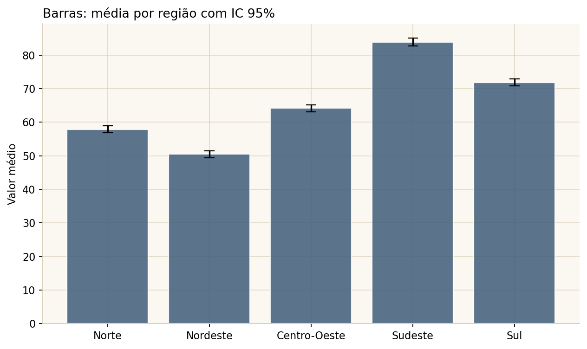
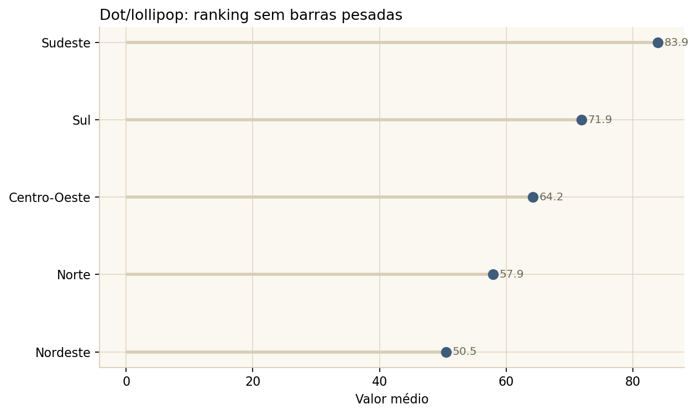
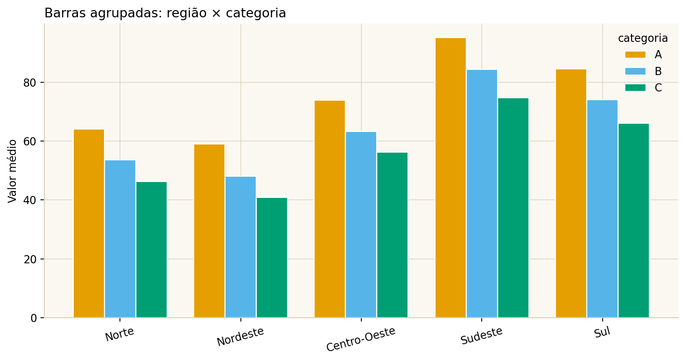
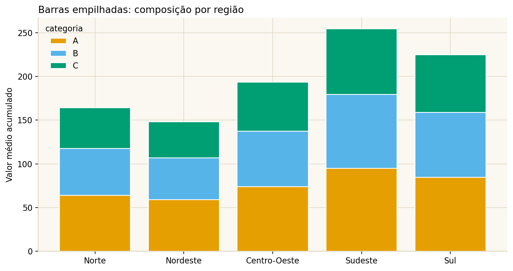
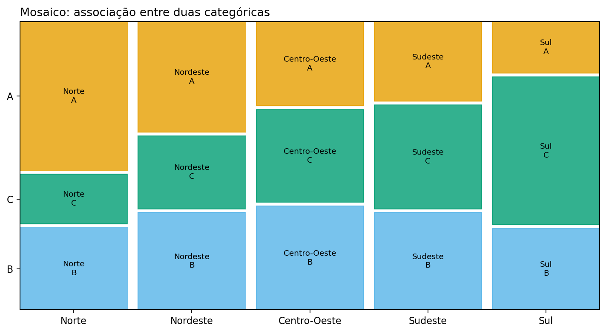
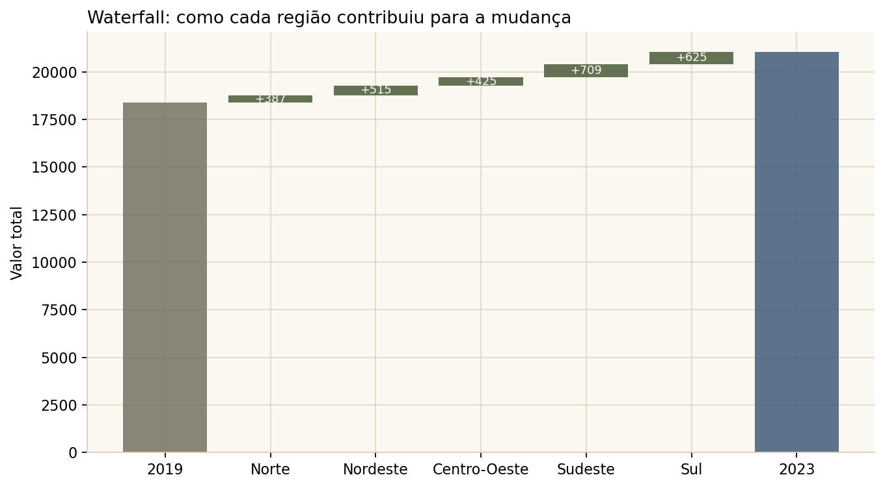

<div class="page-meta">Nível: todos · Tempo: 15 min · Pré-requisito: Distribuição</div>

<div class="objetivo">
<b>Objetivo:</b> comparar categorias, mostrar composição e evitar os gráficos que escondem
a incerteza ou exageram diferenças.
</div>

## Duas perguntas diferentes

- **Comparação:** qual categoria tem o maior valor?
- **Composição:** como o todo se divide entre as categorias?

Barras respondem à primeira; empilhadas, mosaico e Sankey respondem à segunda.

## Dados

`data/exemplo_categorias.csv`: 1.500 linhas sintéticas com região, categoria, ano e valor.

## Barras com IC

{fig-align="center" width="82%"}

- **O que mostra:** comparação de médias com incerteza.
- **O que esconde:** a distribuição; uma média pode esconder bimodalidade.
- **Quando usar:** poucas categorias, comparação direta.
- **Cuidado:** barras devem começar em zero; o IC não é uma “chance de acertar”.

::: {.callout-note collapse="true" title="Código Python"}
```python
import pandas as pd
import matplotlib.pyplot as plt

dados = pd.read_csv("data/exemplo_categorias.csv")
media = dados.groupby("regiao")["valor"].mean()
erro = dados.groupby("regiao")["valor"].sem() * 1.96

fig, ax = plt.subplots(figsize=(8, 5))
ax.bar(media.index, media, yerr=erro, capsize=5, color="#3f5d7a", alpha=0.85)
ax.set_ylabel("Valor médio")
plt.show()
```
:::

## Dot/lollipop

{fig-align="center" width="82%"}

- **O que mostra:** ranking e magnitude com menos tinta.
- **O que esconde:** a incerteza, se você não adicionar IC.
- **Quando usar:** muitas categorias, ranking, relatório executivo.
- **Acessibilidade:** o ponto é o dado; a linha é só guia.

::: {.callout-note collapse="true" title="Código Python"}
```python
import pandas as pd
import matplotlib.pyplot as plt

dados = pd.read_csv("data/exemplo_categorias.csv")
media = dados.groupby("regiao")["valor"].mean().sort_values()

fig, ax = plt.subplots(figsize=(8, 5))
for i, (reg, valor) in enumerate(media.items()):
    ax.hlines(i, 0, valor, color="#d8cdb6", linewidth=2.5)
    ax.scatter(valor, i, color="#3f5d7a", s=60, zorder=3)
ax.set_yticks(range(len(media)), media.index)
ax.set_xlabel("Valor médio")
plt.show()
```
:::

## Barras agrupadas

{fig-align="center" width="88%"}

- **O que mostra:** comparação entre categorias dentro de cada região.
- **O que esconde:** a composição total; o grupo maior domina a leitura.
- **Quando usar:** duas categóricas e uma resposta contínua.
- **Cuidado:** muitas categorias viram um labirinto; agrupe ou use small multiples.

::: {.callout-note collapse="true" title="Código Python"}
```python
import numpy as np
import pandas as pd
import matplotlib.pyplot as plt

dados = pd.read_csv("data/exemplo_categorias.csv")
piv = dados.groupby(["regiao", "categoria"])["valor"].mean().unstack()
x = np.arange(len(piv))
largura = 0.26

fig, ax = plt.subplots(figsize=(9, 5))
for i, cat in enumerate(piv.columns):
    ax.bar(x + (i - 1) * largura, piv[cat], width=largura, label=cat)
ax.set_xticks(x, piv.index, rotation=15)
ax.set_ylabel("Valor médio")
ax.legend(title="categoria", frameon=False)
plt.show()
```
:::

## Barras empilhadas

{fig-align="center" width="88%"}

- **O que mostra:** composição do total por categoria.
- **O que esconde:** a comparação entre as categorias do meio; elas não partem da mesma base.
- **Quando usar:** quando o todo é a mensagem.
- **Cuidado:** para comparar categorias, prefira barras agrupadas ou 100% empilhadas.

::: {.callout-note collapse="true" title="Código Python"}
```python
import numpy as np
import pandas as pd
import matplotlib.pyplot as plt

dados = pd.read_csv("data/exemplo_categorias.csv")
piv = dados.groupby(["regiao", "categoria"])["valor"].mean().unstack()

fig, ax = plt.subplots(figsize=(9, 5))
base = np.zeros(len(piv))
for cat in piv.columns:
    ax.bar(piv.index, piv[cat], bottom=base, label=cat, edgecolor="white")
    base += piv[cat].to_numpy()
ax.set_ylabel("Valor médio acumulado")
ax.legend(title="categoria", frameon=False)
plt.show()
```
:::

## Mosaico

{fig-align="center" width="90%"}

- **O que mostra:** associação entre duas categóricas; a área de cada célula é a contagem.
- **O que esconde:** a incerteza e o tamanho amostral por célula.
- **Quando usar:** tabelas de contingência, associação entre categorias.
- **Cuidado:** células pequenas são instáveis; não leia proporções sem o n.

::: {.callout-note collapse="true" title="Código Python"}
```python
import pandas as pd
import matplotlib.pyplot as plt
from statsmodels.graphics.mosaicplot import mosaic

dados = pd.read_csv("data/exemplo_categorias.csv")
cores = {"A": "#E69F00", "B": "#56B4E9", "C": "#009E73"}

fig, ax = plt.subplots(figsize=(9, 5))
mosaic(
    dados, ["regiao", "categoria"], ax=ax, gap=0.02,
    properties=lambda key: {"color": cores.get(key[1], "#d8cdb6"), "alpha": 0.8},
)
plt.show()
```
:::

## Waterfall

{fig-align="center" width="86%"}

- **O que mostra:** como cada categoria contribuiu para uma mudança total.
- **O que esconde:** a ordem das barras muda a leitura; não há incerteza.
- **Quando usar:** decompor uma variação, orçamento, balanço.
- **Cuidado:** a soma das contribuições precisa fechar com o total.

::: {.callout-note collapse="true" title="Código Python"}
```python
import pandas as pd
import matplotlib.pyplot as plt

dados = pd.read_csv("data/exemplo_categorias.csv")
totais = dados.groupby(["ano", "regiao"])["valor"].sum()
inicio = totais.loc[2019].sum()
fim = totais.loc[2023].sum()
deltas = totais.loc[2023] - totais.loc[2019]

fig, ax = plt.subplots(figsize=(9, 5))
atual = inicio
ax.bar("2019", inicio, color="#6e6a59")
for reg, delta in deltas.items():
    ax.bar(reg, delta, bottom=atual, color="#4a5937" if delta >= 0 else "#b96a4c")
    atual += delta
ax.bar("2023", fim, color="#3f5d7a")
plt.show()
```
:::

## Sankey

<iframe src="../../img/plot_cat_sankey.html" width="100%" height="540" style="border:none;" loading="lazy"></iframe>

- **O que mostra:** fluxo de valor entre região e categoria.
- **O que esconde:** a incerteza e a variação temporal; é uma foto agregada.
- **Quando usar:** composição com fluxo, alocação, migração entre estados.
- **Cuidado:** muitos nós viram espaguete; agrupe categorias pequenas.

::: {.callout-note collapse="true" title="Código Python"}
```python
import pandas as pd
import plotly.graph_objects as go

dados = pd.read_csv("data/exemplo_categorias.csv")
fluxo = dados.groupby(["regiao", "categoria"])["valor"].sum().reset_index()
regioes = list(fluxo["regiao"].unique())
categorias = list(fluxo["categoria"].unique())
labels = regioes + categorias
source = [labels.index(r) for r in fluxo["regiao"]]
target = [labels.index(c) for c in fluxo["categoria"]]

fig = go.Figure(go.Sankey(
    node=dict(label=labels, pad=18, thickness=18),
    link=dict(source=source, target=target, value=fluxo["valor"]),
))
fig.show()
```
:::

## Cuidados com categorias

- **Barras começam em zero.** Eixo truncado exagera diferenças.
- **Pizza com muitas categorias** é difícil de comparar; use barras.
- **Ordem:** ordene por valor ou por uma ordem lógica; não deixe alfabética por acaso.
- **Contagem vs taxa:** em áreas diferentes, compare taxas, não contagens.
- **Cores:** use paleta categórica acessível (Okabe-Ito) e repita a informação em rótulos.

## Próximo passo

[Multivariado](08-multivariado.qmd).
