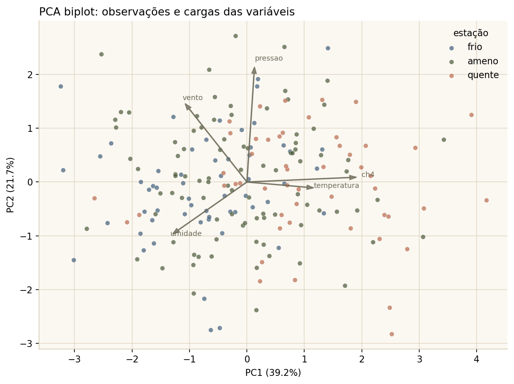
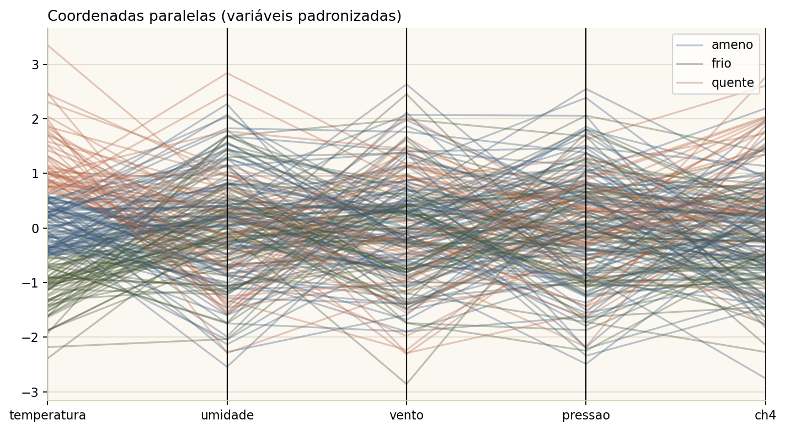
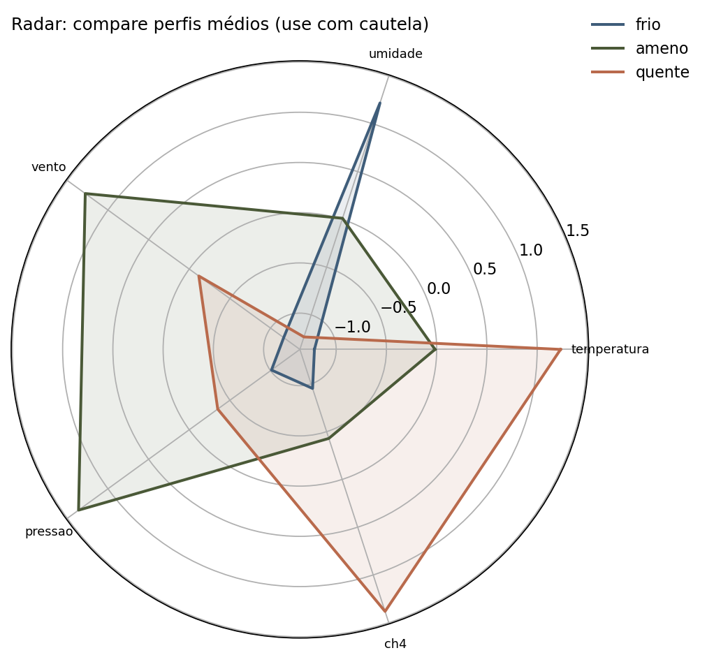
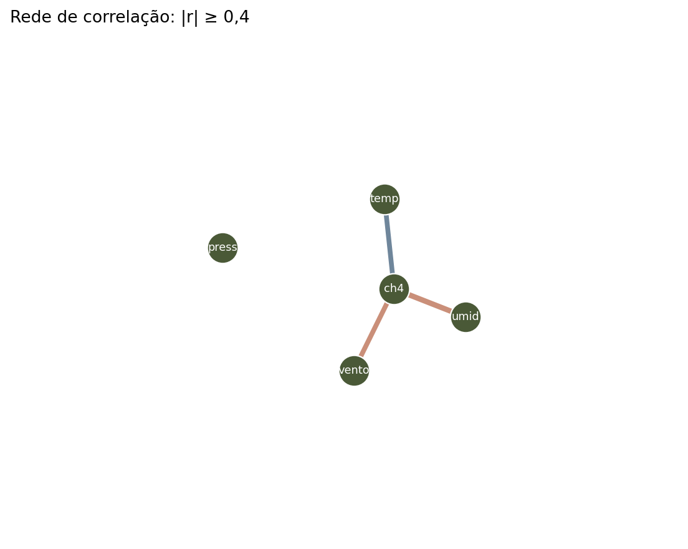

<div class="page-meta">Nível: avançado · Tempo: 15 min · Pré-requisito: Relação</div>

<div class="objetivo">
<b>Objetivo:</b> ver várias variáveis ao mesmo tempo sem esconder escala, grupos ou
multicolinearidade.
</div>

## O problema

Com mais de duas variáveis, você precisa escolher o que sacrificar: posição, cor, tamanho,
forma ou uma projeção. Cada gráfico multivariado sacrifica algo.

## PCA biplot

{fig-align="center" width="86%"}

- **O que mostra:** a variância principal e quais variáveis puxam cada eixo.
- **O que esconde:** relações não lineares e a escala original; componentes são combinações.
- **Quando usar:** explorar estrutura, multicolinearidade, agrupamentos.
- **Cuidado:** padronize as variáveis; as setas são cargas, não causalidade.

::: {.callout-note collapse="true" title="Código Python"}
```python
import pandas as pd
import matplotlib.pyplot as plt
from sklearn.decomposition import PCA
from sklearn.preprocessing import StandardScaler

dados = pd.read_csv("data/exemplo_ch4.csv")
features = ["temperatura", "umidade", "vento", "pressao", "ch4"]
X = StandardScaler().fit_transform(dados[features])
pca = PCA(n_components=2).fit(X)
Z = pca.transform(X)

fig, ax = plt.subplots(figsize=(8, 6))
ax.scatter(Z[:, 0], Z[:, 1], s=25, alpha=0.7)
for i, nome in enumerate(features):
    ax.arrow(0, 0, pca.components_[0, i] * 2.6, pca.components_[1, i] * 2.6,
             color="#6e6a59", width=0.01, head_width=0.08)
    ax.text(pca.components_[0, i] * 2.9, pca.components_[1, i] * 2.9, nome, fontsize=8)
ax.set_xlabel(f"PC1 ({pca.explained_variance_ratio_[0]*100:.1f}%)")
ax.set_ylabel(f"PC2 ({pca.explained_variance_ratio_[1]*100:.1f}%)")
plt.show()
```
:::

## Coordenadas paralelas

{fig-align="center" width="90%"}

- **O que mostra:** o perfil de cada observação ao longo de várias variáveis.
- **O que esconde:** a ordem das variáveis muda a leitura; com muitas linhas vira ruído.
- **Quando usar:** comparar perfis entre grupos, detectar cruzamentos.
- **Cuidado:** padronize as variáveis; caso contrário, a de maior escala domina.

::: {.callout-note collapse="true" title="Código Python"}
```python
import pandas as pd
import matplotlib.pyplot as plt
from sklearn.preprocessing import StandardScaler

dados = pd.read_csv("data/exemplo_ch4.csv")
dados["estacao"] = pd.cut(dados["temperatura"], bins=[-float("inf"), 23, 27, float("inf")],
                          labels=["frio", "ameno", "quente"])
features = ["temperatura", "umidade", "vento", "pressao", "ch4"]
par = dados[features + ["estacao"]].copy()
par[features] = StandardScaler().fit_transform(par[features])

fig, ax = plt.subplots(figsize=(9, 5))
pd.plotting.parallel_coordinates(par, "estacao", alpha=0.35, ax=ax)
plt.show()
```
:::

## Radar

{fig-align="center" width="70%"}

- **O que mostra:** comparação de perfis em várias dimensões.
- **O que esconde:** a área distorce a percepção; a ordem dos eixos muda a forma.
- **Quando usar:** comunicação rápida de perfis, com poucas variáveis.
- **Cuidado:** radar não é bom para valores exatos; prefira barras ou small multiples.

::: {.callout-note collapse="true" title="Código Python"}
```python
import numpy as np
import pandas as pd
import matplotlib.pyplot as plt

dados = pd.read_csv("data/exemplo_ch4.csv")
dados["estacao"] = pd.cut(dados["temperatura"], bins=[-float("inf"), 23, 27, float("inf")],
                          labels=["frio", "ameno", "quente"])
features = ["temperatura", "umidade", "vento", "pressao", "ch4"]
medias = dados.groupby("estacao")[features].mean()
medias_z = (medias - medias.mean()) / medias.std(ddof=0)

angulos = np.linspace(0, 2 * np.pi, len(features), endpoint=False).tolist()
angulos += angulos[:1]
fig, ax = plt.subplots(figsize=(7, 6), subplot_kw=dict(polar=True))
for est in medias_z.index:
    valores = medias_z.loc[est].tolist()
    valores += valores[:1]
    ax.plot(angulos, valores, label=est)
    ax.fill(angulos, valores, alpha=0.1)
ax.set_xticks(angulos[:-1], features)
ax.legend(frameon=False)
plt.show()
```
:::

## Rede de correlação

{fig-align="center" width="76%"}

- **O que mostra:** quais variáveis estão conectadas por correlação.
- **O que esconde:** a força exata e a direção; o limite de |r| é uma escolha.
- **Quando usar:** triagem visual de muitas variáveis.
- **Cuidado:** correlação não é causalidade; o layout é arbitrário.

::: {.callout-note collapse="true" title="Código Python"}
```python
import numpy as np
import pandas as pd
import matplotlib.pyplot as plt
import networkx as nx

dados = pd.read_csv("data/exemplo_ch4.csv")
features = ["temperatura", "umidade", "vento", "pressao", "ch4"]
corr = dados[features].corr()
G = nx.Graph()
G.add_nodes_from(features)
for i, a in enumerate(features):
    for b in features[i + 1:]:
        r = corr.loc[a, b]
        if abs(r) >= 0.4:
            G.add_edge(a, b, weight=abs(r), sign=np.sign(r))
pos = nx.spring_layout(G, seed=42, k=1.2)

fig, ax = plt.subplots(figsize=(7, 6))
for u, v, d in G.edges(data=True):
    cor = "#3f5d7a" if d["sign"] > 0 else "#b96a4c"
    ax.plot([pos[u][0], pos[v][0]], [pos[u][1], pos[v][1]],
            color=cor, linewidth=1 + 5 * d["weight"], alpha=0.75)
for no, (x, y) in pos.items():
    ax.scatter(x, y, s=500, color="#4a5937")
    ax.text(x, y, no, ha="center", va="center", color="white", fontsize=8)
ax.axis("off")
plt.show()
```
:::

## Cuidados multivariados

- **Padronize** antes de PCA, distância e coordenadas paralelas.
- **PCA é linear.** Estruturas curvas podem não aparecer nos primeiros componentes.
- **Ordenação** das variáveis nas coordenadas paralelas muda a história.
- **Radar distorce área.** Use com moderação e explique.
- **Rede com limiar** é uma escolha; mostre o critério.

## Próximo passo

[Incerteza](09-incerteza.qmd).
