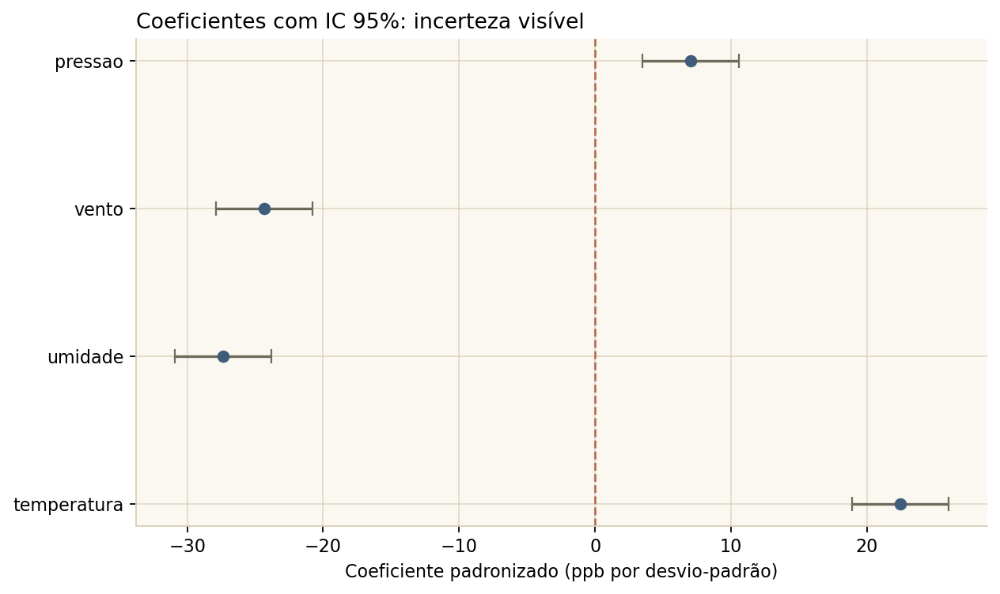
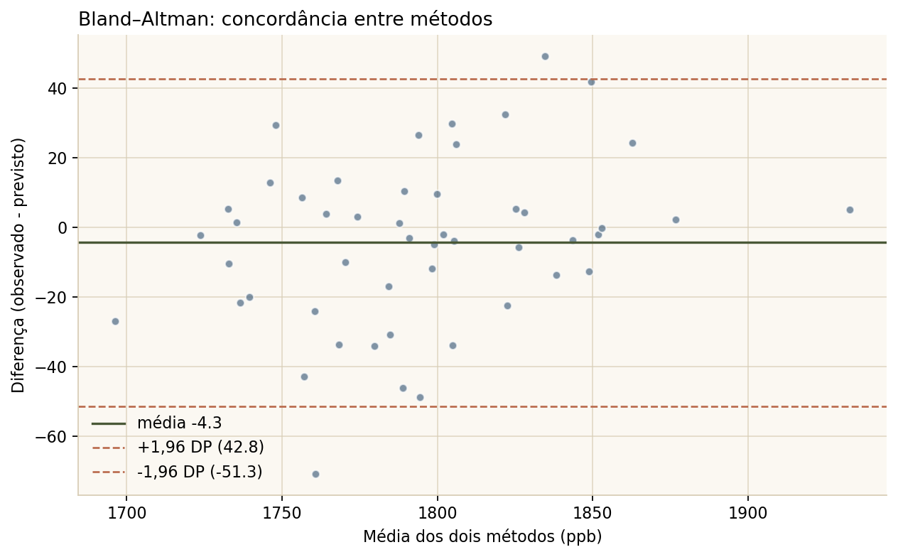
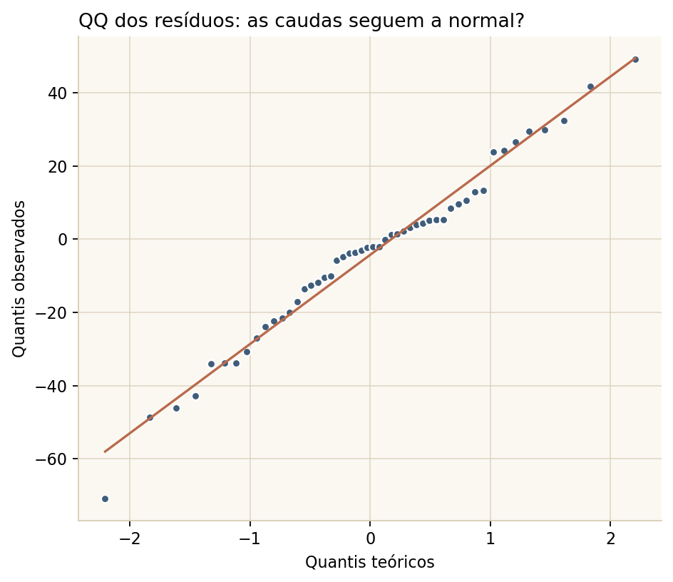
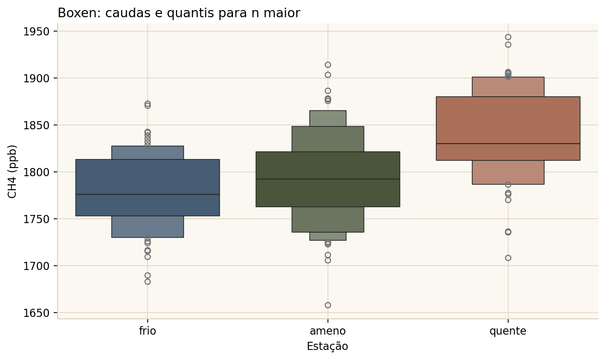

<div class="page-meta">Nível: avançado · Tempo: 14 min · Pré-requisito: Distribuição</div>

<div class="objetivo">
<b>Objetivo:</b> mostrar estimativa, incerteza e concordância sem transformar um número
pontual em certeza.
</div>

## O número sozinho mente

Uma média sem intervalo, um coeficiente sem erro-padrão e um R² sem validação cruzada
escondem a variabilidade. Os gráficos desta página colocam a incerteza no centro.

## Coeficientes com IC

{fig-align="center" width="84%"}

- **O que mostra:** estimativa e intervalo de confiança de cada coeficiente.
- **O que esconde:** a estrutura de correlação entre os preditores e o desenho do estudo.
- **Quando usar:** modelos lineares, meta-análise, comparação de efeitos.
- **Cuidado:** o IC de 95% não significa “95% de chance de o verdadeiro valor estar aqui”.

::: {.callout-note collapse="true" title="Código Python"}
```python
import numpy as np
import pandas as pd
import matplotlib.pyplot as plt
import statsmodels.api as sm
from sklearn.preprocessing import StandardScaler

dados = pd.read_csv("data/exemplo_ch4.csv")
features = ["temperatura", "umidade", "vento", "pressao"]
X = StandardScaler().fit_transform(dados[features])
X = sm.add_constant(X)
modelo = sm.OLS(dados["ch4"], X).fit()

nomes = features
coefs = modelo.params[1:]
ics = modelo.conf_int().iloc[1:]

fig, ax = plt.subplots(figsize=(8, 5))
y = np.arange(len(nomes))
ax.errorbar(coefs, y, xerr=[coefs - ics[0], ics[1] - coefs],
            fmt="o", color="#3f5d7a", ecolor="#6e6a59", capsize=4)
ax.axvline(0, color="#b96a4c", linestyle="--")
ax.set_yticks(y, nomes)
ax.set_xlabel("Coeficiente padronizado (ppb por DP)")
plt.show()
```
:::

## Bland–Altman

{fig-align="center" width="84%"}

- **O que mostra:** diferença entre dois métodos contra a média; viés e limites de concordância.
- **O que esconde:** a ordem dos pares e a relação com outras variáveis.
- **Quando usar:** comparar dois métodos de medição ou dois modelos.
- **Cuidado:** os limites de concordância dependem da amostra; não são “limites de verdade”.

::: {.callout-note collapse="true" title="Código Python"}
```python
import pandas as pd
import matplotlib.pyplot as plt
from sklearn.linear_model import LinearRegression
from sklearn.model_selection import train_test_split

dados = pd.read_csv("data/exemplo_ch4.csv")
X = dados[["temperatura", "umidade", "vento", "pressao"]]
y = dados["ch4"]
X_tr, X_te, y_tr, y_te = train_test_split(X, y, test_size=0.25, random_state=42)
modelo = LinearRegression().fit(X_tr, y_tr)
pred = modelo.predict(X_te)

media = (y_te + pred) / 2
dif = y_te - pred
md = dif.mean()
sd = dif.std(ddof=1)

fig, ax = plt.subplots(figsize=(8, 5))
ax.scatter(media, dif, s=26, color="#3f5d7a", alpha=0.65)
ax.axhline(md, color="#4a5937", label=f"média {md:.1f}")
ax.axhline(md + 1.96 * sd, color="#b96a4c", linestyle="--")
ax.axhline(md - 1.96 * sd, color="#b96a4c", linestyle="--")
ax.set_xlabel("Média dos métodos (ppb)")
ax.set_ylabel("Diferença (observado - previsto)")
ax.legend(frameon=False)
plt.show()
```
:::

## QQ dos resíduos

{fig-align="center" width="66%"}

- **O que mostra:** se os resíduos seguem aproximadamente uma normal.
- **O que esconde:** desvios no centro e a influência de poucos pontos.
- **Quando usar:** diagnóstico de modelos lineares e de testes paramétricos.
- **Cuidado:** é visual, não um teste; com `n` grande, pequenos desvios parecem grandes.

::: {.callout-note collapse="true" title="Código Python"}
```python
import pandas as pd
import matplotlib.pyplot as plt
from scipy import stats
from sklearn.linear_model import LinearRegression
from sklearn.model_selection import train_test_split

dados = pd.read_csv("data/exemplo_ch4.csv")
X = dados[["temperatura", "umidade", "vento", "pressao"]]
y = dados["ch4"]
X_tr, X_te, y_tr, y_te = train_test_split(X, y, test_size=0.25, random_state=42)
res = y_te - LinearRegression().fit(X_tr, y_tr).predict(X_te)

fig, ax = plt.subplots(figsize=(6, 5))
stats.probplot(res, dist="norm", plot=ax)
plt.show()
```
:::

## Boxen

{fig-align="center" width="84%"}

- **O que mostra:** mais quantis do que o boxplot; bom para caudas e `n` grande.
- **O que esconde:** a forma exata e os pontos individuais.
- **Quando usar:** distribuições assimétricas, muitos dados.
- **Cuidado:** com `n` pequeno, o boxen é instável; prefira box ou strip.

::: {.callout-note collapse="true" title="Código Python"}
```python
import pandas as pd
import matplotlib.pyplot as plt
import seaborn as sns

dados = pd.read_csv("data/exemplo_ch4.csv")
dados["estacao"] = pd.cut(dados["temperatura"], bins=[-float("inf"), 23, 27, float("inf")],
                          labels=["frio", "ameno", "quente"])

fig, ax = plt.subplots(figsize=(8, 5))
sns.boxenplot(data=dados, x="estacao", y="ch4", ax=ax)
plt.show()
```
:::

## Cuidados com incerteza

- **IC não é probabilidade do parâmetro.** É uma propriedade do procedimento.
- **Erro-padrão não é desvio-padrão.** O primeiro é a incerteza da estimativa; o segundo, a
  dispersão dos dados.
- **Bland–Altman** exige pares; não use com amostras independentes.
- **QQ** é sensível ao tamanho da amostra e a outliers.
- **Reporte a incerteza** junto com a estimativa, sempre.

## Próximo passo

[Diagnóstico de regressão](10-diagnostico-regressao.qmd).
