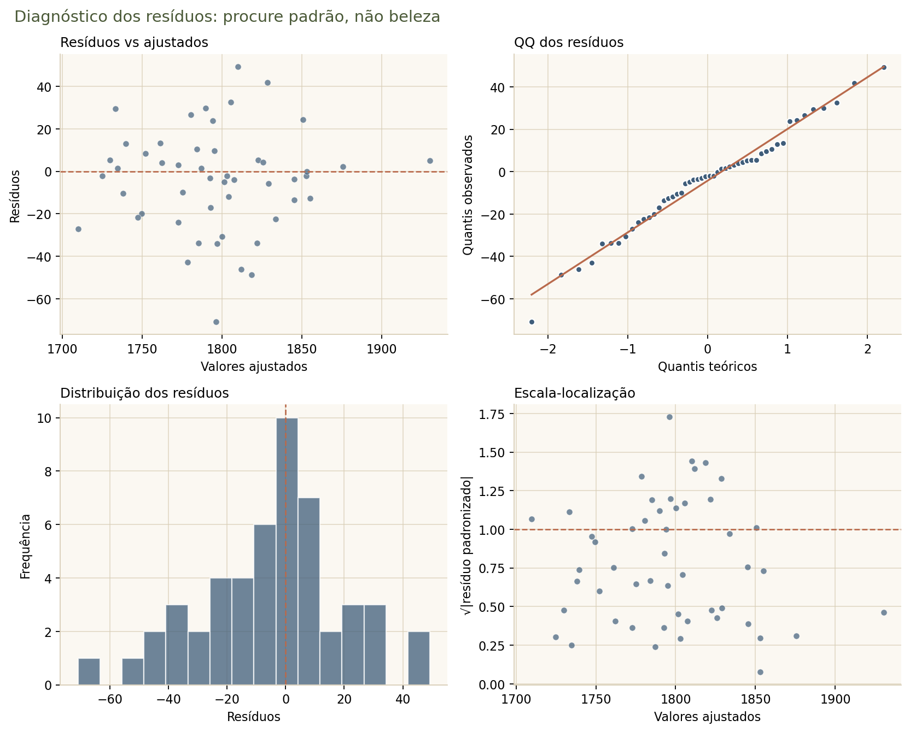
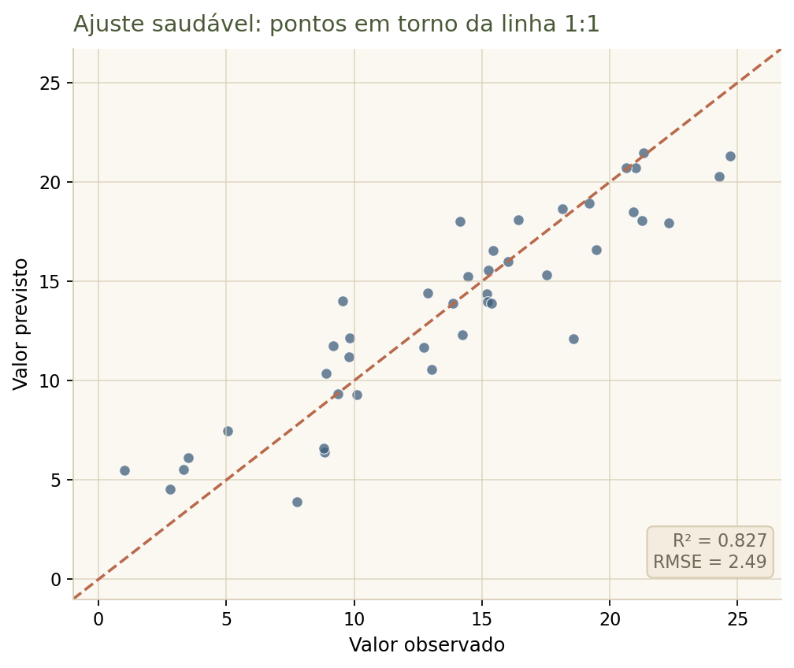
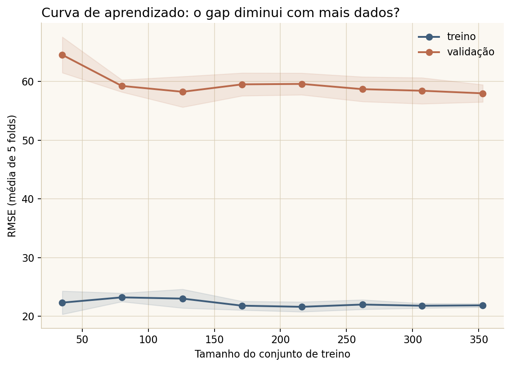
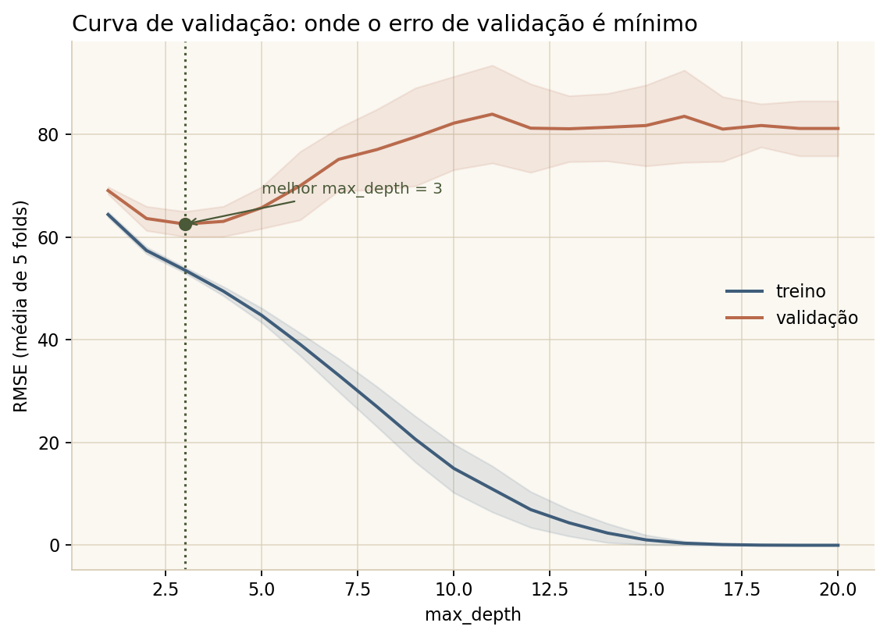
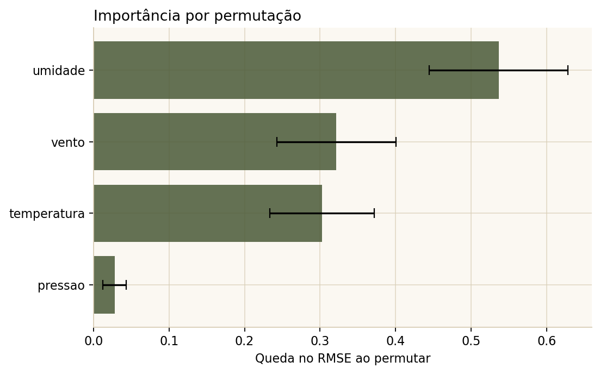
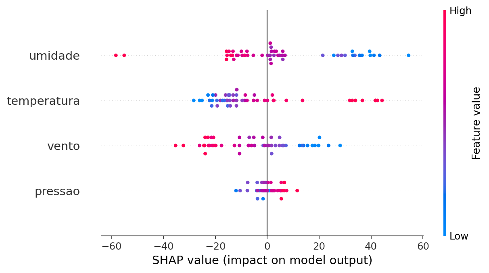

<div class="page-meta">Nível: avançado · Tempo: 15 min · Pré-requisito: Métricas de regressão</div>

<div class="objetivo">
<b>Objetivo:</b> diagnosticar um modelo de regressão com resíduos, curvas de aprendizado,
importância e SHAP — e não só com R².
</div>

## O modelo não é o resultado

Um R² alto pode esconder viés, heterocedasticidade e overfitting. O diagnóstico é o que
transforma um número em uma decisão defensável.

## Resíduos em 4 painéis

{fig-align="center" width="96%"}

- **O que mostra:** padrão nos resíduos, normalidade, heterocedasticidade e outliers.
- **O que esconde:** a ordem temporal e a dependência espacial.
- **Quando usar:** todo modelo de regressão, antes de reportar.
- **Sinais:** U → falta termo não linear; leque → variância não constante; caudas no QQ →
  outliers ou erro não normal.

::: {.callout-note collapse="true" title="Código Python"}
```python
import pandas as pd
import matplotlib.pyplot as plt
from scipy import stats
from sklearn.linear_model import LinearRegression
from sklearn.model_selection import train_test_split

dados = pd.read_csv("data/exemplo_ch4.csv")
X = dados[["temperatura", "umidade", "vento", "pressao"]]
y = dados["ch4"]
X_tr, X_te, y_tr, y_te = train_test_split(X, y, test_size=0.25, random_state=42)
modelo = LinearRegression().fit(X_tr, y_tr)
pred = modelo.predict(X_te)
res = y_te - pred

fig, eixos = plt.subplots(2, 2, figsize=(10, 8))
eixos[0, 0].scatter(pred, res, alpha=0.7)
eixos[0, 0].axhline(0, color="#b96a4c", linestyle="--")
eixos[0, 0].set_xlabel("Ajustados")
eixos[0, 0].set_ylabel("Resíduos")

stats.probplot(res, dist="norm", plot=eixos[0, 1])
eixos[1, 0].hist(res, bins=16)
eixos[1, 1].scatter(pred, (res / res.std()).abs() ** 0.5, alpha=0.7)
plt.show()
```
:::

## Previsto vs observado

{fig-align="center" width="70%"}

- **O que mostra:** se a nuvem acompanha a linha 1:1 e onde o erro é maior.
- **O que esconde:** a distribuição do erro ao longo do tempo ou do espaço.
- **Quando usar:** leitura rápida de viés e faixa.
- **Sinais:** pontos sistematicamente de um lado → viés; curvatura → modelo não linear.

::: {.callout-note collapse="true" title="Código Python"}
```python
import pandas as pd
import matplotlib.pyplot as plt
from sklearn.linear_model import LinearRegression
from sklearn.model_selection import train_test_split

dados = pd.read_csv("data/exemplo_ch4.csv")
X = dados[["temperatura", "umidade", "vento", "pressao"]]
y = dados["ch4"]
X_tr, X_te, y_tr, y_te = train_test_split(X, y, test_size=0.25, random_state=42)
pred = LinearRegression().fit(X_tr, y_tr).predict(X_te)

fig, ax = plt.subplots(figsize=(6, 5))
ax.scatter(y_te, pred, s=30, alpha=0.7)
lim = [min(y_te.min(), pred.min()), max(y_te.max(), pred.max())]
ax.plot(lim, lim, color="#b96a4c", linestyle="--")
ax.set_xlabel("Observado")
ax.set_ylabel("Previsto")
plt.show()
```
:::

## Curva de aprendizado

{fig-align="center" width="80%"}

- **O que mostra:** como treino e validação mudam com o tamanho da amostra.
- **O que esconde:** a variância entre folds e o custo de coletar mais dados.
- **Quando usar:** antes de decidir “preciso de mais dados”.
- **Sinais:** gap grande que não fecha → modelo complexo; curvas convergindo alto → faltam
  features ou o modelo é simples demais.

::: {.callout-note collapse="true" title="Código Python"}
```python
import numpy as np
import pandas as pd
import matplotlib.pyplot as plt
from sklearn.ensemble import RandomForestRegressor
from sklearn.model_selection import learning_curve

dados = pd.read_csv("data/exemplo_ch4.csv")
X = dados[["temperatura", "umidade", "vento", "pressao"]]
y = dados["ch4"]
tam, tr, va = learning_curve(
    RandomForestRegressor(n_estimators=100, random_state=42),
    X, y, cv=5, scoring="neg_root_mean_squared_error",
    train_sizes=np.linspace(0.1, 1.0, 8),
)
fig, ax = plt.subplots(figsize=(8, 5))
ax.plot(tam, -tr.mean(axis=1), label="treino")
ax.plot(tam, -va.mean(axis=1), label="validação")
ax.set_xlabel("Tamanho do treino")
ax.set_ylabel("RMSE")
ax.legend(frameon=False)
plt.show()
```
:::

## Curva de validação

{fig-align="center" width="80%"}

- **O que mostra:** o efeito de um hiperparâmetro no erro de treino e validação.
- **O que esconde:** a interação com outros hiperparâmetros.
- **Quando usar:** calibração manual de um hiperparâmetro.
- **Sinais:** mínimo da validação; se o mínimo está na borda, amplie a faixa.

::: {.callout-note collapse="true" title="Código Python"}
```python
import numpy as np
import pandas as pd
import matplotlib.pyplot as plt
from sklearn.model_selection import validation_curve
from sklearn.tree import DecisionTreeRegressor

dados = pd.read_csv("data/exemplo_ch4.csv")
X = dados[["temperatura", "umidade", "vento", "pressao"]]
y = dados["ch4"]
d = np.arange(1, 21)
tr, va = validation_curve(
    DecisionTreeRegressor(random_state=42),
    X, y, param_name="max_depth", param_range=d,
    cv=5, scoring="neg_root_mean_squared_error",
)
fig, ax = plt.subplots(figsize=(8, 5))
ax.plot(d, -tr.mean(axis=1), label="treino")
ax.plot(d, -va.mean(axis=1), label="validação")
ax.set_xlabel("max_depth")
ax.set_ylabel("RMSE")
ax.legend(frameon=False)
plt.show()
```
:::

## Importância por permutação

{fig-align="center" width="76%"}

- **O que mostra:** quanto o erro piora ao embaralhar cada variável no teste.
- **O que esconde:** a correlação entre features; duas variáveis redundantes dividem a
  importância.
- **Quando usar:** interpretar modelos de árvore/ensemble.
- **Cuidado:** importância não é causalidade; o sinal pode ser um proxy.

::: {.callout-note collapse="true" title="Código Python"}
```python
import pandas as pd
import matplotlib.pyplot as plt
from sklearn.ensemble import RandomForestRegressor
from sklearn.inspection import permutation_importance
from sklearn.model_selection import train_test_split

dados = pd.read_csv("data/exemplo_ch4.csv")
X = dados[["temperatura", "umidade", "vento", "pressao"]]
y = dados["ch4"]
X_tr, X_te, y_tr, y_te = train_test_split(X, y, test_size=0.25, random_state=42)
rf = RandomForestRegressor(n_estimators=300, random_state=42).fit(X_tr, y_tr)
imp = permutation_importance(rf, X_te, y_te, n_repeats=20, random_state=42)

fig, ax = plt.subplots(figsize=(7, 4))
ax.barh(X.columns, imp.importances_mean, xerr=imp.importances_std)
ax.set_xlabel("Queda no RMSE")
plt.show()
```
:::

## SHAP

{fig-align="center" width="84%"}

- **O que mostra:** direção e magnitude da contribuição de cada feature, por observação.
- **O que esconde:** dependência entre features e a diferença entre correlação e causa.
- **Quando usar:** interpretar modelos não lineares e ensembles.
- **Cuidado:** SHAP explica o modelo, não o mundo; não leia como efeito causal.

::: {.callout-note collapse="true" title="Código Python"}
```python
import pandas as pd
import shap
from sklearn.ensemble import RandomForestRegressor
from sklearn.model_selection import train_test_split

dados = pd.read_csv("data/exemplo_ch4.csv")
X = dados[["temperatura", "umidade", "vento", "pressao"]]
y = dados["ch4"]
X_tr, X_te, y_tr, y_te = train_test_split(X, y, test_size=0.25, random_state=42)
rf = RandomForestRegressor(n_estimators=300, random_state=42).fit(X_tr, y_tr)

explainer = shap.TreeExplainer(rf)
valores = explainer.shap_values(X_te)
shap.summary_plot(valores, X_te)
```
:::

## Cuidados

- **Resíduo com padrão** é diagnóstico, não detalhe.
- **Importância e SHAP** não provam causalidade.
- **Curva de aprendizado** não decide sozinha; olhe o custo de mais dados.
- **Validação** tem que respeitar tempo, espaço e grupo.

## Próximo passo

[Diagnóstico de classificação](11-diagnostico-classificacao.qmd).
