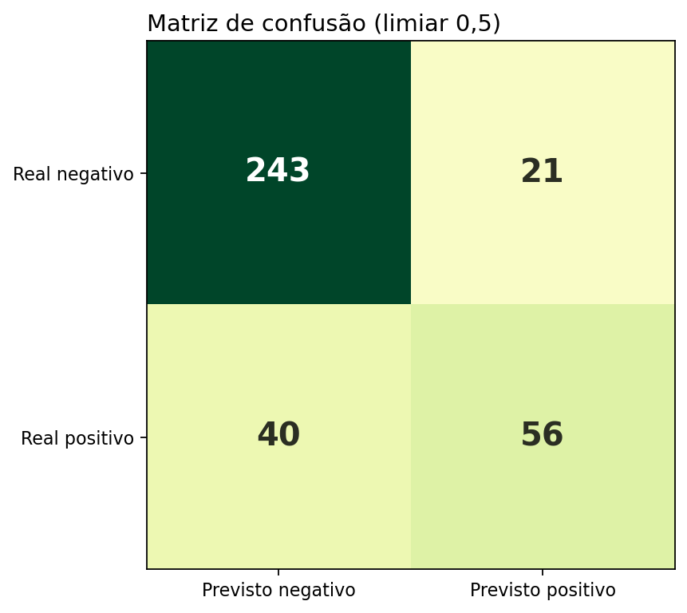
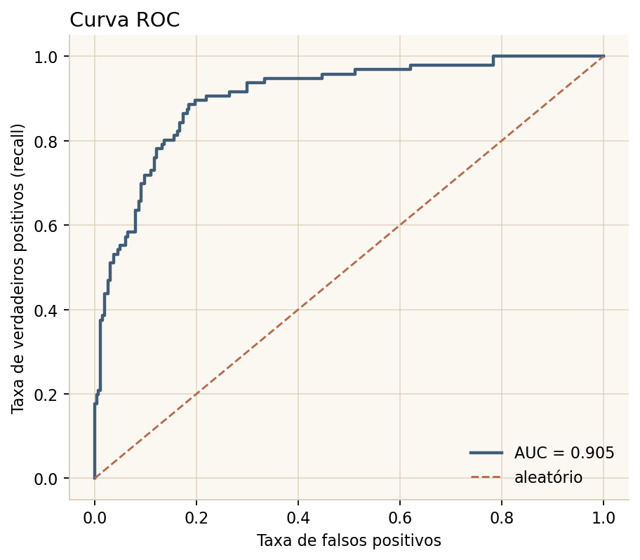
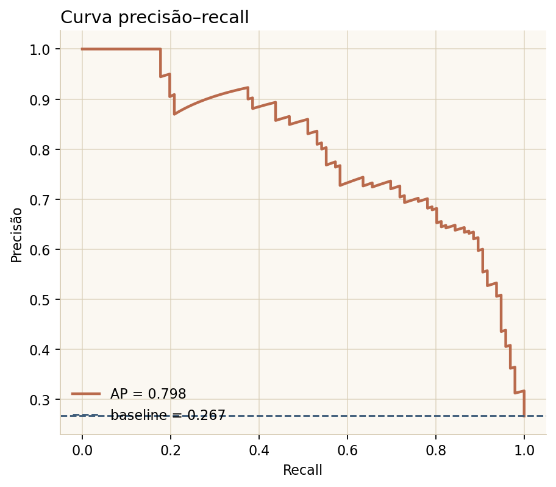
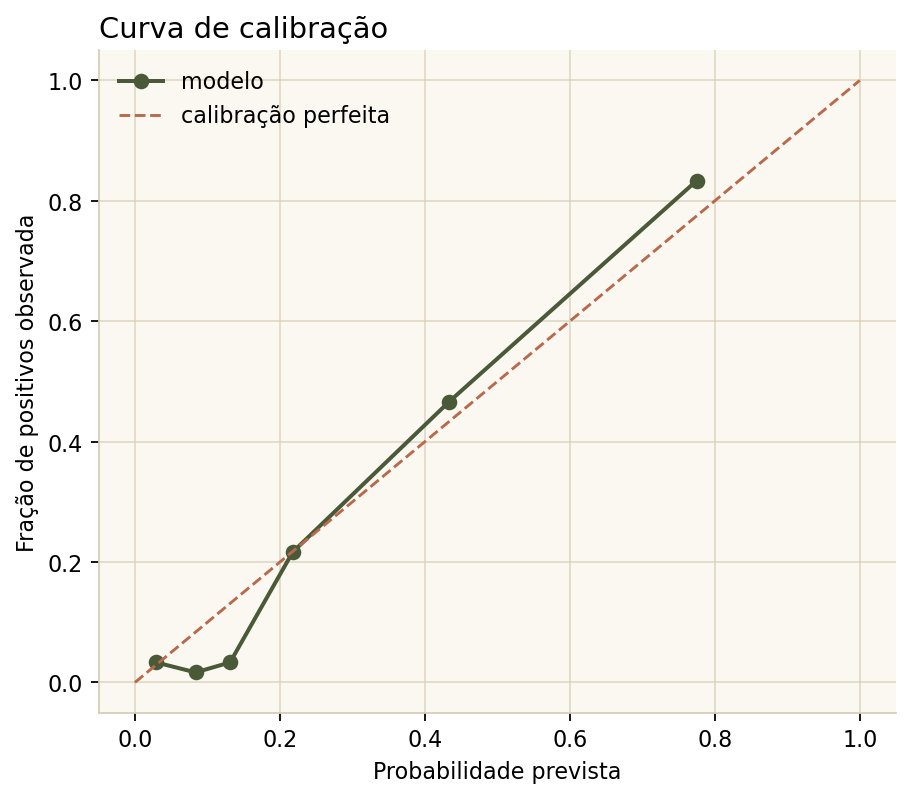
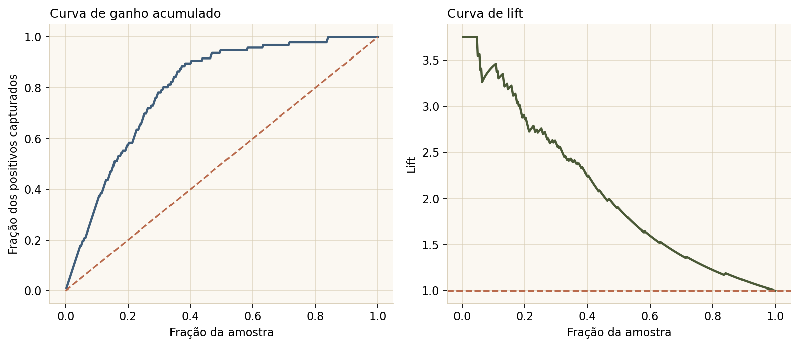

<div class="page-meta">Nível: avançado · Tempo: 15 min · Pré-requisito: ROC, PR e calibração</div>

<div class="objetivo">
<b>Objetivo:</b> diagnosticar um classificador com matriz de confusão, ROC, PR, calibração
e lift — e escolher o limiar pelo custo.
</div>

## Acurácia não é diagnóstico

Um classificador pode ter 90% de acurácia e não encontrar nenhum positivo. O diagnóstico
começa pela matriz de confusão e termina na decisão: qual limiar usar?

## Matriz de confusão

{fig-align="center" width="64%"}

- **O que mostra:** TP, TN, FP e FN; de onde saem precisão, recall e F1.
- **O que esconde:** o limiar e a prevalência; a matriz é uma foto.
- **Quando usar:** sempre, antes de qualquer métrica agregada.
- **Cuidado:** mudar o limiar muda a matriz; reporte o limiar junto.

::: {.callout-note collapse="true" title="Código Python"}
```python
import pandas as pd
import matplotlib.pyplot as plt
from sklearn.linear_model import LogisticRegression
from sklearn.metrics import confusion_matrix, ConfusionMatrixDisplay
from sklearn.model_selection import train_test_split
from sklearn.pipeline import make_pipeline
from sklearn.preprocessing import StandardScaler

dados = pd.read_csv("data/exemplo_classificacao.csv")
X = dados.drop(columns="risco")
y = dados["risco"]
X_tr, X_te, y_tr, y_te = train_test_split(X, y, test_size=0.3, stratify=y, random_state=42)
modelo = make_pipeline(StandardScaler(), LogisticRegression(max_iter=5000)).fit(X_tr, y_tr)
pred = modelo.predict(X_te)

cm = confusion_matrix(y_te, pred)
ConfusionMatrixDisplay(cm).plot(cmap="YlGn")
plt.show()
```
:::

## ROC

{fig-align="center" width="62%"}

- **O que mostra:** trade-off entre TPR e FPR em todos os limiares.
- **O que esconde:** a prevalência e o custo dos erros.
- **Quando usar:** comparar discriminação entre modelos.
- **Cuidado:** em classe muito rara, ROC-AUC pode parecer boa com precisão ruim.

::: {.callout-note collapse="true" title="Código Python"}
```python
import pandas as pd
import matplotlib.pyplot as plt
from sklearn.linear_model import LogisticRegression
from sklearn.metrics import roc_auc_score, roc_curve
from sklearn.model_selection import train_test_split
from sklearn.pipeline import make_pipeline
from sklearn.preprocessing import StandardScaler

dados = pd.read_csv("data/exemplo_classificacao.csv")
X = dados.drop(columns="risco")
y = dados["risco"]
X_tr, X_te, y_tr, y_te = train_test_split(X, y, test_size=0.3, stratify=y, random_state=42)
modelo = make_pipeline(StandardScaler(), LogisticRegression(max_iter=5000)).fit(X_tr, y_tr)
prob = modelo.predict_proba(X_te)[:, 1]

fpr, tpr, _ = roc_curve(y_te, prob)
fig, ax = plt.subplots(figsize=(6, 5))
ax.plot(fpr, tpr, label=f"AUC = {roc_auc_score(y_te, prob):.3f}")
ax.plot([0, 1], [0, 1], color="#b96a4c", linestyle="--")
ax.set_xlabel("Falsos positivos")
ax.set_ylabel("Verdadeiros positivos")
ax.legend(frameon=False)
plt.show()
```
:::

## Precisão–recall

{fig-align="center" width="62%"}

- **O que mostra:** precisão e recall em todos os limiares.
- **O que esconde:** a escolha do limiar; a curva não decide por você.
- **Quando usar:** classe positiva rara, custo de FP importante.
- **Cuidado:** a linha de base é a prevalência, não 0,5.

::: {.callout-note collapse="true" title="Código Python"}
```python
import pandas as pd
import matplotlib.pyplot as plt
from sklearn.linear_model import LogisticRegression
from sklearn.metrics import average_precision_score, precision_recall_curve
from sklearn.model_selection import train_test_split
from sklearn.pipeline import make_pipeline
from sklearn.preprocessing import StandardScaler

dados = pd.read_csv("data/exemplo_classificacao.csv")
X = dados.drop(columns="risco")
y = dados["risco"]
X_tr, X_te, y_tr, y_te = train_test_split(X, y, test_size=0.3, stratify=y, random_state=42)
modelo = make_pipeline(StandardScaler(), LogisticRegression(max_iter=5000)).fit(X_tr, y_tr)
prob = modelo.predict_proba(X_te)[:, 1]

prec, rec, _ = precision_recall_curve(y_te, prob)
fig, ax = plt.subplots(figsize=(6, 5))
ax.plot(rec, prec, label=f"AP = {average_precision_score(y_te, prob):.3f}")
ax.axhline(y_te.mean(), color="#b96a4c", linestyle="--", label="prevalência")
ax.set_xlabel("Recall")
ax.set_ylabel("Precisão")
ax.legend(frameon=False)
plt.show()
```
:::

## Calibração

{fig-align="center" width="62%"}

- **O que mostra:** se a probabilidade prevista corresponde à frequência observada.
- **O que esconde:** a discriminação; um modelo pode ordenar bem e ser mal calibrado.
- **Quando usar:** quando a probabilidade entra na decisão.
- **Cuidado:** calibração de probabilidade ≠ tuning de hiperparâmetros.

::: {.callout-note collapse="true" title="Código Python"}
```python
import pandas as pd
import matplotlib.pyplot as plt
from sklearn.calibration import calibration_curve
from sklearn.linear_model import LogisticRegression
from sklearn.model_selection import train_test_split
from sklearn.pipeline import make_pipeline
from sklearn.preprocessing import StandardScaler

dados = pd.read_csv("data/exemplo_classificacao.csv")
X = dados.drop(columns="risco")
y = dados["risco"]
X_tr, X_te, y_tr, y_te = train_test_split(X, y, test_size=0.3, stratify=y, random_state=42)
modelo = make_pipeline(StandardScaler(), LogisticRegression(max_iter=5000)).fit(X_tr, y_tr)
prob = modelo.predict_proba(X_te)[:, 1]

frac, media = calibration_curve(y_te, prob, n_bins=8, strategy="quantile")
fig, ax = plt.subplots(figsize=(6, 5))
ax.plot(media, frac, marker="o", label="modelo")
ax.plot([0, 1], [0, 1], color="#b96a4c", linestyle="--", label="perfeito")
ax.set_xlabel("Probabilidade prevista")
ax.set_ylabel("Fração observada")
ax.legend(frameon=False)
plt.show()
```
:::

## Lift e ganho

{fig-align="center" width="92%"}

- **O que mostra:** quantos positivos você captura ao agir sobre a fração mais bem
  classificada.
- **O que esconde:** o custo de revisar cada caso e a capacidade operacional.
- **Quando usar:** decisão com orçamento limitado (campanha, triagem, inspeção).
- **Cuidado:** lift alto no topo não garante bom desempenho no resto.

::: {.callout-note collapse="true" title="Código Python"}
```python
import numpy as np
import pandas as pd
import matplotlib.pyplot as plt
from sklearn.linear_model import LogisticRegression
from sklearn.model_selection import train_test_split
from sklearn.pipeline import make_pipeline
from sklearn.preprocessing import StandardScaler

dados = pd.read_csv("data/exemplo_classificacao.csv")
X = dados.drop(columns="risco")
y = dados["risco"]
X_tr, X_te, y_tr, y_te = train_test_split(X, y, test_size=0.3, stratify=y, random_state=42)
modelo = make_pipeline(StandardScaler(), LogisticRegression(max_iter=5000)).fit(X_tr, y_tr)
prob = modelo.predict_proba(X_te)[:, 1]

ordem = np.argsort(-prob)
y_sorted = y_te.to_numpy()[ordem]
ganho = np.cumsum(y_sorted) / y_sorted.sum()
frac = np.arange(1, len(y_sorted) + 1) / len(y_sorted)
lift = ganho / frac

fig, eixos = plt.subplots(1, 2, figsize=(10, 4))
eixos[0].plot(frac, ganho)
eixos[0].plot([0, 1], [0, 1], linestyle="--")
eixos[0].set_title("Ganho acumulado")
eixos[1].plot(frac, lift)
eixos[1].axhline(1, linestyle="--")
eixos[1].set_title("Lift")
plt.show()
```
:::

## Cuidados

- **Acurácia sozinha** não serve em desbalanceamento.
- **AUC alta** não garante probabilidade calibrada.
- **O limiar** é uma decisão de custo, não um padrão.
- **Validação externa** é necessária para afirmar generalização.
- **Reporte** matriz, métricas no limiar escolhido e incerteza.

## Próximo passo

Volte à [galeria](index.qmd) ou veja [incerteza](09-incerteza.qmd).
