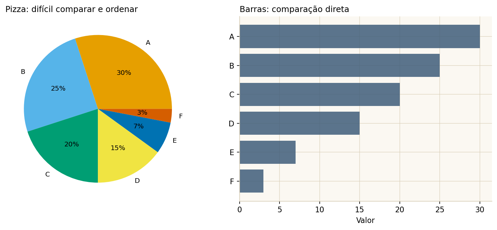
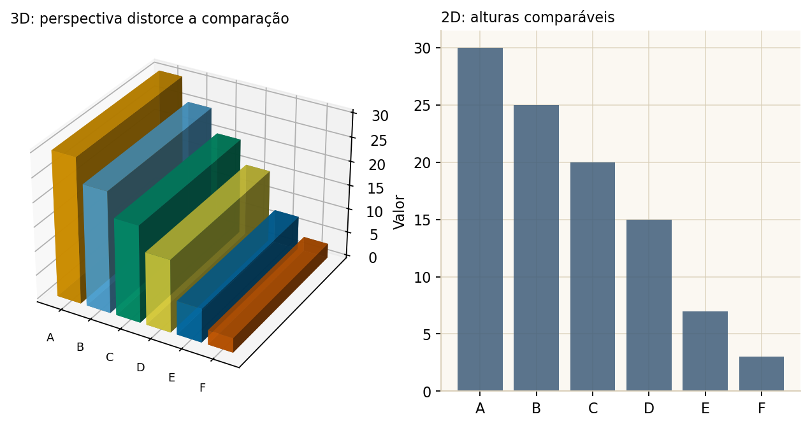
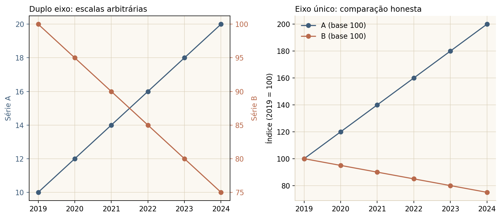
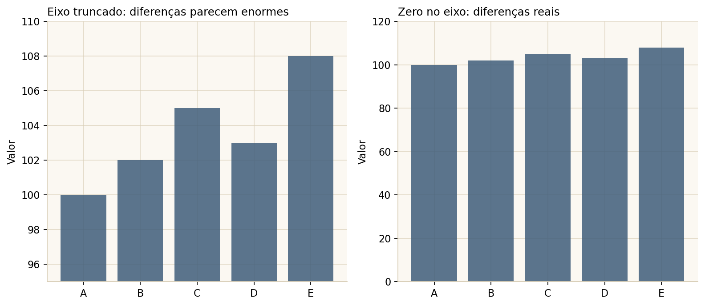
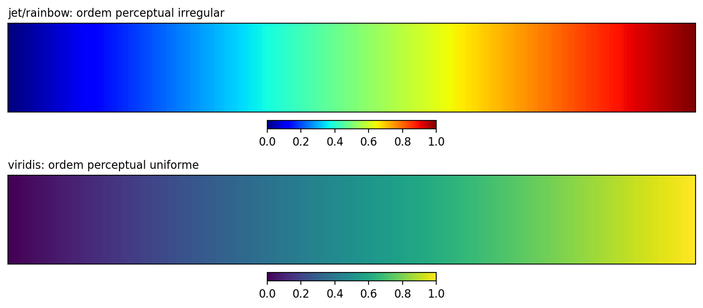

<div class="page-meta">Nível: todos · Tempo: 10 min · Pré-requisito: Cores e acessibilidade</div>

<div class="objetivo">
<b>Objetivo:</b> reconhecer gráficos que distorcem a leitura e saber qual é o substituto
honesto.
</div>

## O gráfico não é o culpado

A maioria dos gráficos “enganosos” não é mentira: é uma escolha que dificulta a comparação.
O problema não é o software; é a decisão de escala, cor, eixo ou perspectiva.

## Pizza

{fig-align="center" width="96%"}

**Por que engana:**
- Ângulos são difíceis de comparar; o olho lê área e arco de formas diferentes.
- Muitas categorias viram fatias finas; a ordem não é clara.
- Rótulos e porcentagens competem com a área.

**Como corrigir:** barras ordenadas, com o valor no eixo.

::: {.callout-note collapse="true" title="Código Python"}
```python
import numpy as np
import matplotlib.pyplot as plt

categorias = ["A", "B", "C", "D", "E", "F"]
valores = np.array([30, 25, 20, 15, 7, 3])

# ruim
plt.figure()
plt.pie(valores, labels=categorias, autopct="%1.0f%%")

# bom
ordem = np.argsort(valores)
plt.figure()
plt.barh(np.array(categorias)[ordem], valores[ordem], color="#3f5d7a")
plt.xlabel("Valor")
plt.show()
```
:::

## Barras 3D

{fig-align="center" width="96%"}

**Por que engana:**
- A perspectiva muda a altura aparente conforme a posição no eixo.
- Barras na frente escondem barras atrás.
- O eixo z não tem uma referência visual comum.

**Como corrigir:** barras 2D, ordenadas, com zero no eixo.

::: {.callout-note collapse="true" title="Código Python"}
```python
import numpy as np
import matplotlib.pyplot as plt

categorias = ["A", "B", "C", "D", "E", "F"]
valores = np.array([30, 25, 20, 15, 7, 3])

# ruim
fig = plt.figure()
ax = fig.add_subplot(111, projection="3d")
ax.bar3d(np.arange(len(valores)), np.zeros(len(valores)), 0,
         0.8, 0.8, valores, color="#3f5d7a")

# bom
plt.figure()
plt.bar(categorias, valores, color="#3f5d7a")
plt.ylabel("Valor")
plt.show()
```
:::

## Duplo eixo

{fig-align="center" width="96%"}

**Por que engana:**
- As duas escalas são escolhidas por quem faz o gráfico; o cruzamento e a inclinação mudam.
- Duas séries com unidades diferentes parecem ter a mesma tendência.
- O leitor não sabe qual eixo usar para cada ponto.

**Como corrigir:** um eixo só, indexando as séries (base 100) ou usando dois painéis.

::: {.callout-note collapse="true" title="Código Python"}
```python
import numpy as np
import matplotlib.pyplot as plt

anos = np.arange(2019, 2025)
a = np.array([10, 12, 14, 16, 18, 20])
b = np.array([100, 95, 90, 85, 80, 75])

# ruim
fig, ax = plt.subplots()
ax.plot(anos, a, color="#3f5d7a")
ax2 = ax.twinx()
ax2.plot(anos, b, color="#b96a4c")

# bom
fig, ax = plt.subplots()
ax.plot(anos, a / a[0] * 100, label="A (base 100)")
ax.plot(anos, b / b[0] * 100, label="B (base 100)")
ax.set_ylabel("Índice (2019 = 100)")
ax.legend(frameon=False)
plt.show()
```
:::

## Eixo truncado

{fig-align="center" width="96%"}

**Por que engana:**
- Começar o eixo em 95 faz uma diferença de 8 parecer enorme.
- O leitor assume que a barra inteira representa o valor.
- A comparação entre categorias fica distorcida.

**Como corrigir:** comece em zero para barras e áreas. Se precisar detalhar, use ponto + linha
ou um painel de zoom, deixando claro que o eixo foi ampliado.

::: {.callout-note collapse="true" title="Código Python"}
```python
import numpy as np
import matplotlib.pyplot as plt

categorias = ["A", "B", "C", "D", "E"]
valores = np.array([100, 102, 105, 103, 108])

# ruim
fig, ax = plt.subplots()
ax.bar(categorias, valores)
ax.set_ylim(95, 110)

# bom
fig, ax = plt.subplots()
ax.bar(categorias, valores)
ax.set_ylim(0, 120)
plt.show()
```
:::

## Arco-íris

{fig-align="center" width="92%"}

**Por que engana:**
- `jet` não tem ordem perceptual uniforme: amarelo e ciano “saltam” e criam fronteiras falsas.
- Não funciona em escala de cinza.
- Pode ser confundido por leitores com daltonismo.

**Como corrigir:** use paletas perceptuais (viridis, cividis) para variáveis sequenciais e
Okabe-Ito para categóricas. Veja [Cores e acessibilidade](04-cores-acessibilidade.qmd).

::: {.callout-note collapse="true" title="Código Python"}
```python
import numpy as np
import matplotlib.pyplot as plt

grad = np.linspace(0, 1, 200).reshape(1, -1)

# ruim
plt.figure()
plt.imshow(grad, aspect="auto", cmap="jet")

# bom
plt.figure()
plt.imshow(grad, aspect="auto", cmap="viridis")
plt.show()
```
:::

## Checklist anti-engano

- [ ] Barras e áreas começam em zero.
- [ ] O eixo não foi truncado sem aviso.
- [ ] Um eixo só, ou escalas justificadas.
- [ ] A perspectiva não é usada para comparar categorias.
- [ ] A paleta é perceptual e acessível.
- [ ] A ordem das categorias é intencional.
- [ ] O gráfico responde à pergunta sem precisar de legenda longa.

## Próximo passo

Volte à [galeria](index.qmd) ou veja [cores e acessibilidade](04-cores-acessibilidade.qmd).
